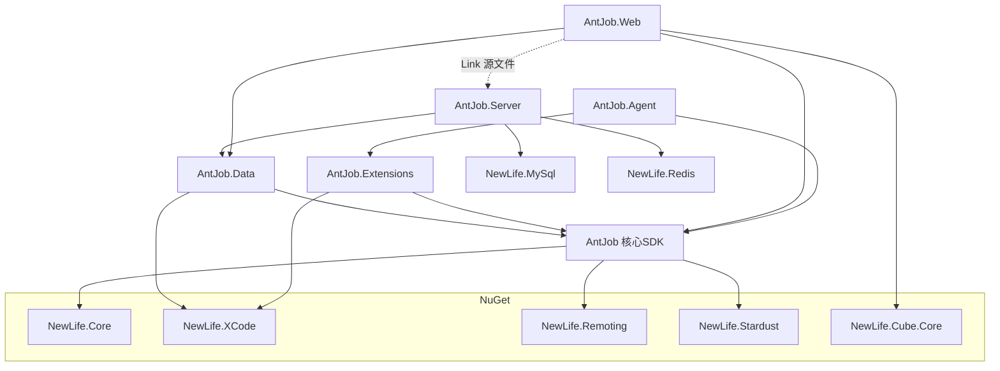
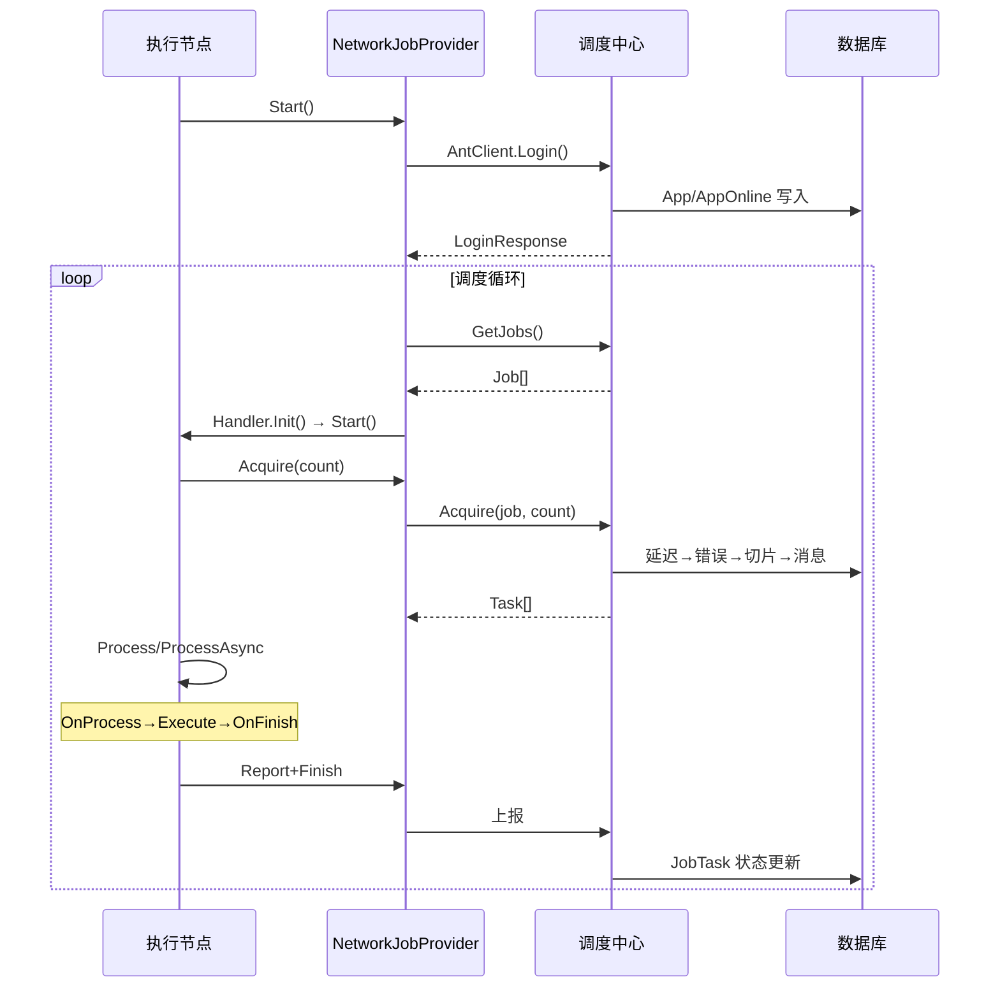

# 架构设计 — AntJob 蚂蚁调度

> 版本：v4.4 | 日期：2026-07-20 | 从代码逆向整理

本文档描述 AntJob 的分层架构、核心组件、关键流程和设计决策。需求定义见[需求文档](需求文档.md)，实现状态见[功能清单](功能清单.md)。

---

## 1. 项目分层

AntJob 遵循 [NewLife 架构分层](../.github/instructions/development.instructions.md) 的务实渐进哲学：

- **阶段 2 — 数据层独立**：AntJob.Data 作为独立类库，被 Server/Web/Agent 三个入口共享
- **按需引入服务层**：Server 端 AntService 和 Web 端共享 AppService/JobService，通过 `<Compile Include Link>` 避免重复
- **混合分层**：Agent 端无独立服务层，Handler 直接对接 Provider 通信

```
┌──────────────────────────────────────────────┐
│              AntJob.Web (net10.0)             │  ← 表现层
│     Cube MVC + REST API + Startup             │
│     Link: AppService, JobService, Setting     │
├──────────────────────────────────────────────┤
│              AntJob.Server (net10.0)          │  ← 服务层+表现层
│     ApiServer(TCP) + AppService + JobService  │
│              AntJob.Agent (net10.0)           │  ← 客户端
├──────────────────────────────────────────────┤
│          AntJob.Extensions (netstandard2.x)    │  ← 扩展层
│       DataHandler / SqlHandler / SqlMessage   │
├──────────────────────────────────────────────┤
│          AntJob.Data (netstandard2.1)         │  ← 独立数据层
│   XCode Entity × 6: Model.xml → App/Job/...  │
├──────────────────────────────────────────────┤
│   AntJob (netstandard2.1/2.0/net461/net45)   │  ← 核心SDK
│ Scheduler / Handler / IJobProvider / Models   │
│ Providers: Network / File / Http              │
└──────────────────────────────────────────────┘
```

### 依赖关系



> **Link 源文件**：AntJob.Web 通过 `<Compile Include="..\AntJob.Server\Services\AppService.cs" Link="Services\AppService.cs" />` 共享 AntJob.Server 的服务逻辑，避免代码重复。NuGet 打包时 AntJob.Web 内嵌 `AntJob.Data.dll`，用户只需引用一个包。

---

## 2. 核心组件

### 2.1 SYS — 核心调度引擎

| 组件 | 类型 | 职责 |
|------|------|------|
| `Scheduler` | class | 调度引擎：管理 `List<Handler>`，从 DI 发现处理器，TimerX 定时连接服务端 |
| `Handler` | abstract class | 处理器基类：生命周期 Init→Start→Acquire→Process→OnProcess→Execute→OnFinish，支持同步/异步双模 |
| `JobContext` | class | 任务上下文：Handler/Task/Result/Data/Error/Cost/Speed/Stopwatch |
| `IJobProvider` | interface | 作业提供者接口：Acquire/Produce/Report/Finish/GetJobs/SetJob |
| `JobProvider` | abstract class | 提供者基类：DisposeBase + IJobProvider + ITracerFeature + ILogFeature |
| `NetworkJobProvider` | class | 网络提供者：AntClient RPC → 调度中心，Peers 邻居发现 |
| `FileJobProvider` | class | 文件提供者：JobFile XML 持久化，离线单机调试 |
| `HttpJobProvider` | class | HTTP 提供者：ApiHttpClient 接入（编译排除，A/B 测试） |
| `AntClient` | class | RPC 客户端：ClientBase 子类，Login/GetJobs/AddJobs/Acquire/Report/Finish |
| `AntSetting` | Config | 客户端配置：Server(多地址主备)/AppID/Secret/Debug |
| `AntJobExtensions` | static class | DI 扩展：AddAntJob() → 注册 Scheduler/AntJobWorker/AntSetting |
| `TemplateHelper` | static class | 模板引擎：{dt}/{End}/{Message} 变量替换，Pool.StringBuilder 优化 |
| `TimeExpression` | class | 时间表达式：{dt+1M+5d:yyyyMMdd} 解析执行，y/M/d/H/m/s/w |
| `MessageHandler` | abstract class | 消息处理器：Topic 订阅，JSON 解码，逐条 ProcessItem |
| `CSharpHandler` | class | C# 脚本处理器：Mode=Time，Execute 读 code 执行（主体待实现） |
| `MessageOption` | class | 消息选项：DelayTime/Unique/AppId |

### 2.2 DATA — 数据持久化

| 实体 | 主键 | 关键字段 |
|------|------|----------|
| `App` | Int32 自增 | Name(唯一)/Secret/Enable/Version/JobCount/MessageCount/ManagerId(Map→User) |
| `AppOnline` | Int32 自增 | Instance(唯一)/AppID(Map→App)/Client/统计(Tasks/Total/Success/Error/Cost/Speed) |
| `Job` | Int32 自增 | AppID+Name(联合唯一)/Mode/Cron/Step/Offset/MaxTask/控制参数/QuietTime/Data |
| `JobTask` | Int32 自增 | JobID/DataTime(DataScale=time)/Status/Client/统计/Key/TraceId |
| `JobError` | Int32 自增 | AppID/JobID/TaskID/DataTime/Data/Server/TraceId |
| `AppHistory` | Int64 雪花Id | AppID/Action/Success/TraceId（DataScale=time 分表） |
| `AppMessage` | Int64 雪花Id | AppID/JobID/Topic/Data/DelayTime（DataScale=time 分表） |

### 2.3 EXT — 扩展调度

| 组件 | 类型 | 职责 |
|------|------|------|
| `DataHandler` | abstract class | 数据窗口基类：Factory/Field/Where/OrderBy/Selects/KeepFirstPage，Mode=Data |
| `DataHandler<TEntity>` | abstract class | 泛型数据处理器：构造器自动识别 Field(雪花Id→MasterTime→UpdateTime→CreateTime) |
| `SqlHandler` | class | SQL 执行器：TemplateHelper→SqlSection.ParseAll→事务内 Query/Execute/Insert |
| `SqlMessage` | class | SQL 消息处理器：继承 MessageHandler，Topic="Sql"，topic_ 列自动生产消息 |
| `SqlSection` | class | SQL 片段解析：/*use connName*/ 指定连接，双换行分隔，Query/Execute/Insert |

### 2.4 SRV — 调度中心服务

| 组件 | 类型 | 职责 |
|------|------|------|
| `AntService` | class | RPC API：[Api(null)] + IActionFilter，Session 绑定 App/AppOnline，Login/GetJobs/AddJobs/SetJob/Acquire/Report/Finish |
| `AppService` | class | 应用认证：Login(自动注册+SaltPasswordProvider md5)/Logout/Ping/GetPeers/WriteHistory |
| `JobService` | class | 核心调度：GetJobs/AddJobs/SetJob/Acquire(延迟重试→错误重试→时间切片→消息消费)/全局Redis锁 |
| `Worker` | IHostedService | 后台服务：ApiServer(9999)→Register<AntService>→星尘注册→ClearOnline(10s)/ClearItems(1h) |
| `AntJobSetting` | Config | 服务配置：[Config("AntJob")]，Port/TokenSecret/AutoRegistry/SessionTimeout |

### 2.5 WEB — 可视化管理后台

| 组件 | 类型 | 职责 |
|------|------|------|
| `AntJobController` | ControllerBase | HTTP REST API：[ApiController]+[Route]，JWT鉴权，/AntJob/Login、/AntJob/GetJobs 等 |
| `AntArea` | AreaBase | Cube 区域：DisplayName="蚂蚁调度"，RegisterArea<AntArea> |
| `AntEntityController<T>` | EntityController<T> | 基类：OnActionExecuting 识别 appId 导航，OnGetFields 条件移除 AppName |
| `AppController` | AntEntityController<App> | 应用管理：列表含在线/作业/任务/消息/错误/历史链接列 |
| `JobController` | AntEntityController<Job> | 作业管理：Name列链接到JobTask，模式彩色，MyTextField自定义下一时间/Cron |
| `JobTaskController` | AntEntityController<JobTask> | 任务管理：MyTitleField按模式彩色渲染时间，Status颜色类，TraceUrl |
| `Startup` | class | 启动：AddStardust→AddCube→EntityFactory预热4连接→RegisterService |

---

## 3. 关键流程

### 3.1 任务调度生命周期



### 3.2 任务切片策略

```
JobService.Acquire(app, model, online):
  1. 检查应用启用 && 作业启用 && 非免打扰时段
  2. 获取全局 Redis 锁 antjob:lock:{jobId}（15s 超时）
  3. CheckDelayTask  → 优先分配延迟任务
  4. CheckOldTask    → 其次分配错误/超时重试
  5. 不足时按 Mode 生成新切片:
     - Time:    Cron.GetNext() 或 DataTime+Step
     - Data:    DataTime+Step，窗口 [DataTime, DataTime+Step)
     - Message: 从 AppMessage 拉取待消费消息
```

### 3.3 DataHandler 数据抽取

```
Init:
  自动识别 Field: DataScale含"time"/"timeShard" → 雪花Id主键 → MasterTime → UpdateTime → CreateTime
  Job.DataTime < 2000年 → GetMinDataTime()（按Field升序取首条记录时间）

OnProcess(ctx):
  while true:
    Fetch(ctx, ref row):
      WHERE Field >= DataTime AND Field < End
      ORDER BY Field ASC, 分页 BatchSize
      KeepFirstPage=true 时 row 始终=0（每次只查第一页）
    if 无数据: break
    ctx.Data = list → Execute(ctx) → Report(ctx, 处理中)
```

---

## 4. 关键设计决策

| 决策 | 说明 |
|------|------|
| UTC 通信 | 客户端↔服务端作业时间字段使用 UTC 传输，本地存储 LocalTime |
| 全局 Redis 锁 | `antjob:lock:{jobId}` 防止多服务端并发分配同一作业 |
| 双模处理器 | 自动检测是否重写 ExecuteAsync/ProcessAsync 等方法，选择同步/异步通道 |
| 僵死检测 | MaxInactiveTime + ConcurrentDictionary<Int32, DateTime> 跟踪，超时标记不存活 |
| 自动注册 | AutoRegistry=true，首次登录自动创建 App 记录并分配 Secret |
| 免打扰时段 | QuietTime="09:00-12:00,13:00-18:00" 多时段，含跨天 "23:00-02:00" |
| 多 TFM | 核心SDK: net45/net461/netstandard2.0/netstandard2.1；入口: net10.0 |
| 内嵌 Data.dll | AntJob.Web NuGet 包通过 `<BuildOutputInPackage>` 内嵌 AntJob.Data.dll |
| 密码保护 | SaltPasswordProvider(Algorithm=md5, SaltTime=60) 避免明文传输 |
| 雪花Id分表 | AppHistory/AppMessage 使用 Int64+DataScale=time，大数据量自动按时间分表 |

---

## 5. 通信矩阵

| 通道 | 协议 | 端口 | 用途 |
|------|------|------|------|
| Agent ↔ Server | NewLife.Remoting TCP | 9999 | 作业上报/任务申请/进度报告 |
| Agent ↔ Web | HTTP REST (JSON) | Kestrel 动态 | JWT 鉴权 API |
| 浏览器 ↔ Web | HTTP | Kestrel 动态 | Cube MVC 管理页面 |

---

## 6. 待补充

- [ ] 消息调度 Message 模式的完整时序图
- [ ] SQL 调度 topic_ 列自动消息生产的详细机制
- [ ] 多调度中心主备切换 Failover 逻辑细节
- [ ] 星尘注册中心 Stardust 集成细节
- [ ] 性能测试基准数据（吞吐/延迟/资源）
