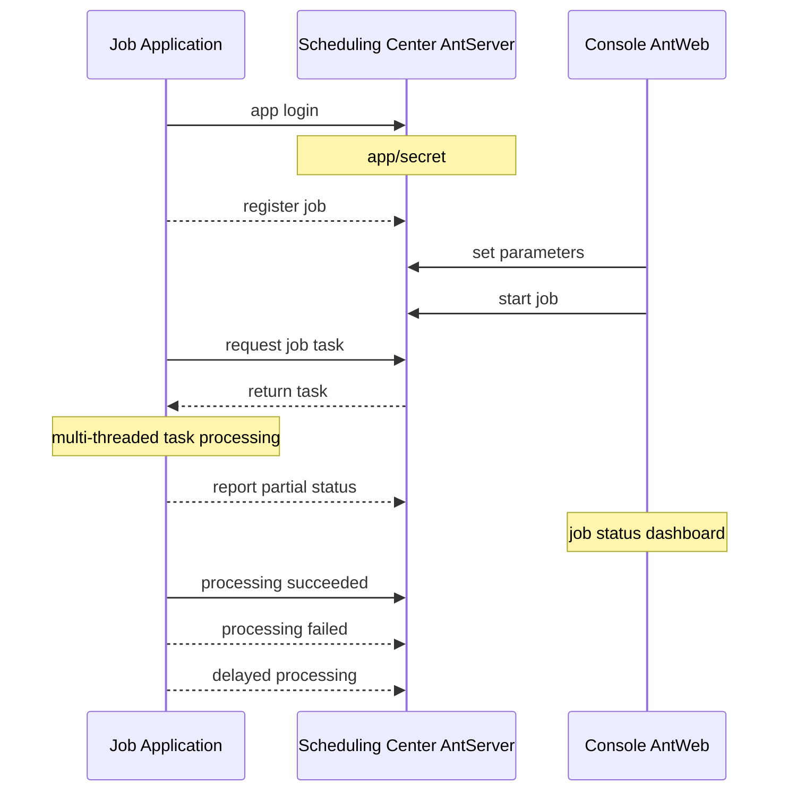
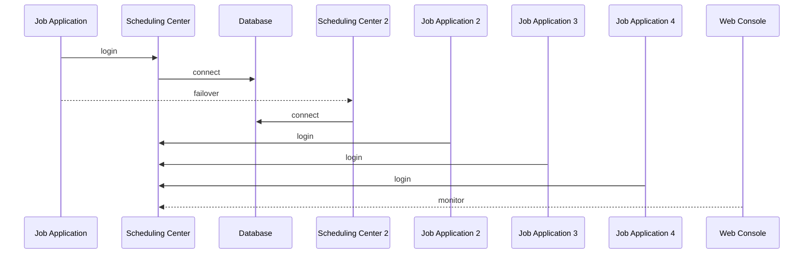

# NewLife.AntJob - جدولة Ant


[](https://github.com/NewLifeX/AntJob/actions/workflows/test.yml)
[](Doc/多语言本地化.md)


[](https://github.com/NewLifeX/AntJob/graphs/contributors)


<!-- lang:start -->
🌐 [English](README.md) | [简体中文](README.zh-CN.md) | [繁體中文](README.zh-TW.md) | [Español](README.es.md) | [Deutsch](README.de.md) | [日本語](README.ja.md) | [Français](README.fr.md) | [Português](README.pt.md) | [Русский](README.ru.md) | [한국어](README.ko.md)
<!-- lang:end -->


**AntJob** منصة موزّعة لجدولة المهام والبيانات في الزمن الحقيقي، مبنية بـ .NET خالصًا: تُقسَّم أي مهمة كبيرة إلى شرائح زمنية/بيانات متوازية، وتُوزَّع على عُقد تنفيذ مرنة، وتُعاد المحاولة عند الفشل وتُعاد المعالجة للتعبئة، مع وحدة تحكم ويب للمراقبة الحيّة.

المصدر المفتوح: [https://github.com/NewLifeX/AntJob](https://github.com/NewLifeX/AntJob)  
البرنامج التعليمي: [https://newlifex.com/blood/antjob](https://newlifex.com/blood/antjob)  
عرض حيّ (بيئة استضافة): [http://ant.newlifex.com](http://ant.newlifex.com/)  

**المحتويات**: [البدء السريع](#البدء-السريع) · [الميزات الرئيسية](#الميزات-الرئيسية) · [خريطة المنظومة](#خريطة-المنظومة) · [التوثيق](#التوثيق) · [المساهمة](#المساهمة) · [الفريق](#الفريق) · [الترخيص](#الترخيص)

## البدء السريع

### التثبيت

```bash
dotnet add package NewLife.AntJob
```

### القالب (موصى به)

```
dotnet new install NewLife.Templates
# Create a project with an AntJob sample
dotnet new antjob --name TestJob
cd TestJob
dotnet run
```

### مثال بسيط

توجد الشيفرة التالية في [Samples/HisAgent](https://github.com/NewLifeX/AntJob/tree/master/Samples/HisAgent). أنشئ مشروع .NET Core 3.1+ وأضف مرجعًا إلى AntJob من NuGet، ثم أنشئ كائن Scheduler وهيئ مزوّد شبكة.

```csharp
using AntJob;
using HisAgent;
using NewLife.Log;
using NewLife.Model;
using Stardust;

// Enable console logging and intercept all exceptions
XTrace.UseConsole();

var services = ObjectContainer.Current;
services.AddStardust();

services.AddAntJob()
    .AddHandler<HelloJob>();

// Friendly shutdown
var host = services.BuildHost();
await host.RunAsync();
```

أضف أول معالج مهمة مجدولة:

```csharp
using System;
using AntJob;

internal class HelloJob : Handler
{
    public HelloJob() => Job.Cron = "7/30 * * * * ?";

    public override Int32 Execute(JobContext ctx)
    {
        // Time of the current task
        var time = ctx.Task.DataTime;
        WriteLog("NewLife AntJob! Current task time: {0}", time);
        return 1; // Number of successfully processed items
    }
}
```

يجب أن ترث معالجات المهام من `Handler` وتعيد تعريف `Execute` لتنفيذ منطق العمل. أما Time وStep المضبوطان في المُنشئ فيُستخدمان فقط عند التسجيل الأول، وتُجرى التعديلات اللاحقة من وحدة التحكم.

أو استخدم معالج مهمة مجدولة غير متزامن:

```csharp
using System;
using AntJob;

internal class HelloJob : Handler
{
    public HelloJob() => Job.Cron = "7/30 * * * * ?";

    public override async Task<Int32> ExecuteAsync(JobContext ctx)
    {
        using var span = Tracer?.NewSpan("HelloJob", ctx.Task.DataTime);

        // Time of the current task
        var time = ctx.Task.DataTime;
        WriteLog("NewLife AntJob! Current task time: {0}", time);
        if (!ctx.Task.Data.IsNullOrEmpty()) WriteLog("Data: {0}", ctx.Task.Data);

        var state = Rand.NextString(16);
        var http = new HttpClient { BaseAddress = new Uri("https://newlifex.com") };
        http.SetUserAgent();
        var rs = await http.GetAsync<IDictionary<String, Object>>("/cube/info", new { state });

        if (rs.TryGetValue("state", out var value) && value is String str)
        {
            Trace.Assert(state == str, "Returned state does not match");
        }

        // Number of successfully processed items
        return 1;
    }
}
```

### التشغيل

عند التشغيل الأول يحاول الاتصال تلقائيًا بـ `tcp://127.0.0.1:9999` و`tcp://ant.newlifex.com:9999` (رئيسي/احتياطي)، وفق تهيئة `AntSetting`. وإذا كان `Server` مضبوطًا على عنوان `http(s)://` فسيتحوّل تلقائيًا إلى قناة HTTP ويتلقى إشعارات الخادم عبر WebSocket.

مثال على السجل:

```sql
21:33:08.470  1 N - Start job scheduling engine [AntJob.Providers.NetworkJobProvider], jobs [1], timer 5s
21:33:08.471  1 N - HelloJob start work False range (2020-04-09 00:00:00, 0001-01-01 00:00:00) Offset=15 Step=10 MaxTask=8
```

### وحدة تحكم الويب وإعادة الضبط

انشر AntJob.Web (IIS / Kestrel / Docker) ثم غيّر إعداد Server لدى العميل ليشير إلى عنوان خدمته. لا حاجة إلى خادم AntServer منفصل:

```json
{
  "Ant": {
    "Server": "https://ant.example.com",
    "AppId": "MyJobApp",
    "Secret": ""
  }
}
```

بعد تسجيل دخول العميل، ينشئ اتصال WebSocket طويل الأمد عبر المسار `/AntJob/Notify` من خلال نبضات HTTP لتلقّي إشعارات تغيّر المهام ووصول الرسائل؛ وعند تعذّر WebSocket يظل يعمل وفق فترة الاستطلاع. وبمجرد تفعيل مهمة في وحدة التحكم، يقطّع مركز الجدولة المهام حسب النقطة الزمنية ويوزّعها: يمكنك عرض تفاصيل المهام وإعادة محاولة الأخطاء وإعادة ضبط المهام دفعةً لإعادة حساب التاريخ. شغّل عدة عُقد Agent للتوسّع — فكل مهمة معيّنة تُنفَّذ على عقدة واحدة فقط، وتُعاد المحاولات وفق السياسة.

### الجدولة من الملفات المحلية فقط

عند عدم تهيئة `NetworkJobProvider` يُستخدم المزوّد المحلي الافتراضي، وهو مناسب للتصحيح دون اتصال على جهاز واحد.

### Docker (توضيحي)

> لم تُوفَّر صورة رسمية بعد؛ يمكنك تجهيز صورة داخل مؤسستك:

```
FROM mcr.microsoft.com/dotnet/aspnet:8.0 AS base
WORKDIR /app
COPY ./publish/ .
ENTRYPOINT ["dotnet","AntJob.Web.dll"]
```

### طوبولوجيات النشر

| الطوبولوجيا | الوصف |
| --- | --- |
| مثيل واحد | Web + Server + تطبيق المهام على الجهاز نفسه للتطوير والاختبار |
| مركزان بتوافر عالٍ | عنوانا مركز جدولة مفصولان بفاصلة (رئيسي/احتياطي)، مع تحويل تلقائي من جانب العميل |
| مجموعة تنفيذ متعددة العُقد | عدة عُقد تنفيذ، مجمّعة حسب العمل أو الحمل، تتصل بمركز جدولة موحّد |
| هجين | مركزان + عدة عُقد تنفيذ في الإنتاج؛ ومجموعات منفصلة للاختبار والتهيئة |

## الميزات الرئيسية

يعتمد AntJob فكرة "النمل ينقل بيته" لتقسيم أي مهمة كبيرة إلى أجزاء صغيرة قابلة للتنفيذ على التوازي. وُلدت الفكرة في لوجيازوي بشنغهاي إبان الأزمة المالية عام 2008، استجابةً لحاجة المؤسسات المالية الملحّة إلى تحليل بيانات منخفض التكلفة وعالي الكفاءة. ومن الأنظمة المقاربة XxlJob وQuartz وHangfire وAirflow (في بعض السيناريوهات) وعناقيد السكربتات المجدولة المبنية ذاتيًا؛ ويشدّد AntJob على "تقطيع البيانات/الزمن + إعادة المحاولة + تعدّد الأنماط الموحّد" والتكامل غير التدخّلي مع منظومة .NET القائمة في المؤسسة، وقد تأكّد ذلك عبر جدولة بمقياس التريليونات وسجلات تنظيف بيانات بمقياس عشرات المليارات.

<details>
<summary><b>حالات الاستخدام النموذجية</b> (4)</summary>

| السيناريو | لماذا يناسب AntJob |
| --- | --- |
| سجلات / أوامر / معاملات / بيانات أجهزة ضخمة | استخراج مستمر وحوسبة فورية على مجموعات بيانات متنامية باستمرار |
| تجميع متدرّج حسب نافذة زمنية | تُحسب نوافذ الثانية / الدقيقة / الساعة / اليوم / Cron المخصّصة شريحةً بشريحة |
| تعبئة البيانات وإعادة الحساب | يمكن إعادة ضبط النطاقات التاريخية وإعادة تنفيذها دون التأثير على النوافذ الحيّة |
| معالجة دفعية عالية التزامن | موزّعة عبر مراكز البيانات بعدد مرن من العُقد |

</details>

<details>
<summary><b>القدرات الأساسية</b> (11)</summary>

| القدرة | ما تقدّمه لك |
| --- | --- |
| أنماط جدولة متعدّدة | الزمن، ونافذة البيانات، والرسائل، وCron، وعبارات SQL، وسكربتات C# الديناميكية |
| تقطيع زمن/بيانات المهمة | بدقّة تصل إلى الثانية، مع اللحاق والتعبئة وإعادة الضبط الدفعي |
| تسليم موثوق للمهام | إعادة محاولة تلقائية مؤجّلة عند الفشل، مع تحمّل الأعطال العابرة في التبعيات |
| مجموعة مرنة | عُقد تنفيذ بلا حالة بطبيعتها، تتوسّع أو تتقلّص في أي وقت |
| بروتوكولات الاتصال | HTTP REST + إشعارات WebSocket من الخادم (الافتراضي الموصى به)، ومتوافق مع NewLife.Remoting TCP RPC |
| مراقبة مرئية | وحدة تحكم ويب لمنحنيات المهام الفورية وحالة المهام والعُقد المتصلة |
| لوحة المهمة | تعديل المعاملات ديناميكيًا مع إحصاءات التشغيل من وحدة التحكم |
| مزوّدات قابلة للتوصيل | تنفيذات `IJobProvider` للمصادر الشبكية والملفات والمصادر المحلية المخصّصة |
| تبعيات خفيفة | تعتمد النواة على منظومة NewLife الخاصة (التسجيل والتهيئة والتتبّع)، ما يقلّل التعقيد الخارجي |
| عبر المنصات ومتعدّدة أطر العمل | من .NET Framework 4.5 حتى .NET 8/9 |
| تسمية قوية وتوافق طويل الأمد | مناسب للنشر الخاص في المؤسسات وإعادة التغليف |

</details>

<details>
<summary><b>أنماط الجدولة</b> (5)</summary>

| النمط | حالة الاستخدام والدقة والحقول الرئيسية |
| --- | --- |
| الزمن / Cron | المهام الدورية العامة بدقّة من الثانية حتى Cron، مدفوعة بـ `Job.Time` / `Cron`؛ وتستبدل تعبيرات Cron فواصل Start+Step الثابتة |
| البيانات (نافذة زمنية) | يعالج البيانات المضافة حديثًا حسب شريحة زمنية (من الثانية إلى أي نافذة)، مدفوعًا بـ Start / End؛ وتُملأ النوافذ الناقصة تلقائيًا، وهو مثالي للحوسبة المتدرّجة على جداول اليوميات والسجلات |
| الرسائل | نمط سلبي مدفوع بالرسائل في الزمن الحقيقي: يصبح `Body` للرسالة الواردة من دفع/طابور خارجي مهمةً |
| SQL / مدفوع بالبيانات | يمسح جدول بيانات ويقطعه حسب المفتاح الأساسي/الزمن (دفعات)؛ مكوّن إضافي يُستخدم كثيرًا للتعبئة التاريخية أو الترحيل الكبير |
| سكربت C# الديناميكي | تجارب سريعة وتحديثات فورية للمنطق الصغير؛ يُترجم السكربت ويُنفَّذ في وقت التشغيل، مع مراعاة حدود الصلاحيات/العزل |

</details>

<details>
<summary><b>البنية والوحدات الأساسية</b> (9)</summary>

| المكوّن | المسؤولية |
| --- | --- |
| AntJob.Server | منطق خادم مركز الجدولة: بيانات Job وTask الوصفية، والتقطيع، والإسناد، وسياسة إعادة المحاولة |
| AntJob.Web | منصة إدارة مرئية مبنية على NewLife.Cube: عزل التطبيقات متعددة المستأجرين، والصلاحيات، والمراقبة |
| AntJob (المكتبة) | SDK العميل: تجريدات Scheduler وHandler، والاتصال الشبكي، وأغلفة السياق |
| AntJob.Extensions | أنماط جدولة موسّعة: SqlMessage وDataHandler وMessageHandler وCSharpHandler وغيرها |
| Samples | مشاريع أمثلة (HisAgent وHisData وHisWeb وHelloWork) |
| Scheduler | محرّك الجدولة الأساسي الذي يدير دورات حياة المعالجات وإرسال المهام |
| Handler | الفئة الأساسية لوحدات العمل؛ وكل وحدة تنفّذ `Execute` / `ExecuteAsync` |
| IJobProvider | مزوّد مصدر المهام الذي يدعم المصادر الشبكية والمحلية والمخصّصة |
| JobContext | بيئة تنفيذ مهمة واحدة وحالتها، بما في ذلك الإحصاءات ومساعدات التسجيل |

</details>

<details>
<summary><b>الموثوقية والاتساق</b> (6)</summary>

| الضمان | كيف يعمل |
| --- | --- |
| إسناد ذرّي للمهمة | لا تُلتقط مهمة بمعرّف معيّن إلا من عقدة واحدة |
| آلة الحالة | جاهز -> قيد المعالجة -> مكتمل / خطأ / ملغى |
| إعادة محاولة تلقائية | تُعاد المهام الفاشلة بعد تأخير (دقيقة واحدة افتراضيًا)، حتى N محاولات (قابلة للتهيئة) |
| آلية إعادة الضبط | إعادة ضبط نطاق تاريخي دفعةً واحدة لإعادة الحساب (تعبئة / تصحيح) |
| اللاتكرارية | ينبغي أن ينفّذ منطق العمل كتابات غير متكرّرة بناءً على المفاتيح الأساسية/النوافذ الزمنية |
| نبضات القلب وجدول المتصلين | كشف فوري لاتصال العُقد وانقطاعها، بما يدعم التوسّع المرن |

</details>

<details>
<summary><b>التهيئة</b> (7)</summary>

| الإعداد | المعنى |
| --- | --- |
| `Server` | عنوان (عناوين) مركز الجدولة. يستخدم `http(s)://` قناة HTTP + WebSocket، ويستخدم `tcp://` القناة المتوافقة مع RPC، مثل `https://a.example.com,https://b.example.com` أو `tcp://a:9999,tcp://b:9999` |
| `AppID` / `Secret` | بيانات اعتماد عزل التطبيق، تُسجَّل تلقائيًا أو تُوزَّع يدويًا |
| `Debug` | مفتاح تصحيح يُخرج سجلات أكثر تفصيلًا |
| `UseRegistry` | هل تُحلّ عناوين الخدمة عبر مركز تسجيل Stardust (الافتراضي true)؛ اضبطه على false عند الاتصال المباشر عبر بوابة |
| `MessageIdlePeriod` | دورة الطلب الخامل لمهام نوع الرسائل بالثواني (الافتراضي 15)؛ ويوقظه إشعار رسالة عبر قناة HTTP فورًا |
| قاعدة البيانات | تُنشئ اتصالات جانب Web/Server الجداول تلقائيًا عبر الهندسة العكسية في XCode |
| تكامل Stardust | قدرات اختيارية لمركز التسجيل وAPM ومركز الإعدادات لجانب Web/Server |

</details>

<details>
<summary><b>آليات التوسعة</b> (6)</summary>

| الآلية | كيفية الاستخدام |
| --- | --- |
| معالج مخصّص | ارث من `Handler` وأعد تعريف `Execute(JobContext ctx)` وأعِد عدد العناصر التي نجحت معالجتها |
| مزوّد مصدر بيانات مخصّص | نفّذ `IJobProvider` (مثل Kafka / Redis Stream / REST) |
| جدولة الرسائل | يحوّل `MessageHandler` أي جسم رسالة إلى مهام |
| SQL / مدفوع بالبيانات | يمسح `SqlMessage` + `DataHandler` البيانات ويقطّعانها |
| السكربتات الديناميكية | يتيح `CSharpHandler` تجربة سريعة عبر السكربتات (قيّد الصلاحيات في الإنتاج) |
| التغليف القائم على الإضافات | التسمية القوية ودعم أطر TFM المتعددة يتيحان وضع المعالجات في تجميعات منفصلة وتوصيلها الساخن |

</details>

<details>
<summary><b>الأداء وتخطيط السعة</b> (7)</summary>

| البند | الإرشاد |
| --- | --- |
| حجم الشرائح لكل مهمة | حتى عشرات المليارات من سجلات المهام التاريخية، حسب سعة قاعدة البيانات |
| إنتاجية العقدة | تعتمد على منطق عمل المعالج؛ وحمل الجدولة في الإطار ضئيل (تحكّم جدولة في الذاكرة) |
| ضغط جامع القمامة | تُستخدم تجمّعات الكائنات والذاكرة المؤقتة داخليًا، بالاعتماد على تحسينات NewLife.Core |
| دقة التقطيع | أبقِها معتدلة؛ فالشرائح الدقيقة جدًا تزيد الحمل الوصفي للجدولة |
| ضغط قاعدة البيانات | استخدم الإدخال/الإخراج الدفعي أو التخزين المؤقت لتقليل الحمل على قاعدة البيانات |
| نوافذ حساب كبيرة | فضّل نمط البيانات مع حلقة نوافذ فرعية |
| مقياس مُثبت | إرسال رسائل SMS جماعي في صناديق الاستثمار، و6 مليارات صف مقطّعة من جدول واحد، و12 مليون طلب شحن يوميًا، وسجلات تنظيف بيانات بمقياس عشرات المليارات، وجدولة سنوية بمقياس التريليونات |

</details>

<details>
<summary><b>المفاهيم الأساسية</b> (5)</summary>

| المفهوم | المعنى |
| --- | --- |
| Job | تهيئة المهمة: الزمن/الخطوة/Cron/النمط/حد التزامن، إلخ. |
| Task | أصغر وحدة تنفيذ بعد تجسيد المهمة، بنقطة زمنية أو فاصل زمني وجسم رسالة |
| Handler | حامل منطق العمل، وتُدار دورة حياته بواسطة Scheduler |
| JobContext | سياق تنفيذ مهمة واحدة، بما في ذلك Task والإحصاءات ومساعدات التسجيل |
| IJobProvider | مزوّد مصدر المهام (شبكة/محلي/مخصّص) |

</details>

<details>
<summary><b>المقارنة مع مجدولات أخرى</b> (4)</summary>

| النظام | ما يميّز AntJob عنه |
| --- | --- |
| Quartz.NET | مكتبة جدولة/Cron خالصة؛ ويضيف AntJob تقطيع البيانات/الرسائل وإعادة الحساب وتجزئة المجموعة البسيطة |
| Hangfire | مهام خلفية دائمة؛ ويركّز AntJob على التقطيع المستمر للزمن/البيانات بدلًا من طابور مهام لمرة واحدة |
| XXL-JOB | منظومة Java؛ وAntJob أصلي في .NET بأنماط متعددة موحّدة وسكربتات ديناميكية |
| Airflow | تنسيق DAG؛ وAntJob أخف ويتركّز على معالجة النوافذ عالية التكرار، ويمكن أن يكمّل Airflow |

</details>

<details>
<summary><b>الأسئلة الشائعة</b> (5)</summary>

| السؤال | الجواب |
| --- | --- |
| لماذا تُوقَف المهام افتراضيًا بعد التسجيل؟ | لمنع بدء عدد كبير منها قبل ضبط المعاملات؛ فعّلها يدويًا من وحدة تحكم الويب |
| كيف أعيد حساب بيانات شهر كامل؟ | غيّر وقت البداية في لوحة المهمة، أو أعد ضبط النطاق الزمني المحدّد، أو حدّد مهامًا دفعةً وأعد ضبطها |
| هل تعيق المهام الفاشلة المهام اللاحقة؟ | لا؛ تُعاد المهام الفاشلة بعد تأخير بينما تستمر جدولة النوافذ الأخرى |
| هل يمكنني استخدام HTTP/WebSocket فقط؟ | نعم. اضبط `Server` على عنوان `http://` أو `https://` ليستخدم العميل تلقائيًا HTTP REST + إشعارات WebSocket دون خادم AntServer منفصل؛ وعناوين `tcp://` تُبقي القناة المتوافقة مع RPC |
| كيف أحدّ من مخاطر السكربتات؟ | عطّل CSharpHandler غير المستخدم، أو اعزله في عملية منفصلة بتهيئة أقل صلاحية |

</details>

<details>
<summary><b>تقدّم الترقية إلى v4</b> (5)</summary>

| البند | الحالة |
| --- | --- |
| الوصول عبر HTTP | منجز: يوفّر AntWeb خدمات الجدولة دون حاجة إلى AntServer؛ وإشعارات WebSocket من الخادم تأتي مع قناة HTTP |
| الجدولة الزمنية المعزّزة | منجز: تُدعم تعبيرات Cron، لتحل تدريجيًا محل التدرّج الثابت Start+Step |
| مهام مُولَّدة مسبقًا | مخطّط: تنفيذ في الموعد بالضبط (تحسين الدقة، قيد التقييم) |
| تأخير المهمة النشطة | منجز: طلب تأخير أثناء التنفيذ دون احتسابه فشلًا |
| مزيد من أنماط الجدولة | مخطّط: AntAgent منتظم يدمج جدولة SQL / جدولة C#، مع نمطي الاستخراج والدفع لاحقًا |

</details>

<details>
<summary><b>خارطة الطريق بعد v4</b> (4)</summary>

| البند | الوصف |
| --- | --- |
| واجهة تأخير المهمة النشطة | تقييم تأخير أثناء التنفيذ والتنفيذ لاحقًا دون احتسابه خطأ |
| قنوات تنبيه قابلة للتوصيل | البريد الإلكتروني / Webhook / WeCom وغيرها من القنوات |
| تصدير مقاييس المراقبة | تصدير متعدد الأبعاد لـ Prometheus / OpenTelemetry |
| طبقة DAG اختيارية | تنسيق DAG / التبعيات بعد استقرار النواة |

</details>

### مخططات البنية

طوبولوجيا المكوّنات

```
+----------------------+            +-------------------------+
|  Execution Node(Agent)|  RPC/TCP  |  Scheduling Center(Server)|
|  - Scheduler         |            | - JobService / Task     |
|  - Handlers(business)|            | - State & metadata      |
+----------+-----------+            +-----------+-------------+
           |  Sync logs/tracing (optional Stardust)  |
           v
    +-------------+      Web UI / API      +------------------+
    | DB / Storage|  <------------------>  | Web Console AntWeb|
    +-------------+                         +------------------+
```

تطبيق المهمة (ينفّذ IJob)



بنية مركز الجدولة (رئيسي/تابع)



## خريطة المنظومة

NewLife منظومة متعدّدة الطبقات من مشاريع مفتوحة المصدر تُصدَر بإصدارات مستقلة. الخريطة أدناه مشتركة حرفيًا بين جميع مستودعات NewLife؛ وكل مشروع يرتبط بمستودعه وبحزمته الرئيسية على NuGet.

| المشروع | الوظيفة | التنزيلات |
| --- | --- | --- |
| **الأساس** | | |
| [NewLife.Core](https://github.com/NewLifeX/X) | التسجيل والتهيئة والتخزين المؤقت والشبكات والتسلسل والجدولة وتتبّع أداء APM. | [](https://www.nuget.org/packages/NewLife.Core) |
| [NewLife.XCode](https://github.com/NewLifeX/NewLife.XCode) | وسيط بيانات: جداول واحدة بمستوى عشرات المليارات من الصفوف، تقسيم تلقائي للجداول، فصل القراءة عن الكتابة، وأكثر من 10 قواعد بيانات. | [](https://www.nuget.org/packages/NewLife.XCode) |
| [NewLife.Net](https://github.com/NewLifeX/NewLife.Net) | مكتبة شبكات عالية الأداء: 1.77 مليون pps / 14.5 Gbps على جهاز واحد (TCP 1KB، 2026-10)، و4 ملايين اتصال TCP طويل الأمد. | [](https://www.nuget.org/packages/NewLife.Net) |
| [NewLife.Remoting](https://github.com/NewLifeX/NewLife.Remoting) | إطار اتصال بروتوكولي وRPC لتطبيقات العميل/الخادم وأجهزة إنترنت الأشياء. | [](https://www.nuget.org/packages/NewLife.Remoting) |
| [NewLife.Agent](https://github.com/NewLifeX/NewLife.Agent) | يثبّت تطبيقات .NET كخدمات حارسة لنظام التشغيل: خدمات Windows وsystemd في Linux. | [](https://www.nuget.org/packages/NewLife.Agent) |
| [NewLife.Templates](https://github.com/NewLifeX/NewLife.Zero) | قوالب مشاريع `dotnet new` للطرفية وweb وAPI والخدمات والبيانات وإنترنت الأشياء. | [](https://www.nuget.org/packages/NewLife.Templates) |
| **البيانات والمراسلة** | | |
| [NewLife.Redis](https://github.com/NewLifeX/NewLife.Redis) | عميل Redis بزمن استجابة بالميكروثانية، وملايين العمليات في الثانية، وقوائم رسائل مدمجة. | [](https://www.nuget.org/packages/NewLife.Redis) |
| [NewLife.RocketMQ](https://github.com/NewLifeX/NewLife.RocketMQ) | عميل RocketMQ مُدار بالكامل لـ Apache RocketMQ وخدمة رسائل Alibaba Cloud. | [](https://www.nuget.org/packages/NewLife.RocketMQ) |
| [NewLife.MQTT](https://github.com/NewLifeX/NewLife.MQTT) | عميل وخادم MQTT، بما في ذلك الاتصال بـ Alibaba Cloud IoT. | [](https://www.nuget.org/packages/NewLife.MQTT) |
| [NewLife.NovaDb](https://github.com/NewLifeX/NewLife.NovaDb) | قاعدة بيانات هجينة بلغة C#: مدمجة أو شبكية، وعلائقية، وسلاسل زمنية، وقائمة رسائل، وKV في واحد. | [](https://www.nuget.org/packages/NewLife.NovaDb) |
| [NewLife.MySql](https://github.com/NewLifeX/NewLife.MySql) | برنامج تشغيل MySql وطبقة مساعدة مبنية على مكدّس بيانات NewLife. | [](https://www.nuget.org/packages/NewLife.MySql) |
| **Web والذكاء الاصطناعي والأنظمة الموزّعة** | | |
| [NewLife.Cube](https://github.com/NewLifeX/NewLife.Cube) | إطار منصة إدارة سريعة: الصلاحيات، والدخول الموحّد SSO، وخادم OAuth، وتوليد واجهات CRUD. | [](https://www.nuget.org/packages/NewLife.Cube) |
| [Stardust](https://github.com/NewLifeX/Stardust) | منصة خدمات موزّعة: إدارة العقد، وAPM، ومركز الإعدادات، ومركز التسجيل، ومركز النشر. | [](https://www.nuget.org/packages/NewLife.Stardust) |
| [AntJob](https://github.com/NewLifeX/AntJob) | منصة موزّعة للمهام وجدولة البيانات الفورية، مع التقسيم وإعادة المحاولة وإعادة التعبئة. | [](https://www.nuget.org/packages/NewLife.AntJob) |
| [NewLife.AI](https://github.com/NewLifeX/NewLife.AI) | عميل موحّد لـ 46 مزوّد LLM بالإضافة إلى ChatAI، تطبيق ويب جاهز للمحادثة. | [](https://www.nuget.org/packages/NewLife.AI) |
| **الصناعة وإنترنت الأشياء** | | |
| [NewLife.IoT](https://github.com/NewLifeX/NewLife.IoT) | مكتبة معايير إنترنت الأشياء التي تعرّف عقود البروتوكولات وتجريدات الأجهزة. | [](https://www.nuget.org/packages/NewLife.IoT) |
| [NewLife.Modbus](https://github.com/NewLifeX/NewLife.Modbus) | تنفيذ Modbus TCP/RTU/ASCII فوق NewLife.IoT. | [](https://www.nuget.org/packages/NewLife.Modbus) |
| [NewLife.Siemens](https://github.com/NewLifeX/NewLife.Siemens) | بروتوكول Siemens PLC فوق NewLife.IoT. | [](https://www.nuget.org/packages/NewLife.Siemens) |
| [NewLife.Omron](https://github.com/NewLifeX/NewLife.Omron) | بروتوكول Omron PLC فوق NewLife.IoT. | [](https://www.nuget.org/packages/NewLife.Omron) |
| [NewLife.Melsec](https://github.com/NewLifeX/NewLife.Melsec) | بروتوكول Mitsubishi Melsec PLC فوق NewLife.IoT. | [](https://www.nuget.org/packages/NewLife.Melsec) |
| [NewLife.OPC](https://github.com/NewLifeX/NewLife.OPC) | عميل OPC للوصول إلى البيانات الصناعية. | — |
| [NewLife.BACnet](https://github.com/NewLifeX/NewLife.BACnet) | مكدّس بروتوكول BACnet لأتمتة المباني. | [](https://www.nuget.org/packages/NewLife.BACnet) |
| [ZeroIoT](https://github.com/NewLifeX/ZeroIoT) | منصة إنترنت أشياء مفتوحة المصدر وخفيفة، مع إدارة البوابات والأجهزة. | — |
| **تليماتيكا المركبات** | | |
| [NewLife.JT808](https://github.com/NewLifeX/NewLife.JT808) | بروتوكول تحديد مواقع المركبات JT/T 808: أكثر من 70 جسم رسالة، 2011/2013/2019. | [](https://www.nuget.org/packages/NewLife.JT808) |
| [NewLife.JT809](https://github.com/NewLifeX/NewLife.JT809) | بروتوكول JT/T 809 بين المنصات لجهات إدارة النقل. | [](https://www.nuget.org/packages/NewLife.JT809) |
| [NewLife.JT1078](https://github.com/NewLifeX/NewLife.JT1078) | فيديو داخل المركبة JT/T 1078: تحليل RTP وإعادة التجميع إلى FLV/fMP4 والبث المباشر. | [](https://www.nuget.org/packages/NewLife.JT1078) |
| **مكوّنات المجال** | | |
| [NewLife.Office](https://github.com/NewLifeX/NewLife.Office) | حزمة واحدة لـ Excel وWord وPPT وPDF وأكثر من 15 صيغة مستندات. | [](https://www.nuget.org/packages/NewLife.Office) |
| [NewLife.Audio](https://github.com/NewLifeX/NewLife.Audio) | صوت عبر المنصات: مرمّزات، وإدخال/إخراج الأجهزة، وDSP، وحاويات، وبث. | [](https://www.nuget.org/packages/NewLife.Audio) |
| [NewLife.Video](https://github.com/NewLifeX/NewLife.Video) | مرمّزات الفيديو وصيغ الحاويات ومعالجة الإطارات والبث. | [](https://www.nuget.org/packages/NewLife.Video) |
| [NewLife.Map](https://github.com/NewLifeX/NewLife.Map) | واجهة موحّدة فوق Baidu وAMap وTencent وTianditu مع الترميز الجغرافي وتحويل الإحداثيات. | [](https://www.nuget.org/packages/NewLife.Map) |
| [NewLife.IP](https://github.com/NewLifeX/NewLife.IP) | تحديد الموقع الجغرافي لعناوين IPv4 بقاعدة بيانات غير متصلة مُعيّنة في الذاكرة، وواجهة API عبر الإنترنت كبديل. | [](https://www.nuget.org/packages/NewLife.IP) |
| **الأدوات والمنتجات** | | |
| [CrazyCoder](https://github.com/NewLifeX/XCoder) | صندوق أدوات المطوّر: الشبكات والمنفذ التسلسلي والتشفير والتعبيرات النمطية وModbus وMQTT. | [](https://www.nuget.org/packages/NewLife.XCoder) |
| [GitCandy](https://github.com/NewLifeX/GitCandy) | نظام استضافة ذاتية لإدارة الشيفرة المصدرية Git. | — |
| [LuckyClover](https://github.com/NewLifeX/LuckyClover) | يثبّت بيئة تشغيل .NET المطابقة تلقائيًا عند التشغيل من مضيف أقدم. | — |

> تعرض الشارات الحزمة الرئيسية لكل مشروع؛ أما حزم السمات والإضافات والحزم التابعة فمذكورة في صفحاتها على NuGet. الحزم التي تتجاوز 30 حزمة وغير المذكورة هنا (FTP وLoRa وإضافات Office وبرامج تشغيل البروتوكولات وغيرها) متاحة في [منظمة NewLifeX](https://github.com/NewLifeX) وعلى [newlifex.com](https://newlifex.com). يُصان هذا الجدول في README الخاص بـ NewLife.Core.

## التوثيق

| المستند | الوصف |
| --- | --- |
| [متطلبات المشروع](Doc/需求文档.md) | الرؤية والأهداف الأساسية والمتطلبات الوظيفية للوحدات السبع الرئيسية وقائمة المؤجَّل |
| [قائمة الميزات](Doc/功能清单.md) | تتبّع ثلاثي الأبعاد (التنفيذ/الاختبار/التعليقات) لـ 85 ميزة (بما في ذلك فحص التقسيم الإلزامي) |
| [تصميم البنية](Doc/架构设计.md) | البنية الطبقية ومسؤوليات المكوّنات الأساسية ومخططات تتابع العمليات الرئيسية وقرارات التصميم |
| [نشر HTTP وWebSocket](Doc/HTTP与WebSocket部署.md) | تهيئة البوابة وبث Redis وخطوات الترحيل وقائمة فحص استكشاف الأخطاء |
| [قياس أداء المكوّنات الأساسية](Doc/Benchmark/核心组件性能测试.md) | بيانات القياس ونصائح الضبط لتعبيرات الزمن واستبدال القوالب وتحليل شظايا SQL |

- البرنامج التعليمي: [https://newlifex.com/blood/antjob](https://newlifex.com/blood/antjob)
- العرض الحيّ: [http://ant.newlifex.com](http://ant.newlifex.com/)
- قواعد تعدد اللغات في README: [Doc/多语言本地化.md](Doc/多语言本地化.md)

## المساهمة

### البناء والاختبار

```bash
dotnet build -c Release
dotnet test -c Release
# Only the main test project (net10.0), used by CI on win-x64 and linux-arm64
dotnet test AntTest/AntTest.csproj -c Release
```

- التكامل المستمر: يبني `.github/workflows/test.yml` ويشغّل الاختبارات ويتحقق من الترجمة ومبدّل اللغة في README
- فحوص README: `pwsh -File sync-readme-languages.ps1 -Check`، `pwsh -File sync-readme-package.ps1 -Check` و`pwsh -File check-readme-structure.ps1`
- قياس الأداء: `Benchmark/AntJob.Benchmarks` (BenchmarkDotNet)

### هيكل المستودع

```
AntJob/                 Client core library
AntJob.Extensions/      Extension handlers/messages/SQL, etc.
AntJob.Server/          Scheduling-center core service logic (JobService, etc.)
AntJob.Web/             Razor Pages + Cube admin console
AntJob.Data/            Base data models (entity layer)
Samples/                Sample projects (HisAgent, HisData, HisWeb, HelloWork)
AntTest/                Unit/integration tests
Doc/                    Documentation and assets
```

### الإصدار

ادفع وسمًا يبدأ بـ `v` (مثل `v5.0.2026.1024`) لتشغيل `.github/workflows/publish.yml`. تُحزّم سير العمل `AntJob` و`AntJob.Extensions` و`AntJob.Web`، وتنشرها إلى NuGet.org وGitHub Packages، وتنشئ GitHub Release تُؤخذ ملاحظاته من قسم `ChangeLog.md` المطابق (وتشمل الأصول nupkg وsnupkg). أما التشغيل اليدوي فيكتفي بنشر الحزم ولا ينشئ Release. كما تنتج الالتزامات التي تمسّ `AntJob/` أو `AntJob.Extensions/` على master حزمًا تجريبية عبر `publish-beta.yml`.

### الملاحظات

- قبل الإرسال، تأكّد من نجاح `dotnet build` والاختبارات ذات الصلة؛ والتزم بأسلوب شيفرة المستودع.
- أبلغ عن الأخطاء والاقتراحات عبر [Issue](https://github.com/NewLifeX/AntJob/issues)؛ والنجوم وطلبات السحب موضع ترحيب.

## الفريق


تأسّست NewLife في عام 2002، وأمضت أكثر من عقدين في منظومة .NET وإنترنت الأشياء، وتدير ما يقارب 100 مشروع مفتوح المصدر (34 منها مشاريع رئيسية)، وتقدّم حلولًا متكاملة للبرمجيات والأجهزة لقطاعات الكهرباء والخدمات اللوجستية والرعاية الصحية والتحكّم الصناعي والإنترنت. ونلتزم بمبدأ "لا أسبقية في التعلّم — الإتقان يكسب الاحترام".

نُزّلت المكوّنات مفتوحة المصدر <!--nuget-total:start-->6.48M<!--nuget-total:end--> مرة من NuGet (على مستوى المنظومة بأكملها، حتى 2026-10).

الموقع: https://newlifex.com · المنظمة مفتوحة المصدر: https://github.com/NewLifeX

<details>
<summary>حساب WeChat الرسمي: 智能大石头 (امسح للاشتراك)</summary>


</details>

## الترخيص

هذا المشروع مرخّص بموجب [MIT](https://github.com/NewLifeX/AntJob/blob/master/LICENSE) © 2002-2026 فريق NewLife. يمكنك استخدامه وتعديله وإعادة توزيعه بحرية.

> إذا كان هذا المشروع مفيدًا لك، فنرحّب بمنحه نجمة (Star) أو مشاركته مع فريقك أو تقديم اقتراحات تحسين عبر Issue/PR.
