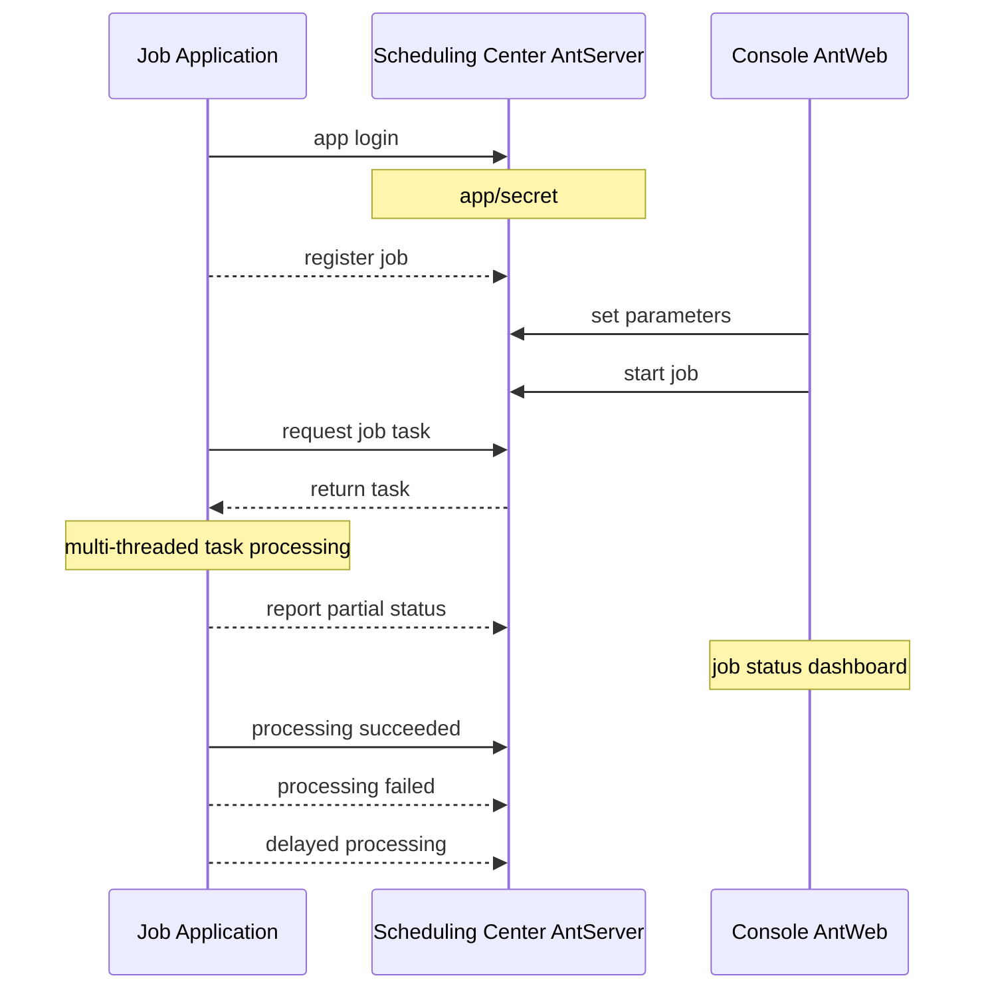
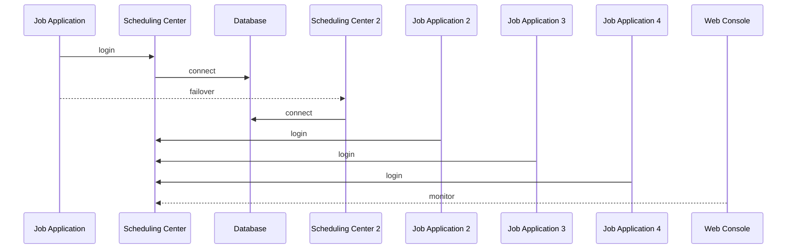

# NewLife.AntJob - Ameisen-Scheduling


[](https://github.com/NewLifeX/AntJob/actions/workflows/test.yml)
[](Doc/多语言本地化.md)


[](https://github.com/NewLifeX/AntJob/graphs/contributors)


<!-- lang:start -->
🌐 [English](README.md) | [简体中文](README.zh-CN.md) | [繁體中文](README.zh-TW.md) | [Español](README.es.md) | [日本語](README.ja.md) | [Français](README.fr.md) | [Português](README.pt.md) | [Русский](README.ru.md) | [한국어](README.ko.md) | [العربية](README.ar.md)
<!-- lang:end -->


**AntJob** ist eine rein in .NET umgesetzte Plattform für verteiltes Aufgaben- und Echtzeit-Datenscheduling: Jede große Aufgabe wird in parallele Zeit-/Datenscheiben (Slices) zerlegt, auf elastische Worker-Knoten verteilt, bei Fehlern erneut versucht und für Backfills erneut abgespielt – mit einer Web-Konsole zur Live-Überwachung.

Open Source: [https://github.com/NewLifeX/AntJob](https://github.com/NewLifeX/AntJob)  
Tutorial: [https://newlifex.com/blood/antjob](https://newlifex.com/blood/antjob)  
Live-Demo (gehostete Umgebung): [http://ant.newlifex.com](http://ant.newlifex.com/)  

**Inhalt**: [Schnellstart](#schnellstart) · [Hauptfunktionen](#hauptfunktionen) · [Ökosystem-Karte](#ökosystem-karte) · [Dokumentation](#dokumentation) · [Mitwirken](#mitwirken) · [Team](#team) · [Lizenz](#lizenz)

## Schnellstart

### Installation

```bash
dotnet add package NewLife.AntJob
```

### Vorlage (empfohlen)

```
dotnet new install NewLife.Templates
# Create a project with an AntJob sample
dotnet new antjob --name TestJob
cd TestJob
dotnet run
```

### Minimales Beispiel

Der folgende Quellcode liegt in [Samples/HisAgent](https://github.com/NewLifeX/AntJob/tree/master/Samples/HisAgent). Erstellen Sie ein .NET-Core-3.1+-Projekt und referenzieren Sie AntJob aus NuGet. Instanziieren Sie einen Scheduler und konfigurieren Sie einen Netzwerk-Provider.

```csharp
using AntJob;
using HisAgent;
using NewLife.Log;
using NewLife.Model;
using Stardust;

// Enable console logging and intercept all exceptions
XTrace.UseConsole();

var services = ObjectContainer.Current;
services.AddStardust();

services.AddAntJob()
    .AddHandler<HelloJob>();

// Friendly shutdown
var host = services.BuildHost();
await host.RunAsync();
```

Fügen Sie den ersten Handler für einen geplanten Job hinzu:

```csharp
using System;
using AntJob;

internal class HelloJob : Handler
{
    public HelloJob() => Job.Cron = "7/30 * * * * ?";

    public override Int32 Execute(JobContext ctx)
    {
        // Time of the current task
        var time = ctx.Task.DataTime;
        WriteLog("NewLife AntJob! Current task time: {0}", time);
        return 1; // Number of successfully processed items
    }
}
```

Job-Handler müssen von `Handler` erben und `Execute` überschreiben, um die Geschäftslogik umzusetzen. Die im Konstruktor gesetzten Werte für Time und Step gelten nur für die Erstregistrierung; spätere Änderungen erfolgen in der Konsole.

Oder verwenden Sie einen asynchronen Handler für einen geplanten Job:

```csharp
using System;
using AntJob;

internal class HelloJob : Handler
{
    public HelloJob() => Job.Cron = "7/30 * * * * ?";

    public override async Task<Int32> ExecuteAsync(JobContext ctx)
    {
        using var span = Tracer?.NewSpan("HelloJob", ctx.Task.DataTime);

        // Time of the current task
        var time = ctx.Task.DataTime;
        WriteLog("NewLife AntJob! Current task time: {0}", time);
        if (!ctx.Task.Data.IsNullOrEmpty()) WriteLog("Data: {0}", ctx.Task.Data);

        var state = Rand.NextString(16);
        var http = new HttpClient { BaseAddress = new Uri("https://newlifex.com") };
        http.SetUserAgent();
        var rs = await http.GetAsync<IDictionary<String, Object>>("/cube/info", new { state });

        if (rs.TryGetValue("state", out var value) && value is String str)
        {
            Trace.Assert(state == str, "Returned state does not match");
        }

        // Number of successfully processed items
        return 1;
    }
}
```

### Ausführen

Beim ersten Start versucht der Client automatisch, sich mit `tcp://127.0.0.1:9999` und `tcp://ant.newlifex.com:9999` (aktiv/Standby) zu verbinden; gesteuert wird dies über die Konfiguration `AntSetting`. Ist `Server` mit einer `http(s)://`-Adresse konfiguriert, wechselt er automatisch auf den HTTP-Kanal und empfängt Downstream-Benachrichtigungen über WebSocket.

Log-Beispiel:

```sql
21:33:08.470  1 N - Start job scheduling engine [AntJob.Providers.NetworkJobProvider], jobs [1], timer 5s
21:33:08.471  1 N - HelloJob start work False range (2020-04-09 00:00:00, 0001-01-01 00:00:00) Offset=15 Step=10 MaxTask=8
```

### Web-Konsole und Zurücksetzen

Stellen Sie AntJob.Web bereit (IIS / Kestrel / Docker) und ändern Sie anschließend die Einstellung `Server` des Clients auf die Dienstadresse. Ein separater AntServer ist nicht erforderlich:

```json
{
  "Ant": {
    "Server": "https://ant.example.com",
    "AppId": "MyJobApp",
    "Secret": ""
  }
}
```

Nach der Anmeldung des Clients baut dieser per HTTP-Heartbeat eine langlebige WebSocket-Verbindung zu `/AntJob/Notify` auf, um Benachrichtigungen über Job-Änderungen und eintreffende Nachrichten zu erhalten; ist WebSocket nicht verfügbar, arbeitet er weiter im Polling-Intervall. Sobald ein Job in der Konsole aktiviert ist, zerlegt das Scheduling-Zentrum die Aufgaben nach Zeitpunkten und verteilt sie: Sie können Aufgabendetails einsehen, Fehler erneut ausführen und Aufgaben gesammelt zurücksetzen, um den Verlauf neu zu berechnen. Betreiben Sie mehrere Agents, um horizontal zu skalieren – jede Aufgabe wird von genau einem Knoten ausgeführt, und Fehler werden gemäß Richtlinie erneut versucht.

### Nur lokale Dateiplanung

Ist kein `NetworkJobProvider` konfiguriert, wird der standardmäßige lokale Provider verwendet; er eignet sich für Offline-Debugging auf einem einzelnen Rechner.

### Docker (beispielhaft)

> Ein offizielles Image gibt es noch nicht; Sie können eines innerhalb Ihrer Organisation paketieren:

```
FROM mcr.microsoft.com/dotnet/aspnet:8.0 AS base
WORKDIR /app
COPY ./publish/ .
ENTRYPOINT ["dotnet","AntJob.Web.dll"]
```

### Bereitstellungstopologien

| Topologie | Beschreibung |
| --- | --- |
| Einzelinstanz | Web + Server + JobApp auf derselben Maschine für Entwicklung und Tests |
| Hochverfügbarkeit mit zwei Zentren | Zwei durch Kommas getrennte Adressen des Scheduling-Zentrums (aktiv/Standby) mit automatischem Client-Failover |
| Multi-Ausführungs-Cluster | Mehrere Ausführungsknoten, gruppiert nach Geschäftsbereich oder Last, angebunden an ein einheitliches Scheduling-Zentrum |
| Hybrid | Zwei Zentren + mehrere Ausführungsknoten in der Produktion; getrennte Cluster für Test/Staging |

## Hauptfunktionen

AntJob nutzt die Idee der „Ameisen, die ein Haus tragen“, um jede große Aufgabe in kleine, parallel ausführbare Teile zu zerlegen. Die Idee entstand 2008 in Lujiazui, Shanghai, während der Finanzkrise – als Antwort auf den dringenden Bedarf von Finanzinstituten an kostengünstiger, hocheffizienter Datenanalyse. Vergleichbare Systeme sind XxlJob, Quartz, Hangfire, Airflow (in bestimmten Szenarien) sowie selbstgebaute Cluster aus geplanten Skripten; AntJob betont „Daten-/Zeitscheiben + Wiederholung + einheitliche vielfältige Modi“ und die nicht-invasive Integration in das bestehende .NET-Ökosystem eines Unternehmens, belegt durch Scheduling im Billionen-Maßstab und Datenbereinigungsprotokolle im Umfang von zig Milliarden.

<details>
<summary><b>Typische Anwendungsfälle</b> (4)</summary>

| Szenario | Warum AntJob passt |
| --- | --- |
| Massenhafte Logs / Bestellungen / Transaktionen / Gerätedaten | Kontinuierliche Extraktion und Echtzeitberechnung über ständig wachsende Datenmengen |
| Rollierende Aggregation nach Zeitfenster | Sekunden- / Minuten- / Stunden- / Tages- / benutzerdefinierte Cron-Fenster werden Scheibe für Scheibe berechnet |
| Daten-Backfill und Neuberechnung | Historische Bereiche lassen sich zurücksetzen und erneut abspielen, ohne laufende Fenster zu beeinflussen |
| Hochparallele Stapelverarbeitung | Verteilung über Rechenzentren mit elastischer Knotenanzahl |

</details>

<details>
<summary><b>Kernfunktionen</b> (11)</summary>

| Fähigkeit | Was sie liefert |
| --- | --- |
| Mehrere Planungsmodi | Zeit, Datenfenster, Nachricht, Cron, SQL-Anweisungen und dynamische C#-Skripte |
| Zeit-/Datenscheiben für Jobs | Bis zur Sekundengranularität, mit Aufholen, Backfill und Stapel-Zurücksetzen |
| Zuverlässige Aufgabenauslieferung | Automatische verzögerte Wiederholung bei Fehlern, tolerant gegenüber temporären Abhängigkeitsausfällen |
| Elastischer Cluster | Von Natur aus zustandslose Ausführungsknoten, die jederzeit skaliert werden können |
| Kommunikationsprotokolle | HTTP REST + WebSocket-Downstream-Benachrichtigungen (empfohlener Standard), kompatibel mit NewLife.Remoting TCP RPC |
| Visuelle Überwachung | Web-Konsole für Echtzeit-Job-Kurven, Aufgabenstatus und Online-Knoten |
| Job-Panel | Dynamische Parameteranpassung plus Laufzeitstatistiken aus der Konsole |
| Austauschbare Provider | `IJobProvider`-Implementierungen für Netzwerk-, Datei- und lokale benutzerdefinierte Quellen |
| Leichte Abhängigkeiten | Der Kern stützt sich auf das eigene NewLife-Ökosystem (Logging, Konfiguration, Tracing) und senkt so die externe Komplexität |
| Plattformübergreifend und Multi-TFM | Von .NET Framework 4.5 bis .NET 8/9 |
| Starke Namen und langfristige Kompatibilität | Praktisch für private Unternehmensbereitstellung und Sekundärverpackung |

</details>

<details>
<summary><b>Planungsmodi</b> (5)</summary>

| Modus | Anwendungsfall, Granularität und Schlüsselfelder |
| --- | --- |
| Zeit / Cron | Allgemeine periodische Aufgaben mit Granularität von Sekunden bis Cron, gesteuert über `Job.Time` / `Cron`; Cron-Ausdrücke ersetzen feste Start+Step-Intervalle |
| Daten (Zeitfenster) | Verarbeitet neu hinzugekommene Daten zeitscheibenweise (Sekunde bis beliebiges Fenster), gesteuert über Start / End; fehlende Fenster werden automatisch nachgefüllt, ideal für rollierende Berechnungen über Journal- und Logtabellen |
| Nachricht | Passiver, echtzeitgetriebener Nachrichtenmodus: Der `Body` einer von außen eingeschleusten Nachricht bzw. Queue-Nachricht wird zur Aufgabe |
| SQL / datengetrieben | Durchsucht eine Datentabelle und schneidet sie nach Primärschlüssel/Zeit (Batch); eine Erweiterungskomponente, die häufig für historisches Backfill oder Massenmigration genutzt wird |
| Dynamisches C#-Skript | Schnelle Experimente und Hot Updates für kleine Logik; das Skript wird zur Laufzeit kompiliert und ausgeführt, vorbehaltlich Berechtigungs- und Sandbox-Grenzen |

</details>

<details>
<summary><b>Architektur und Kernmodule</b> (9)</summary>

| Komponente | Verantwortung |
| --- | --- |
| AntJob.Server | Serverlogik des Scheduling-Zentrums: Job- und Task-Metadaten, Slicing, Zuweisung und Wiederholungsrichtlinie |
| AntJob.Web | Visuelle Verwaltungsplattform auf Basis von NewLife.Cube: Mandanten-App-Isolation, Berechtigungen, Überwachung |
| AntJob (Bibliothek) | Client-SDK: Scheduler- und Handler-Abstraktionen, Netzwerkkommunikation, Kontext-Wrapper |
| AntJob.Extensions | Erweiterte Planungstypen: SqlMessage, DataHandler, MessageHandler, CSharpHandler usw. |
| Samples | Beispielprojekte (HisAgent, HisData, HisWeb, HelloWork) |
| Scheduler | Kern-Scheduling-Engine, die Handler-Lebenszyklen und Aufgabenverteilung verwaltet |
| Handler | Basisklasse für Geschäftsmodule; jedes Modul implementiert `Execute` / `ExecuteAsync` |
| IJobProvider | Provider für Aufgabenquellen mit Unterstützung für Netzwerk-, lokale und benutzerdefinierte Quellen |
| JobContext | Ausführungsumgebung und -zustand einer Aufgabe, einschließlich Statistiken und Logging-Hilfen |

</details>

<details>
<summary><b>Zuverlässigkeit und Konsistenz</b> (6)</summary>

| Garantie | Funktionsweise |
| --- | --- |
| Atomare Aufgabenzuweisung | Eine bestimmte Aufgaben-ID wird von genau einem Knoten übernommen |
| Zustandsmaschine | Ready -> Processing -> Completed / Error / Cancelled |
| Automatische Wiederholung | Fehlgeschlagene Aufgaben werden nach einer Verzögerung (standardmäßig 1 Minute) erneut versucht, bis zu N-mal (konfigurierbar) |
| Zurücksetzen | Ein historischer Bereich wird gesammelt zurückgesetzt und neu berechnet (Backfill / Korrektur) |
| Idempotenz | Die Geschäftslogik sollte idempotente Schreibvorgänge auf Basis von Primärschlüsseln/Zeitfenstern implementieren |
| Heartbeat und Online-Tabelle | Echtzeiterkennung von Online-/Offline-Knoten, unterstützt elastische Skalierung |

</details>

<details>
<summary><b>Konfiguration</b> (7)</summary>

| Einstellung | Bedeutung |
| --- | --- |
| `Server` | Adresse(n) des Scheduling-Zentrums. `http(s)://` nutzt den HTTP- + WebSocket-Kanal, `tcp://` den RPC-kompatiblen Kanal, z. B. `https://a.example.com,https://b.example.com` oder `tcp://a:9999,tcp://b:9999` |
| `AppID` / `Secret` | Zugangsdaten zur Anwendungsisolation, automatisch registriert oder manuell verteilt |
| `Debug` | Debug-Schalter, der ausführlichere Protokolle ausgibt |
| `UseRegistry` | Ob Dienstadressen über die Stardust-Registry aufgelöst werden (Standard true); auf false setzen, wenn die Verbindung direkt über ein Gateway erfolgt |
| `MessageIdlePeriod` | Leerlauf-Anfrageintervall für nachrichtentypisierte Jobs in Sekunden (Standard 15); eine Nachrichtenbenachrichtigung über den HTTP-Kanal weckt ihn sofort auf |
| Datenbank | Verbindungen auf Web-/Server-Seite erstellen Tabellen automatisch über XCode-Reverse-Engineering |
| Stardust-Integration | Optionale Registry-, APM- und Konfigurationszentrum-Fähigkeiten für die Web-/Server-Seite |

</details>

<details>
<summary><b>Erweiterungsmechanismen</b> (6)</summary>

| Mechanismus | Verwendung |
| --- | --- |
| Benutzerdefinierter Handler | Von `Handler` erben, `Execute(JobContext ctx)` überschreiben und die Anzahl erfolgreich verarbeiteter Elemente zurückgeben |
| Benutzerdefinierter Datenquellen-Provider | `IJobProvider` implementieren (zum Beispiel Kafka / Redis Stream / REST) |
| Nachrichtenplanung | `MessageHandler` macht aus einem beliebigen Nachrichtenrumpf Aufgaben |
| SQL / datengetrieben | `SqlMessage` + `DataHandler` durchsuchen und schneiden Daten |
| Dynamische Skripte | `CSharpHandler` ermöglicht schnelles Ausprobieren über Skripte (Berechtigungen in der Produktion einschränken) |
| Plugin-basierte Paketierung | Starke Namen und Multi-TFM-Unterstützung erlauben Handler in separaten Assemblys und Hot-Plugging |

</details>

<details>
<summary><b>Leistung und Kapazitätsplanung</b> (7)</summary>

| Punkt | Empfehlung |
| --- | --- |
| Slice-Volumen pro Job | Bis zu zig Milliarden Aufgabenverlaufsdatensätze, abhängig von der Datenbankkapazität |
| Durchsatz pro Knoten | Hängt von der Geschäftslogik des Handlers ab; der Planungs-Overhead des Frameworks ist minimal (In-Memory-Scheduling-Steuerung) |
| GC-Druck | Intern kommen Objektpools und Caches zum Einsatz, wodurch die Optimierungen von NewLife.Core greifen |
| Slice-Granularität | Moderater Wert; zu feine Slices erhöhen den Metadaten-Overhead der Planung |
| Datenbankdruck | Batch-I/O oder Caching verwenden, um die Datenbanklast zu senken |
| Große Berechnungsfenster | Data-Modus mit Unterfenster-Schleife bevorzugen |
| Erprobter Maßstab | Massenversand von Fonds-SMS, 6 Milliarden Zeilen aus einer einzelnen Tabelle geschnitten, 12 Millionen Expressbestellungen pro Tag, zig Milliarden Datenbereinigungsdatensätze und jährliches Scheduling im Billionen-Maßstab |

</details>

<details>
<summary><b>Kernkonzepte</b> (5)</summary>

| Konzept | Bedeutung |
| --- | --- |
| Job | Job-Konfiguration: Zeit/Step/Cron/Modus/Nebenläufigkeitslimit usw. |
| Task | Kleinste Ausführungseinheit, nachdem ein Job instanziiert wurde, mit Zeitpunkt oder Intervall und Nachrichtenrumpf |
| Handler | Träger der Geschäftslogik, dessen Lebenszyklus vom Scheduler verwaltet wird |
| JobContext | Ausführungskontext einer Aufgabe, einschließlich Task, Statistiken und Logging-Hilfen |
| IJobProvider | Provider für Aufgabenquellen (Netzwerk/lokal/benutzerdefiniert) |

</details>

<details>
<summary><b>Vergleich mit anderen Schedulern</b> (4)</summary>

| System | Unterschied zu AntJob |
| --- | --- |
| Quartz.NET | Eine reine Scheduling-/Cron-Bibliothek; AntJob ergänzt Daten-/Nachrichten-Slicing, Neuberechnung und einfaches Cluster-Sharding |
| Hangfire | Persistente Hintergrundjobs; AntJob konzentriert sich auf kontinuierliches Zeit-/Daten-Slicing statt auf eine einmalige Aufgabenwarteschlange |
| XXL-JOB | Java-Ökosystem; AntJob ist .NET-nativ mit einheitlichen vielfältigen Modi und dynamischer Skripterstellung |
| Airflow | DAG-Orchestrierung; AntJob ist leichter, fokussiert auf hochfrequente Fensterverarbeitung und kann Airflow ergänzen |

</details>

<details>
<summary><b>FAQ</b> (5)</summary>

| Frage | Antwort |
| --- | --- |
| Warum sind Jobs nach der Registrierung standardmäßig gestoppt? | Um eine Vielzahl von Starts vor der Parameterkonfiguration zu verhindern; aktivieren Sie sie manuell in der Web-Konsole |
| Wie berechne ich einen Monat an Daten neu? | Ändern Sie die Startzeit im Job-Panel, setzen Sie den angegebenen Zeitraum zurück oder wählen Sie Aufgaben gesammelt aus und setzen Sie sie zurück |
| Blockieren fehlgeschlagene Aufgaben die nachfolgenden? | Nein; fehlgeschlagene Aufgaben werden mit Verzögerung wiederholt, während andere Fenster weiter geplant werden |
| Kann ich ausschließlich HTTP/WebSocket verwenden? | Ja. Setzen Sie `Server` auf eine `http://`- oder `https://`-Adresse, und der Client nutzt automatisch HTTP REST + WebSocket-Benachrichtigungen ohne separaten AntServer; `tcp://`-Adressen behalten den RPC-kompatiblen Kanal |
| Wie begrenze ich das Skriptrisiko? | Nicht genutzte CSharpHandler deaktivieren oder in einem separaten Prozess mit minimalen Berechtigungen isolieren |

</details>

<details>
<summary><b>Fortschritt beim v4-Upgrade</b> (5)</summary>

| Punkt | Status |
| --- | --- |
| HTTP-Zugang | Erledigt: AntWeb bietet die Planungsdienste, kein AntServer erforderlich; WebSocket-Downstream-Benachrichtigungen sind im HTTP-Kanal enthalten |
| Verbessertes geplantes Scheduling | Erledigt: Cron-Ausdrücke werden unterstützt und ersetzen schrittweise das feste Start+Step-Stepping |
| Vorab generierte Aufgaben | Geplant: exakt zur geplanten Zeit ausführen (Genauigkeitsverbesserung, noch zu bewerten) |
| Aktive Aufgabenverzögerung | Erledigt: während der Ausführung eine Verzögerung anfordern, ohne sie als Fehler zu zählen |
| Weitere Planungsmodi | Geplant: regulärer AntAgent inklusive SQL- und C#-Scheduling, später folgen Extraktions- und Push-Modus |

</details>

<details>
<summary><b>Roadmap nach v4</b> (4)</summary>

| Punkt | Beschreibung |
| --- | --- |
| API für aktive Aufgabenverzögerung | Verzögerung während der Ausführung bewerten und später ausführen, ohne sie als Fehler zu zählen |
| Austauschbare Alarmkanäle | E-Mail / Webhook / WeCom und weitere Kanäle |
| Export von Überwachungsmetriken | Mehrdimensionaler Export für Prometheus / OpenTelemetry |
| Optionale DAG-Ebene | DAG-/Abhängigkeitsorchestrierung nach Stabilisierung des Kerns |

</details>

### Architekturdiagramme

Komponententopologie

```
+----------------------+            +-------------------------+
|  Execution Node(Agent)|  RPC/TCP  |  Scheduling Center(Server)|
|  - Scheduler         |            | - JobService / Task     |
|  - Handlers(business)|            | - State & metadata      |
+----------+-----------+            +-----------+-------------+
           |  Sync logs/tracing (optional Stardust)  |
           v
    +-------------+      Web UI / API      +------------------+
    | DB / Storage|  <------------------>  | Web Console AntWeb|
    +-------------+                         +------------------+
```

Job-Anwendung (implementiert IJob)



Master/Slave-Architektur des Scheduling-Zentrums



## Ökosystem-Karte

NewLife ist ein geschichtetes Ökosystem unabhängig versionierter Open-Source-Projekte. Die folgende Karte wird wortgleich in allen NewLife-Repositories verwendet; jedes Projekt verlinkt auf sein Repository und sein primäres NuGet-Paket.

| Projekt | Funktion | Downloads |
| --- | --- | --- |
| **Grundlage** | | |
| [NewLife.Core](https://github.com/NewLifeX/X) | Protokollierung, Konfiguration, Caching, Netzwerk, Serialisierung, Zeitplanung und APM-Tracing. | [](https://www.nuget.org/packages/NewLife.Core) |
| [NewLife.XCode](https://github.com/NewLifeX/NewLife.XCode) | Daten-Middleware: einzelne Tabellen in der Größenordnung von zig Milliarden Zeilen, automatisches Sharding, Lese-/Schreibtrennung, über 10 Datenbanken. | [](https://www.nuget.org/packages/NewLife.XCode) |
| [NewLife.Net](https://github.com/NewLifeX/NewLife.Net) | Hochperformante Netzwerkbibliothek: 1,77 Mio. pps / 14,5 Gbps auf einer Maschine (TCP 1KB, 2026-10), 4 Mio. langlebige TCP-Verbindungen. | [](https://www.nuget.org/packages/NewLife.Net) |
| [NewLife.Remoting](https://github.com/NewLifeX/NewLife.Remoting) | Protokollkommunikation und RPC-Framework für Client/Server-Anwendungen und IoT-Geräte. | [](https://www.nuget.org/packages/NewLife.Remoting) |
| [NewLife.Agent](https://github.com/NewLifeX/NewLife.Agent) | Installiert .NET-Anwendungen als Betriebssystem-Dienste: Windows-Dienste und Linux-systemd. | [](https://www.nuget.org/packages/NewLife.Agent) |
| [NewLife.Templates](https://github.com/NewLifeX/NewLife.Zero) | `dotnet new`-Projektvorlagen für Konsole, Web, API, Dienst, Daten und IoT. | [](https://www.nuget.org/packages/NewLife.Templates) |
| **Daten & Messaging** | | |
| [NewLife.Redis](https://github.com/NewLifeX/NewLife.Redis) | Redis-Client mit Mikrosekunden-Latenz, Millionen Operationen pro Sekunde und integrierten Nachrichtenwarteschlangen. | [](https://www.nuget.org/packages/NewLife.Redis) |
| [NewLife.RocketMQ](https://github.com/NewLifeX/NewLife.RocketMQ) | Vollständig verwalteter RocketMQ-Client für Apache RocketMQ und Alibaba Cloud Message Queue. | [](https://www.nuget.org/packages/NewLife.RocketMQ) |
| [NewLife.MQTT](https://github.com/NewLifeX/NewLife.MQTT) | MQTT-Client und -Server, einschließlich Alibaba Cloud IoT-Anbindung. | [](https://www.nuget.org/packages/NewLife.MQTT) |
| [NewLife.NovaDb](https://github.com/NewLifeX/NewLife.NovaDb) | Hybriddatenbank in C#: eingebettet oder im Netzwerk, relational, Zeitreihen, Nachrichtenwarteschlange und KV in einem. | [](https://www.nuget.org/packages/NewLife.NovaDb) |
| [NewLife.MySql](https://github.com/NewLifeX/NewLife.MySql) | MySql-Treiber und Hilfsschicht auf Basis des NewLife-Datenstacks. | [](https://www.nuget.org/packages/NewLife.MySql) |
| **Web, KI & verteilt** | | |
| [NewLife.Cube](https://github.com/NewLifeX/NewLife.Cube) | Schnelles Framework für Administrationsplattformen: Berechtigungen, SSO, OAuth-Server und CRUD-Gerüst. | [](https://www.nuget.org/packages/NewLife.Cube) |
| [Stardust](https://github.com/NewLifeX/Stardust) | Verteilte Dienstplattform: Knotenverwaltung, APM, Konfigurationszentrum, Registry und Release-Center. | [](https://www.nuget.org/packages/NewLife.Stardust) |
| [AntJob](https://github.com/NewLifeX/AntJob) | Plattform für verteilte Aufgaben und Echtzeit-Datenplanung mit Sharding, Wiederholungen und Backfill. | [](https://www.nuget.org/packages/NewLife.AntJob) |
| [NewLife.AI](https://github.com/NewLifeX/NewLife.AI) | Einheitlicher Client für 46 LLM-Anbieter plus ChatAI, eine sofort einsatzbereite Web-Chat-Anwendung. | [](https://www.nuget.org/packages/NewLife.AI) |
| **Industrie & IoT** | | |
| [NewLife.IoT](https://github.com/NewLifeX/NewLife.IoT) | IoT-Standardbibliothek mit Protokollverträgen und Geräteabstraktionen. | [](https://www.nuget.org/packages/NewLife.IoT) |
| [NewLife.Modbus](https://github.com/NewLifeX/NewLife.Modbus) | Modbus-TCP/RTU/ASCII-Implementierung auf Basis von NewLife.IoT. | [](https://www.nuget.org/packages/NewLife.Modbus) |
| [NewLife.Siemens](https://github.com/NewLifeX/NewLife.Siemens) | Siemens-SPS-Protokoll auf Basis von NewLife.IoT. | [](https://www.nuget.org/packages/NewLife.Siemens) |
| [NewLife.Omron](https://github.com/NewLifeX/NewLife.Omron) | Omron-SPS-Protokoll auf Basis von NewLife.IoT. | [](https://www.nuget.org/packages/NewLife.Omron) |
| [NewLife.Melsec](https://github.com/NewLifeX/NewLife.Melsec) | Mitsubishi-Melsec-SPS-Protokoll auf Basis von NewLife.IoT. | [](https://www.nuget.org/packages/NewLife.Melsec) |
| [NewLife.OPC](https://github.com/NewLifeX/NewLife.OPC) | OPC-Client für industriellen Datenzugriff. | — |
| [NewLife.BACnet](https://github.com/NewLifeX/NewLife.BACnet) | BACnet-Protokollstack für die Gebäudeautomation. | [](https://www.nuget.org/packages/NewLife.BACnet) |
| [ZeroIoT](https://github.com/NewLifeX/ZeroIoT) | Leichtgewichtige Open-Source-IoT-Plattform mit Gateway- und Geräteverwaltung. | — |
| **Fahrzeugtelematik** | | |
| [NewLife.JT808](https://github.com/NewLifeX/NewLife.JT808) | JT/T-808-Fahrzeugortungsprotokoll: über 70 Nachrichtenkörper, 2011/2013/2019. | [](https://www.nuget.org/packages/NewLife.JT808) |
| [NewLife.JT809](https://github.com/NewLifeX/NewLife.JT809) | JT/T-809-Plattform-zu-Plattform-Protokoll für Verkehrsbehörden. | [](https://www.nuget.org/packages/NewLife.JT809) |
| [NewLife.JT1078](https://github.com/NewLifeX/NewLife.JT1078) | JT/T-1078-Fahrzeugvideo: RTP-Parsing, FLV/fMP4-Remuxing und Live-Streaming. | [](https://www.nuget.org/packages/NewLife.JT1078) |
| **Domänenkomponenten** | | |
| [NewLife.Office](https://github.com/NewLifeX/NewLife.Office) | Ein Paket für Excel, Word, PPT, PDF und über 15 Dokumentformate. | [](https://www.nuget.org/packages/NewLife.Office) |
| [NewLife.Audio](https://github.com/NewLifeX/NewLife.Audio) | Plattformübergreifendes Audio: Codecs, Geräte-I/O, DSP, Container und Streaming. | [](https://www.nuget.org/packages/NewLife.Audio) |
| [NewLife.Video](https://github.com/NewLifeX/NewLife.Video) | Videocodecs, Containerformate, Frame-Verarbeitung und Streaming. | [](https://www.nuget.org/packages/NewLife.Video) |
| [NewLife.Map](https://github.com/NewLifeX/NewLife.Map) | Einheitliche Schnittstelle für Baidu, AMap, Tencent und Tianditu mit Geokodierung und Koordinatenumrechnung. | [](https://www.nuget.org/packages/NewLife.Map) |
| [NewLife.IP](https://github.com/NewLifeX/NewLife.IP) | IPv4-Geolokalisierung mit einer offline speichergemappten Datenbank und einer Online-API als Fallback. | [](https://www.nuget.org/packages/NewLife.IP) |
| **Werkzeuge & Produkte** | | |
| [CrazyCoder](https://github.com/NewLifeX/XCoder) | Entwickler-Toolbox: Netzwerk, serielle Schnittstelle, Krypto, Regex, Modbus und MQTT. | [](https://www.nuget.org/packages/NewLife.XCoder) |
| [GitCandy](https://github.com/NewLifeX/GitCandy) | Selbst gehostetes Git-Quellcode-Verwaltungssystem. | — |
| [LuckyClover](https://github.com/NewLifeX/LuckyClover) | Installiert automatisch die passende .NET-Laufzeit, wenn es von einem älteren Host gestartet wird. | — |

> Die Badges zeigen das primäre Paket jedes Projekts; Theme-, Erweiterungs- und Satellitenpakete sind auf den jeweiligen NuGet-Seiten aufgeführt. Die hier nicht aufgeführten über 30 Pakete (FTP, LoRa, Office-Erweiterungen, Protokolltreiber und mehr) sind in der [NewLifeX-Organisation](https://github.com/NewLifeX) und auf [newlifex.com](https://newlifex.com) verfügbar. Diese Tabelle wird im NewLife.Core-README gepflegt.

## Dokumentation

| Dokument | Beschreibung |
| --- | --- |
| [Anforderungen](Doc/需求文档.md) | Vision, Kernziele, funktionale Anforderungen der 7 Hauptmodule und die Zurückstellungsliste |
| [Funktionsliste](Doc/功能清单.md) | Dreidimensionale Statusverfolgung (Implementierung/Test/Kommentar) von 85 Funktionen (inklusive verpflichtender Split-Prüfung) |
| [Architektur](Doc/架构设计.md) | Geschichtete Architektur, Verantwortlichkeiten der Kernkomponenten, Sequenzdiagramme der Kernabläufe, Designentscheidungen |
| [HTTP- und WebSocket-Bereitstellung](Doc/HTTP与WebSocket部署.md) | Gateway-Konfiguration, Redis-Broadcast, Migrationsschritte und Checkliste zur Fehlerbehebung |
| [Benchmarks der Kernkomponenten](Doc/Benchmark/核心组件性能测试.md) | Benchmark-Daten und Tuning-Empfehlungen für Zeitausdrücke, Vorlagenersetzung und SQL-Fragment-Parsing |

- Tutorial: [https://newlifex.com/blood/antjob](https://newlifex.com/blood/antjob)
- Live-Demo: [http://ant.newlifex.com](http://ant.newlifex.com/)
- Regeln für mehrsprachige READMEs: [Doc/多语言本地化.md](Doc/多语言本地化.md)

## Mitwirken

### Build und Test

```bash
dotnet build -c Release
dotnet test -c Release
# Only the main test project (net10.0), used by CI on win-x64 and linux-arm64
dotnet test AntTest/AntTest.csproj -c Release
```

- CI: `.github/workflows/test.yml` baut, führt Tests aus und prüft Lokalisierung sowie den README-Sprachumschalter
- README-Prüfungen: `pwsh -File sync-readme-languages.ps1 -Check`, `pwsh -File sync-readme-package.ps1 -Check` und `pwsh -File check-readme-structure.ps1`
- Benchmarks: `Benchmark/AntJob.Benchmarks` (BenchmarkDotNet)

### Repository-Struktur

```
AntJob/                 Client core library
AntJob.Extensions/      Extension handlers/messages/SQL, etc.
AntJob.Server/          Scheduling-center core service logic (JobService, etc.)
AntJob.Web/             Razor Pages + Cube admin console
AntJob.Data/            Base data models (entity layer)
Samples/                Sample projects (HisAgent, HisData, HisWeb, HelloWork)
AntTest/                Unit/integration tests
Doc/                    Documentation and assets
```

### Veröffentlichung

Lösen Sie einen Tag mit Präfix `v` aus (zum Beispiel `v5.0.2026.1024`), um `.github/workflows/publish.yml` zu starten. Der Workflow packt `AntJob`, `AntJob.Extensions` und `AntJob.Web`, veröffentlicht sie auf NuGet.org und GitHub Packages und erstellt ein GitHub Release, dessen Notizen dem passenden Abschnitt der `ChangeLog.md` entnommen werden (die Assets umfassen nupkg und snupkg). Ein manueller Lauf veröffentlicht nur Pakete und erstellt kein Release. Commits auf master, die `AntJob/` oder `AntJob.Extensions/` berühren, erzeugen über `publish-beta.yml` zusätzlich Beta-Pakete.

### Feedback

- Stellen Sie vor dem Einreichen sicher, dass `dotnet build` und die relevanten Tests durchlaufen; halten Sie sich an den Code-Stil des Repositorys.
- Melden Sie Fehler und Vorschläge über [Issue](https://github.com/NewLifeX/AntJob/issues); Stars und PRs sind willkommen.

## Team


NewLife wurde 2002 gegründet und widmet sich seit mehr als zwei Jahrzehnten dem .NET- und IoT-Ökosystem, betreut fast 100 Open-Source-Projekte (34 davon Hauptprojekte) und liefert integrierte Hard- und Softwarelösungen für die Bereiche Energie, Logistik, Gesundheitswesen, Industrieautomation und Internet. Unser Leitspruch lautet „Lernen kennt kein Dienstalter – wer es beherrscht, wird zum Lehrmeister“.

Die Open-Source-Komponenten wurden <!--nuget-total:start-->6.48M<!--nuget-total:end--> Mal von NuGet heruntergeladen (ökosystemweit, Stand 2026-10).

Website: https://newlifex.com · Open-Source-Organisation: https://github.com/NewLifeX

<details>
<summary>WeChat-Offizieller Account: 智能大石头 (zum Folgen scannen)</summary>


</details>

## Lizenz

Dieses Projekt steht unter der [MIT](https://github.com/NewLifeX/AntJob/blob/master/LICENSE)-Lizenz © 2002-2026 NewLife Team. Sie dürfen es frei verwenden, verändern und weitergeben.

> Wenn dieses Projekt für Sie hilfreich ist, geben Sie ihm gerne einen Star, teilen Sie es in Ihrem Team oder reichen Sie Verbesserungsvorschläge über Issue/PR ein.
