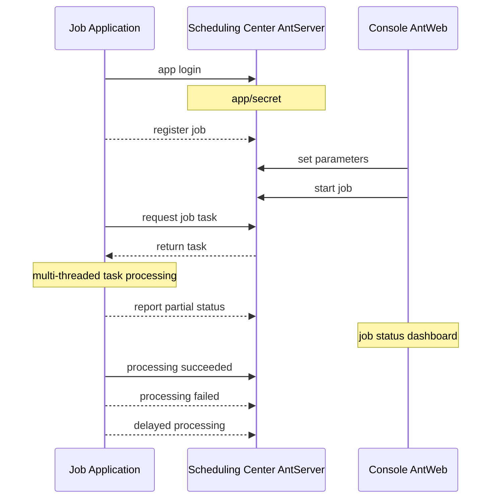
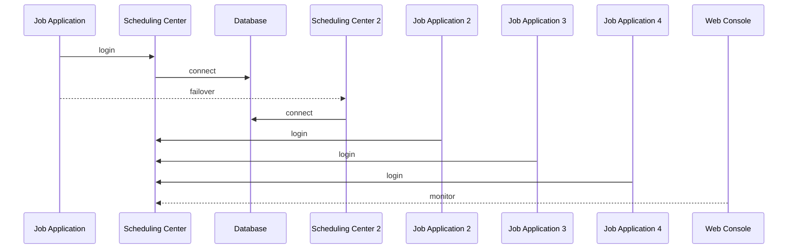

# NewLife.AntJob - Programación de tareas Ant


[](https://github.com/NewLifeX/AntJob/actions/workflows/test.yml)
[](Doc/多语言本地化.md)


[](https://github.com/NewLifeX/AntJob/graphs/contributors)


<!-- lang:start -->
🌐 [English](README.md) | [简体中文](README.zh-CN.md) | [繁體中文](README.zh-TW.md) | [Deutsch](README.de.md) | [日本語](README.ja.md) | [Français](README.fr.md) | [Português](README.pt.md) | [Русский](README.ru.md) | [한국어](README.ko.md) | [العربية](README.ar.md)
<!-- lang:end -->


**AntJob** es una plataforma de programación de tareas distribuidas y de datos en tiempo real construida íntegramente en .NET: cualquier trabajo grande se divide en fragmentos paralelos de tiempo/datos, se despacha a nodos de ejecución elásticos, se reintenta si falla y se puede volver a ejecutar para rellenar el histórico, todo con una consola web para supervisión en vivo.

Código abierto: [https://github.com/NewLifeX/AntJob](https://github.com/NewLifeX/AntJob)  
Tutorial: [https://newlifex.com/blood/antjob](https://newlifex.com/blood/antjob)  
Demo en vivo (entorno alojado): [http://ant.newlifex.com](http://ant.newlifex.com/)  

**Contenido**: [Inicio rápido](#inicio-rápido) · [Características principales](#características-principales) · [Mapa del ecosistema](#mapa-del-ecosistema) · [Documentación](#documentación) · [Contribución](#contribución) · [Equipo](#equipo) · [Licencia](#licencia)

## Inicio rápido

### Instalación

```bash
dotnet add package NewLife.AntJob
```

### Plantilla (recomendada)

```
dotnet new install NewLife.Templates
# Create a project with an AntJob sample
dotnet new antjob --name TestJob
cd TestJob
dotnet run
```

### Ejemplo mínimo

El siguiente código fuente se encuentra en [Samples/HisAgent](https://github.com/NewLifeX/AntJob/tree/master/Samples/HisAgent). Cree un proyecto .NET Core 3.1+ y referencie AntJob desde NuGet. Cree una instancia de Scheduler y configure un proveedor de red.

```csharp
using AntJob;
using HisAgent;
using NewLife.Log;
using NewLife.Model;
using Stardust;

// Enable console logging and intercept all exceptions
XTrace.UseConsole();

var services = ObjectContainer.Current;
services.AddStardust();

services.AddAntJob()
    .AddHandler<HelloJob>();

// Friendly shutdown
var host = services.BuildHost();
await host.RunAsync();
```

Añada el primer controlador de trabajo programado:

```csharp
using System;
using AntJob;

internal class HelloJob : Handler
{
    public HelloJob() => Job.Cron = "7/30 * * * * ?";

    public override Int32 Execute(JobContext ctx)
    {
        // Time of the current task
        var time = ctx.Task.DataTime;
        WriteLog("NewLife AntJob! Current task time: {0}", time);
        return 1; // Number of successfully processed items
    }
}
```

Los controladores de trabajos deben heredar de `Handler` y sobrescribir `Execute` para implementar la lógica de negocio. Los valores Time y Step establecidos en el constructor solo se usan en el primer registro; los cambios posteriores se realizan en la consola.

O utilice un controlador de trabajo programado asíncrono:

```csharp
using System;
using AntJob;

internal class HelloJob : Handler
{
    public HelloJob() => Job.Cron = "7/30 * * * * ?";

    public override async Task<Int32> ExecuteAsync(JobContext ctx)
    {
        using var span = Tracer?.NewSpan("HelloJob", ctx.Task.DataTime);

        // Time of the current task
        var time = ctx.Task.DataTime;
        WriteLog("NewLife AntJob! Current task time: {0}", time);
        if (!ctx.Task.Data.IsNullOrEmpty()) WriteLog("Data: {0}", ctx.Task.Data);

        var state = Rand.NextString(16);
        var http = new HttpClient { BaseAddress = new Uri("https://newlifex.com") };
        http.SetUserAgent();
        var rs = await http.GetAsync<IDictionary<String, Object>>("/cube/info", new { state });

        if (rs.TryGetValue("state", out var value) && value is String str)
        {
            Trace.Assert(state == str, "Returned state does not match");
        }

        // Number of successfully processed items
        return 1;
    }
}
```

### Ejecución

En la primera ejecución intenta conectarse automáticamente a `tcp://127.0.0.1:9999` y `tcp://ant.newlifex.com:9999` (activo/en espera), según la configuración de `AntSetting`. Si `Server` se configura con una dirección `http(s)://`, cambia automáticamente al canal HTTP y recibe las notificaciones descendentes por WebSocket.

Ejemplo de log:

```sql
21:33:08.470  1 N - Start job scheduling engine [AntJob.Providers.NetworkJobProvider], jobs [1], timer 5s
21:33:08.471  1 N - HelloJob start work False range (2020-04-09 00:00:00, 0001-01-01 00:00:00) Offset=15 Step=10 MaxTask=8
```

### Consola web y reinicio

Despliegue AntJob.Web (IIS / Kestrel / Docker) y después cambie el ajuste Server del cliente para apuntar a la dirección de su servicio. No se necesita un AntServer independiente:

```json
{
  "Ant": {
    "Server": "https://ant.example.com",
    "AppId": "MyJobApp",
    "Secret": ""
  }
}
```

Tras iniciar sesión, el cliente establece una conexión WebSocket persistente en `/AntJob/Notify` mediante latidos HTTP para recibir notificaciones de cambios de trabajo y de llegada de mensajes; cuando WebSocket no está disponible, sigue funcionando con el intervalo de sondeo. Al habilitar un trabajo en la consola, el centro de programación lo divide en tareas por punto temporal y las despacha: puede ver el detalle de las tareas, reintentar los errores y restablecer tareas en lote para recalcular el histórico. Ejecute varios Agentes para escalar horizontalmente: cada tarea la ejecuta exactamente un nodo y los fallos se reintentan según la política configurada.

### Solo programación desde archivo local

Cuando no se configura `NetworkJobProvider`, se usa el proveedor local predeterminado, adecuado para depurar sin conexión en una sola máquina.

### Docker (ilustrativo)

> Todavía no se ofrece una imagen oficial; puede empaquetar una dentro de su organización:

```
FROM mcr.microsoft.com/dotnet/aspnet:8.0 AS base
WORKDIR /app
COPY ./publish/ .
ENTRYPOINT ["dotnet","AntJob.Web.dll"]
```

### Topologías de despliegue

| Topología | Descripción |
| --- | --- |
| Instancia única | Web + Server + JobApp en la misma máquina para desarrollo y pruebas |
| Alta disponibilidad de doble centro | Dos direcciones de centro de programación separadas por comas (activo/en espera), con conmutación automática del cliente |
| Clúster de múltiples ejecutores | Varios nodos de ejecución, agrupados por negocio o carga, conectados a un centro de programación unificado |
| Híbrida | Doble centro + varios nodos de ejecución en producción; clústeres separados para pruebas/preproducción |

## Características principales

AntJob aplica la idea de «las hormigas que mudan de casa» para dividir cualquier trabajo grande en piezas pequeñas que pueden ejecutarse en paralelo. La idea nació en Lujiazui (Shanghái) durante la crisis financiera de 2008, ante la necesidad urgente de las entidades financieras de un análisis de datos barato y de alta eficiencia. Entre los sistemas comparables están XxlJob, Quartz, Hangfire, Airflow (en algunos escenarios) y clústeres propios de scripts programados; AntJob pone el acento en el «particionado de datos/tiempo + reintentos + múltiples modos unificados» y en una integración no intrusiva con el ecosistema .NET que ya tiene la empresa, avalada por una programación a escala de billones y decenas de miles de millones de registros de limpieza de datos.

<details>
<summary><b>Casos de uso típicos</b> (4)</summary>

| Escenario | Por qué encaja AntJob |
| --- | --- |
| Logs, pedidos, transacciones y datos de dispositivos masivos | Extracción continua y cálculo en tiempo real sobre conjuntos de datos que no dejan de crecer |
| Agregación continua por ventana de tiempo | Las ventanas de segundo / minuto / hora / día / Cron personalizado se calculan fragmento a fragmento |
| Relleno y recálculo de datos | Los rangos históricos se pueden restablecer y volver a ejecutar sin afectar a las ventanas en vivo |
| Procesamiento por lotes de alta concurrencia | Distribuido entre centros de datos con un número elástico de nodos |

</details>

<details>
<summary><b>Capacidades principales</b> (11)</summary>

| Capacidad | Qué aporta |
| --- | --- |
| Múltiples modos de programación | Tiempo, ventana de datos, mensaje, Cron, sentencias SQL y scripts dinámicos de C# |
| Particionado de tiempo/datos del trabajo | Hasta granularidad de segundos, con recuperación, relleno histórico y restablecimiento en lote |
| Entrega fiable de tareas | Reintento automático con retardo ante fallos, tolerando fallos transitorios de dependencias |
| Clúster elástico | Nodos de ejecución naturalmente sin estado que escalan hacia arriba o hacia abajo en cualquier momento |
| Protocolos de comunicación | HTTP REST + notificaciones descendentes por WebSocket (opción predeterminada recomendada), compatible con RPC TCP de NewLife.Remoting |
| Supervisión visual | Consola web con curvas de trabajos en tiempo real, estado de las tareas y nodos en línea |
| Panel de trabajos | Ajuste dinámico de parámetros y estadísticas de ejecución desde la consola |
| Proveedores conectables | Implementaciones de `IJobProvider` para fuentes de red, archivo y personalizadas locales |
| Dependencias ligeras | El núcleo se apoya en el propio ecosistema de NewLife (logs, configuración, seguimiento), lo que reduce la complejidad externa |
| Multiplataforma y multi-TFM | Desde .NET Framework 4.5 hasta .NET 8/9 |
| Nombre seguro y compatibilidad a largo plazo | Cómodo para el despliegue privado empresarial y el empaquetado secundario |

</details>

<details>
<summary><b>Modos de programación</b> (5)</summary>

| Modo | Caso de uso, granularidad y campos clave |
| --- | --- |
| Tiempo / Cron | Trabajos periódicos generales con granularidad de segundos a Cron, gobernados por `Job.Time` / `Cron`; las expresiones Cron sustituyen a los intervalos fijos Start+Step |
| Datos (ventana de tiempo) | Procesa los datos recién añadidos por fragmento de tiempo (de segundos a cualquier ventana), gobernado por Start / End; las ventanas faltantes se rellenan automáticamente, ideal para cálculo continuo sobre tablas de diario y de log |
| Mensaje | Modo pasivo y en tiempo real dirigido por mensajes: el `Body` de un mensaje externo enviado o de cola se convierte en una tarea |
| SQL / dirigido por datos | Recorre una tabla de datos y la divide por clave primaria/tiempo (por lotes); componente de extensión que suele usarse para relleno histórico o migración masiva |
| Script dinámico de C# | Experimentos rápidos y actualizaciones en caliente para lógica pequeña; el script se compila y ejecuta en tiempo de ejecución, sujeto a límites de permisos/sandbox |

</details>

<details>
<summary><b>Arquitectura y módulos principales</b> (9)</summary>

| Componente | Responsabilidad |
| --- | --- |
| AntJob.Server | Lógica del servidor del centro de programación: metadatos de trabajos y tareas, particionado, asignación y política de reintentos |
| AntJob.Web | Plataforma de gestión visual construida sobre NewLife.Cube: aislamiento de Apps multiinquilino, permisos y supervisión |
| AntJob (biblioteca) | SDK de cliente: abstracciones Scheduler y Handler, comunicación de red y envolturas de contexto |
| AntJob.Extensions | Tipos de programación extendidos: SqlMessage, DataHandler, MessageHandler, CSharpHandler, etc. |
| Samples | Proyectos de ejemplo (HisAgent, HisData, HisWeb, HelloWork) |
| Scheduler | Motor de programación central que gestiona el ciclo de vida de los controladores y el despacho de tareas |
| Handler | Clase base de los módulos de negocio; cada módulo implementa `Execute` / `ExecuteAsync` |
| IJobProvider | Proveedor de origen de tareas que admite fuentes de red, locales y personalizadas |
| JobContext | Entorno de ejecución y estado de una tarea, incluidas las estadísticas y las utilidades de log |

</details>

<details>
<summary><b>Fiabilidad y consistencia</b> (6)</summary>

| Garantía | Cómo funciona |
| --- | --- |
| Asignación atómica de tareas | Un ID de tarea dado lo adquiere exactamente un nodo |
| Máquina de estados | Listo -> En proceso -> Completado / Error / Cancelado |
| Reintento automático | Las tareas fallidas se reintentan tras un retardo (1 minuto por defecto), hasta N veces (configurable) |
| Mecanismo de reinicio | Restablecimiento en lote de un rango histórico para recalcular (relleno / corrección) |
| Idempotencia | La lógica de negocio debe implementar escrituras idempotentes basadas en claves primarias y ventanas de tiempo |
| Latido y tabla de nodos en línea | Detección en tiempo real de nodos en línea/fuera de línea, lo que permite el escalado elástico |

</details>

<details>
<summary><b>Configuración</b> (7)</summary>

| Ajuste | Significado |
| --- | --- |
| `Server` | Dirección(es) del centro de programación. `http(s)://` usa el canal HTTP + WebSocket; `tcp://` usa el canal compatible con RPC, p. ej. `https://a.example.com,https://b.example.com` o `tcp://a:9999,tcp://b:9999` |
| `AppID` / `Secret` | Credenciales de aislamiento de la aplicación, registradas automáticamente o distribuidas a mano |
| `Debug` | Interruptor de depuración que genera logs más detallados |
| `UseRegistry` | Indica si se resuelven las direcciones de servicio mediante el registro de Stardust (true por defecto); establézcalo en false si se conecta directamente a través de una pasarela |
| `MessageIdlePeriod` | Periodo de sondeo inactivo para trabajos de tipo mensaje, en segundos (15 por defecto); una notificación de mensaje por canal HTTP lo despierta de inmediato |
| Base de datos | Las conexiones del lado Web/Server crean las tablas automáticamente mediante ingeniería inversa de XCode |
| Integración con Stardust | Registro, APM y centro de configuración opcionales para el lado Web/Server |

</details>

<details>
<summary><b>Mecanismos de extensión</b> (6)</summary>

| Mecanismo | Cómo usarlo |
| --- | --- |
| Controlador personalizado | Herede de `Handler`, sobrescriba `Execute(JobContext ctx)` y devuelva el número de elementos procesados correctamente |
| Proveedor de origen de datos personalizado | Implemente `IJobProvider` (por ejemplo Kafka / Redis Stream / REST) |
| Programación por mensajes | `MessageHandler` convierte un cuerpo de mensaje arbitrario en tareas |
| SQL / dirigido por datos | `SqlMessage` + `DataHandler` recorren y dividen los datos |
| Scripts dinámicos | `CSharpHandler` permite probar y corregir rápidamente mediante scripts (restrinja los permisos en producción) |
| Empaquetado por complementos | El nombre seguro y la compatibilidad multi-TFM permiten que los controladores residan en ensamblados separados y se conecten en caliente |

</details>

<details>
<summary><b>Rendimiento y planificación de capacidad</b> (7)</summary>

| Aspecto | Recomendación |
| --- | --- |
| Volumen de fragmentos por trabajo | Hasta decenas de miles de millones de registros históricos de tareas, según la capacidad de la base de datos |
| Rendimiento por nodo | Depende de la lógica de negocio del controlador; la sobrecarga de programación del framework es mínima (control de programación en memoria) |
| Presión de GC | Internamente se usan grupos de objetos y cachés, aprovechando las optimizaciones de NewLife.Core |
| Granularidad de los fragmentos | Manténgala moderada; los fragmentos demasiado finos aumentan la sobrecarga de metadatos de programación |
| Presión sobre la base de datos | Use E/S por lotes o caché para reducir la carga de la base de datos |
| Ventanas de cálculo grandes | Prefiera el modo Datos con un bucle de subventanas |
| Escala demostrada | Envío masivo de SMS de fondos, 6 000 millones de filas particionadas de una sola tabla, 12 millones de pedidos exprés al día, decenas de miles de millones de registros de limpieza de datos y programación anual a escala de billones |

</details>

<details>
<summary><b>Conceptos básicos</b> (5)</summary>

| Concepto | Significado |
| --- | --- |
| Job | Configuración del trabajo: tiempo/step/Cron/modo/límite de concurrencia, etc. |
| Task | La unidad de ejecución más pequeña que se genera al instanciar un trabajo, con un punto o intervalo de tiempo y un cuerpo de mensaje |
| Handler | Portador de la lógica de negocio cuyo ciclo de vida gestiona el Scheduler |
| JobContext | Contexto de ejecución de una tarea, que incluye la tarea, las estadísticas y las utilidades de log |
| IJobProvider | Proveedor de origen de tareas (red/local/personalizado) |

</details>

<details>
<summary><b>Comparación con otros planificadores</b> (4)</summary>

| Sistema | En qué se diferencia AntJob |
| --- | --- |
| Quartz.NET | Una biblioteca pura de programación/Cron; AntJob añade particionado de datos/mensajes, recálculo y sharding de clúster sencillo |
| Hangfire | Trabajos en segundo plano persistentes; AntJob se centra en el particionado continuo de tiempo/datos en lugar de una cola de tareas puntual |
| XXL-JOB | Ecosistema Java; AntJob es nativo de .NET, con múltiples modos unificados y scripts dinámicos |
| Airflow | Orquestación de DAG; AntJob es más ligero y se centra en el procesamiento de ventanas de alta frecuencia, y puede complementar a Airflow |

</details>

<details>
<summary><b>Preguntas frecuentes</b> (5)</summary>

| Pregunta | Respuesta |
| --- | --- |
| ¿Por qué los trabajos quedan detenidos por defecto tras registrarse? | Para evitar un gran número de inicios antes de configurar los parámetros; habilítelos manualmente en la consola web |
| ¿Cómo recalculo los datos de un mes? | Cambie la hora de inicio en el panel del trabajo, restablezca el rango de tiempo indicado, o seleccione tareas en lote y restablézcalas |
| ¿Las tareas fallidas bloquean las siguientes? | No; las tareas fallidas se reintentan con retardo mientras las demás ventanas siguen programándose |
| ¿Puedo usar solo HTTP/WebSocket? | Sí. Configure `Server` con una dirección `http://` o `https://` y el cliente usará automáticamente HTTP REST + notificaciones WebSocket sin un AntServer independiente; las direcciones `tcp://` mantienen el canal compatible con RPC |
| ¿Cómo limito el riesgo de los scripts? | Desactive el CSharpHandler si no lo usa, o aíslelo en un proceso separado con una configuración de privilegios mínimos |

</details>

<details>
<summary><b>Avance de la actualización a v4</b> (5)</summary>

| Elemento | Estado |
| --- | --- |
| Acceso HTTP | Hecho: AntWeb presta los servicios de programación, sin necesidad de AntServer; las notificaciones descendentes por WebSocket se incluyen con el canal HTTP |
| Programación periódica mejorada | Hecho: se admiten expresiones Cron, que sustituyen gradualmente al avance fijo Start+Step |
| Tareas pregeneradas | Previsto: ejecución exacta a la hora (mejora de precisión, pendiente de evaluar) |
| Retardo activo de tareas | Hecho: solicitar un retardo durante la ejecución sin contarlo como fallo |
| Más modos de programación | Previsto: AntAgent regular, incorporando programación SQL / programación C#, con modos de extracción y de envío a continuación |

</details>

<details>
<summary><b>Hoja de ruta más allá de v4</b> (4)</summary>

| Elemento | Descripción |
| --- | --- |
| API de retardo activo de tareas | Evaluar un retardo durante la ejecución y ejecutar más tarde sin contarlo como error |
| Canales de alerta conectables | Correo electrónico / Webhook / WeCom y otros canales |
| Exportación de métricas de supervisión | Exportación multidimensional para Prometheus / OpenTelemetry |
| Capa DAG opcional | Orquestación de DAG / dependencias una vez estabilizado el núcleo |

</details>

### Diagramas de arquitectura

Topología de componentes

```
+----------------------+            +-------------------------+
|  Execution Node(Agent)|  RPC/TCP  |  Scheduling Center(Server)|
|  - Scheduler         |            | - JobService / Task     |
|  - Handlers(business)|            | - State & metadata      |
+----------+-----------+            +-----------+-------------+
           |  Sync logs/tracing (optional Stardust)  |
           v
    +-------------+      Web UI / API      +------------------+
    | DB / Storage|  <------------------>  | Web Console AntWeb|
    +-------------+                         +------------------+
```

Aplicación de trabajos (implementa IJob)



Arquitectura maestro/esclavo del centro de programación



## Mapa del ecosistema

NewLife es un ecosistema por capas de proyectos de código abierto con versionado independiente. El mapa siguiente se comparte literalmente en todos los repositorios de NewLife; cada proyecto enlaza a su repositorio y a su paquete principal de NuGet.

| Proyecto | Qué hace | Descargas |
| --- | --- | --- |
| **Fundación** | | |
| [NewLife.Core](https://github.com/NewLifeX/X) | Registro de logs, configuración, caché, red, serialización, programación de tareas y seguimiento APM. | [](https://www.nuget.org/packages/NewLife.Core) |
| [NewLife.XCode](https://github.com/NewLifeX/NewLife.XCode) | Middleware de datos: tablas únicas a escala de decenas de miles de millones, particionado automático, separación lectura/escritura y más de 10 bases de datos. | [](https://www.nuget.org/packages/NewLife.XCode) |
| [NewLife.Net](https://github.com/NewLifeX/NewLife.Net) | Biblioteca de red de alto rendimiento: 1,77 M pps / 14,5 Gbps en una máquina (TCP 1KB, 2026-10), 4 M conexiones TCP persistentes. | [](https://www.nuget.org/packages/NewLife.Net) |
| [NewLife.Remoting](https://github.com/NewLifeX/NewLife.Remoting) | Framework de comunicación por protocolo y RPC para aplicaciones cliente/servidor y dispositivos IoT. | [](https://www.nuget.org/packages/NewLife.Remoting) |
| [NewLife.Agent](https://github.com/NewLifeX/NewLife.Agent) | Instala aplicaciones .NET como demonios del sistema operativo: servicios de Windows y systemd de Linux. | [](https://www.nuget.org/packages/NewLife.Agent) |
| [NewLife.Templates](https://github.com/NewLifeX/NewLife.Zero) | Plantillas de proyecto `dotnet new` para consola, web, API, servicio, datos e IoT. | [](https://www.nuget.org/packages/NewLife.Templates) |
| **Datos y mensajería** | | |
| [NewLife.Redis](https://github.com/NewLifeX/NewLife.Redis) | Cliente Redis con latencia de microsegundos, millones de operaciones por segundo y colas de mensajes integradas. | [](https://www.nuget.org/packages/NewLife.Redis) |
| [NewLife.RocketMQ](https://github.com/NewLifeX/NewLife.RocketMQ) | Cliente RocketMQ totalmente administrado para Apache RocketMQ y Alibaba Cloud Message Queue. | [](https://www.nuget.org/packages/NewLife.RocketMQ) |
| [NewLife.MQTT](https://github.com/NewLifeX/NewLife.MQTT) | Cliente y servidor MQTT, incluida la conectividad con Alibaba Cloud IoT. | [](https://www.nuget.org/packages/NewLife.MQTT) |
| [NewLife.NovaDb](https://github.com/NewLifeX/NewLife.NovaDb) | Base de datos híbrida en C#: embebida o en red, relacional, series temporales, cola de mensajes y KV en una sola. | [](https://www.nuget.org/packages/NewLife.NovaDb) |
| [NewLife.MySql](https://github.com/NewLifeX/NewLife.MySql) | Controlador y capa de ayuda de MySql construidos sobre la pila de datos de NewLife. | [](https://www.nuget.org/packages/NewLife.MySql) |
| **Web, IA y distribuido** | | |
| [NewLife.Cube](https://github.com/NewLifeX/NewLife.Cube) | Framework rápido para plataformas de administración: permisos, SSO, servidor OAuth y andamiaje CRUD. | [](https://www.nuget.org/packages/NewLife.Cube) |
| [Stardust](https://github.com/NewLifeX/Stardust) | Plataforma distribuida de servicios: gestión de nodos, APM, centro de configuración, registro y centro de despliegues. | [](https://www.nuget.org/packages/NewLife.Stardust) |
| [AntJob](https://github.com/NewLifeX/AntJob) | Plataforma de tareas distribuidas y programación de datos en tiempo real con particionado, reintentos y relleno histórico. | [](https://www.nuget.org/packages/NewLife.AntJob) |
| [NewLife.AI](https://github.com/NewLifeX/NewLife.AI) | Cliente unificado para 46 proveedores de LLM más ChatAI, una aplicación web de chat lista para usar. | [](https://www.nuget.org/packages/NewLife.AI) |
| **Industrial e IoT** | | |
| [NewLife.IoT](https://github.com/NewLifeX/NewLife.IoT) | Biblioteca estándar de IoT que define contratos de protocolo y abstracciones de dispositivos. | [](https://www.nuget.org/packages/NewLife.IoT) |
| [NewLife.Modbus](https://github.com/NewLifeX/NewLife.Modbus) | Implementación de Modbus TCP/RTU/ASCII sobre NewLife.IoT. | [](https://www.nuget.org/packages/NewLife.Modbus) |
| [NewLife.Siemens](https://github.com/NewLifeX/NewLife.Siemens) | Protocolo para PLC Siemens sobre NewLife.IoT. | [](https://www.nuget.org/packages/NewLife.Siemens) |
| [NewLife.Omron](https://github.com/NewLifeX/NewLife.Omron) | Protocolo para PLC Omron sobre NewLife.IoT. | [](https://www.nuget.org/packages/NewLife.Omron) |
| [NewLife.Melsec](https://github.com/NewLifeX/NewLife.Melsec) | Protocolo para PLC Mitsubishi Melsec sobre NewLife.IoT. | [](https://www.nuget.org/packages/NewLife.Melsec) |
| [NewLife.OPC](https://github.com/NewLifeX/NewLife.OPC) | Cliente OPC para el acceso a datos industriales. | — |
| [NewLife.BACnet](https://github.com/NewLifeX/NewLife.BACnet) | Pila de protocolo BACnet para la automatización de edificios. | [](https://www.nuget.org/packages/NewLife.BACnet) |
| [ZeroIoT](https://github.com/NewLifeX/ZeroIoT) | Plataforma IoT de código abierto y ligera con gestión de pasarelas y dispositivos. | — |
| **Telemática vehicular** | | |
| [NewLife.JT808](https://github.com/NewLifeX/NewLife.JT808) | Protocolo de posicionamiento vehicular JT/T 808: más de 70 cuerpos de mensaje, 2011/2013/2019. | [](https://www.nuget.org/packages/NewLife.JT808) |
| [NewLife.JT809](https://github.com/NewLifeX/NewLife.JT809) | Protocolo plataforma a plataforma JT/T 809 para autoridades de transporte. | [](https://www.nuget.org/packages/NewLife.JT809) |
| [NewLife.JT1078](https://github.com/NewLifeX/NewLife.JT1078) | Vídeo a bordo JT/T 1078: análisis RTP, remultiplexado FLV/fMP4 y transmisión en directo. | [](https://www.nuget.org/packages/NewLife.JT1078) |
| **Componentes de dominio** | | |
| [NewLife.Office](https://github.com/NewLifeX/NewLife.Office) | Un solo paquete para Excel, Word, PPT, PDF y más de 15 formatos de documento. | [](https://www.nuget.org/packages/NewLife.Office) |
| [NewLife.Audio](https://github.com/NewLifeX/NewLife.Audio) | Audio multiplataforma: códecs, E/S de dispositivos, DSP, contenedores y streaming. | [](https://www.nuget.org/packages/NewLife.Audio) |
| [NewLife.Video](https://github.com/NewLifeX/NewLife.Video) | Códecs de vídeo, formatos de contenedor, procesamiento de fotogramas y streaming. | [](https://www.nuget.org/packages/NewLife.Video) |
| [NewLife.Map](https://github.com/NewLifeX/NewLife.Map) | Interfaz unificada sobre Baidu, AMap, Tencent y Tianditu con geocodificación y conversión de coordenadas. | [](https://www.nuget.org/packages/NewLife.Map) |
| [NewLife.IP](https://github.com/NewLifeX/NewLife.IP) | Geolocalización IPv4 con una base de datos offline mapeada en memoria y una API en línea de respaldo. | [](https://www.nuget.org/packages/NewLife.IP) |
| **Herramientas y productos** | | |
| [CrazyCoder](https://github.com/NewLifeX/XCoder) | Caja de herramientas del desarrollador: red, puerto serie, criptografía, expresiones regulares, Modbus y MQTT. | [](https://www.nuget.org/packages/NewLife.XCoder) |
| [GitCandy](https://github.com/NewLifeX/GitCandy) | Sistema de gestión de código fuente Git autoalojado. | — |
| [LuckyClover](https://github.com/NewLifeX/LuckyClover) | Instala automáticamente el runtime de .NET correspondiente cuando se ejecuta desde un host más antiguo. | — |

> Las insignias muestran el paquete principal de cada proyecto; los paquetes de temas, extensiones y satélites figuran en sus páginas de NuGet. Los más de 30 paquetes no listados aquí (FTP, LoRa, extensiones de Office, controladores de protocolo, etc.) están disponibles en la [organización NewLifeX](https://github.com/NewLifeX) y en [newlifex.com](https://newlifex.com). Esta tabla se mantiene en el README de NewLife.Core.

## Documentación

| Documento | Descripción |
| --- | --- |
| [Requisitos](Doc/需求文档.md) | Visión, objetivos principales, requisitos funcionales de los 7 módulos principales y la lista de elementos aplazados |
| [Lista de funciones](Doc/功能清单.md) | Seguimiento tridimensional de implementación/pruebas/comentarios de 85 funciones (incluida la comprobación obligatoria de división) |
| [Arquitectura](Doc/架构设计.md) | Arquitectura por capas, responsabilidades de los componentes principales, diagramas de secuencia de los procesos clave y decisiones de diseño |
| [Despliegue de HTTP y WebSocket](Doc/HTTP与WebSocket部署.md) | Configuración de la pasarela, difusión por Redis, pasos de migración y lista de verificación para la resolución de problemas |
| [Benchmarks de componentes principales](Doc/Benchmark/核心组件性能测试.md) | Datos de benchmark y recomendaciones de ajuste para expresiones de tiempo, reemplazo de plantillas y análisis de fragmentos SQL |

- Tutorial: [https://newlifex.com/blood/antjob](https://newlifex.com/blood/antjob)
- Demo en vivo: [http://ant.newlifex.com](http://ant.newlifex.com/)
- Reglas de README multilingüe: [Doc/多语言本地化.md](Doc/多语言本地化.md)

## Contribución

### Compilación y pruebas

```bash
dotnet build -c Release
dotnet test -c Release
# Only the main test project (net10.0), used by CI on win-x64 and linux-arm64
dotnet test AntTest/AntTest.csproj -c Release
```

- CI: `.github/workflows/test.yml` compila, ejecuta las pruebas y verifica la localización y el selector de idioma de los README
- Comprobaciones de los README: `pwsh -File sync-readme-languages.ps1 -Check`, `pwsh -File sync-readme-package.ps1 -Check` y `pwsh -File check-readme-structure.ps1`
- Benchmarks: `Benchmark/AntJob.Benchmarks` (BenchmarkDotNet)

### Estructura del repositorio

```
AntJob/                 Client core library
AntJob.Extensions/      Extension handlers/messages/SQL, etc.
AntJob.Server/          Scheduling-center core service logic (JobService, etc.)
AntJob.Web/             Razor Pages + Cube admin console
AntJob.Data/            Base data models (entity layer)
Samples/                Sample projects (HisAgent, HisData, HisWeb, HelloWork)
AntTest/                Unit/integration tests
Doc/                    Documentation and assets
```

### Publicación

Publique una etiqueta con el prefijo `v` (por ejemplo `v5.0.2026.1024`) para activar `.github/workflows/publish.yml`. El flujo empaqueta `AntJob`, `AntJob.Extensions` y `AntJob.Web`, los publica en NuGet.org y GitHub Packages, y crea una GitHub Release cuyas notas se toman de la sección correspondiente de `ChangeLog.md` (los recursos incluyen nupkg y snupkg). Una ejecución manual solo publica los paquetes y no crea una Release. Los commits que tocan `AntJob/` o `AntJob.Extensions/` en master también generan paquetes beta mediante `publish-beta.yml`.

### Comentarios

- Antes de enviar cambios, asegúrese de que `dotnet build` y las pruebas correspondientes pasen; siga el estilo de código del repositorio.
- Informe de errores y sugerencias mediante [Issue](https://github.com/NewLifeX/AntJob/issues); las estrellas y los PR son bienvenidos.

## Equipo


NewLife se fundó en 2002 y lleva más de dos décadas dedicado al ecosistema .NET e IoT, mantiene cerca de 100 proyectos de código abierto (34 de ellos principales) y ofrece soluciones integradas de software y hardware para los sectores de energía, logística, salud, control industrial e Internet. Nos guía el lema «en el aprendizaje no hay antigüedad: quien domina es maestro».

Los componentes de código abierto acumulan <!--nuget-total:start-->6.48M<!--nuget-total:end--> descargas en NuGet (todo el ecosistema, a fecha de 2026-10).

Sitio web: https://newlifex.com · Organización de código abierto: https://github.com/NewLifeX

<details>
<summary>Cuenta oficial de WeChat: 智能大石头 (escanea para seguir)</summary>


</details>

## Licencia

Este proyecto se distribuye bajo la licencia [MIT](https://github.com/NewLifeX/AntJob/blob/master/LICENSE) © 2002-2026 Equipo NewLife. Puede usarlo, modificarlo y redistribuirlo libremente.

> Si este proyecto le resulta útil, no dude en darle una estrella, compartirlo con su equipo o enviar sugerencias de mejora mediante Issue/PR.
