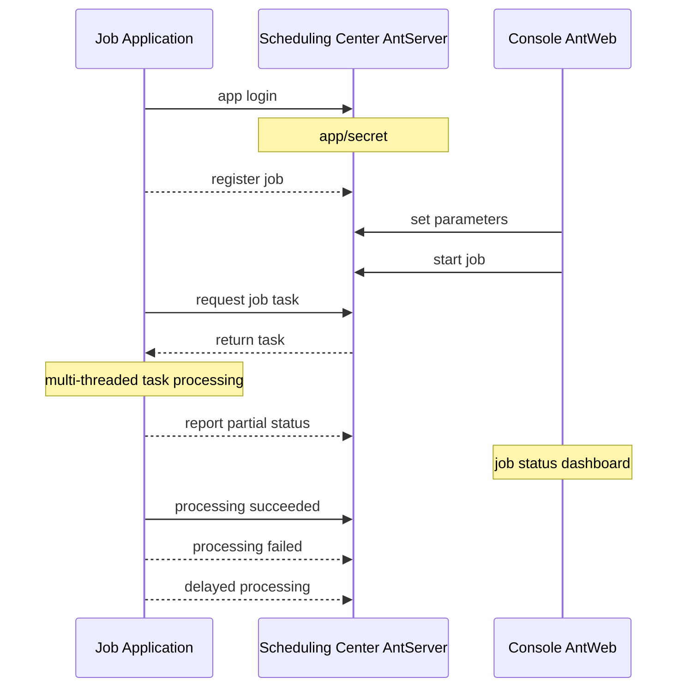
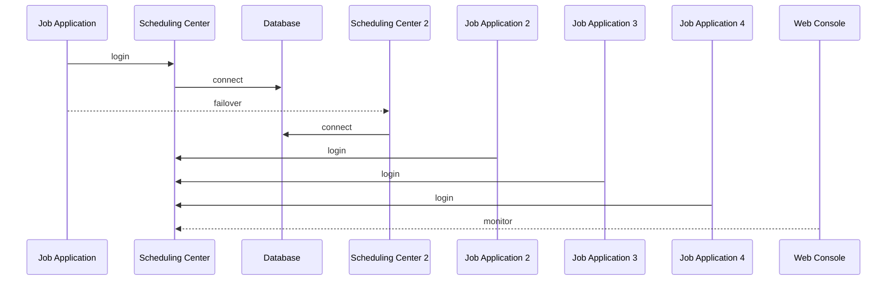

# NewLife.AntJob - Ordonnancement des fourmis


[](https://github.com/NewLifeX/AntJob/actions/workflows/test.yml)
[](Doc/多语言本地化.md)


[](https://github.com/NewLifeX/AntJob/graphs/contributors)


<!-- lang:start -->
🌐 [English](README.md) | [简体中文](README.zh-CN.md) | [繁體中文](README.zh-TW.md) | [Español](README.es.md) | [Deutsch](README.de.md) | [日本語](README.ja.md) | [Português](README.pt.md) | [Русский](README.ru.md) | [한국어](README.ko.md) | [العربية](README.ar.md)
<!-- lang:end -->

**AntJob** est une plateforme d'ordonnancement de tâches et de données en temps réel, entièrement développée en .NET : toute tâche volumineuse est découpée en tranches temporelles ou de données exécutées en parallèle, distribuée à des nœuds d'exécution élastiques, relancée en cas d'échec et rejouée pour le rattrapage (backfill), avec une console web pour la supervision en direct.

Dépôt open source : [https://github.com/NewLifeX/AntJob](https://github.com/NewLifeX/AntJob)  
Tutoriel : [https://newlifex.com/blood/antjob](https://newlifex.com/blood/antjob)  
Démo en ligne (environnement hébergé) : [http://ant.newlifex.com](http://ant.newlifex.com/)  


**Sommaire** : [Démarrage rapide](#démarrage-rapide) · [Fonctionnalités principales](#fonctionnalités-principales) · [Carte de l'écosystème](#carte-de-lécosystème) · [Documentation](#documentation) · [Contribuer](#contribuer) · [Équipe](#équipe) · [Licence](#licence)

## Démarrage rapide

### Installation

```bash
dotnet add package NewLife.AntJob
```

### Modèle (recommandé)

```
dotnet new install NewLife.Templates
# Create a project with an AntJob sample
dotnet new antjob --name TestJob
cd TestJob
dotnet run
```

### Exemple minimal

Le code source suivant se trouve dans [Samples/HisAgent](https://github.com/NewLifeX/AntJob/tree/master/Samples/HisAgent). Créez un projet .NET Core 3.1+ et référencez AntJob depuis NuGet. Instanciez un Scheduler et configurez un fournisseur réseau.

```csharp
using AntJob;
using HisAgent;
using NewLife.Log;
using NewLife.Model;
using Stardust;

// Enable console logging and intercept all exceptions
XTrace.UseConsole();

var services = ObjectContainer.Current;
services.AddStardust();

services.AddAntJob()
    .AddHandler<HelloJob>();

// Friendly shutdown
var host = services.BuildHost();
await host.RunAsync();
```

Ajoutez un premier gestionnaire de tâche planifiée :

```csharp
using System;
using AntJob;

internal class HelloJob : Handler
{
    public HelloJob() => Job.Cron = "7/30 * * * * ?";

    public override Int32 Execute(JobContext ctx)
    {
        // Time of the current task
        var time = ctx.Task.DataTime;
        WriteLog("NewLife AntJob! Current task time: {0}", time);
        return 1; // Number of successfully processed items
    }
}
```

Les gestionnaires de tâches doivent hériter de `Handler` et redéfinir `Execute` pour implémenter la logique métier. Les valeurs Time et Step définies dans le constructeur ne servent qu'au premier enregistrement ; les modifications ultérieures s'effectuent dans la console.

Ou utilisez un gestionnaire de tâche planifiée asynchrone :

```csharp
using System;
using AntJob;

internal class HelloJob : Handler
{
    public HelloJob() => Job.Cron = "7/30 * * * * ?";

    public override async Task<Int32> ExecuteAsync(JobContext ctx)
    {
        using var span = Tracer?.NewSpan("HelloJob", ctx.Task.DataTime);

        // Time of the current task
        var time = ctx.Task.DataTime;
        WriteLog("NewLife AntJob! Current task time: {0}", time);
        if (!ctx.Task.Data.IsNullOrEmpty()) WriteLog("Data: {0}", ctx.Task.Data);

        var state = Rand.NextString(16);
        var http = new HttpClient { BaseAddress = new Uri("https://newlifex.com") };
        http.SetUserAgent();
        var rs = await http.GetAsync<IDictionary<String, Object>>("/cube/info", new { state });

        if (rs.TryGetValue("state", out var value) && value is String str)
        {
            Trace.Assert(state == str, "Returned state does not match");
        }

        // Number of successfully processed items
        return 1;
    }
}
```

### Exécution

Au premier démarrage, il tente automatiquement de se connecter à `tcp://127.0.0.1:9999` et `tcp://ant.newlifex.com:9999` (actif/secours), selon la configuration `AntSetting`. Si `Server` est configuré avec une adresse `http(s)://`, le client bascule automatiquement sur le canal HTTP et reçoit les notifications descendantes via WebSocket.

Exemple de journal :

```sql
21:33:08.470  1 N - Start job scheduling engine [AntJob.Providers.NetworkJobProvider], jobs [1], timer 5s
21:33:08.471  1 N - HelloJob start work False range (2020-04-09 00:00:00, 0001-01-01 00:00:00) Offset=15 Step=10 MaxTask=8
```

### Console web et réinitialisation

Déployez AntJob.Web (IIS / Kestrel / Docker), puis modifiez le paramètre Server du client pour le faire pointer vers l'adresse de son service. Aucun AntServer distinct n'est nécessaire :

```json
{
  "Ant": {
    "Server": "https://ant.example.com",
    "AppId": "MyJobApp",
    "Secret": ""
  }
}
```

Après la connexion du client, celui-ci établit une connexion WebSocket persistante sur `/AntJob/Notify` au moyen de heartbeats HTTP afin de recevoir les notifications de changement de tâche et d'arrivée de message ; lorsque WebSocket est indisponible, le client continue de fonctionner selon l'intervalle d'interrogation. Dès qu'une tâche est activée dans la console, le centre d'ordonnancement découpe les tâches par point temporel et les distribue : vous pouvez consulter le détail des tâches, relancer les erreurs et réinitialiser des tâches par lots pour recalculer l'historique. Lancez plusieurs Agents pour monter en charge — chaque tâche donnée n'est exécutée que par un seul nœud, et les échecs sont relancés selon la stratégie définie.

### Ordonnancement local sur fichier uniquement

Lorsque `NetworkJobProvider` n'est pas configuré, le fournisseur local par défaut est utilisé ; il convient au débogage hors ligne sur une seule machine.

### Docker (à titre d'illustration)

> Aucune image officielle n'est encore fournie ; vous pouvez en créer une au sein de votre organisation :

```
FROM mcr.microsoft.com/dotnet/aspnet:8.0 AS base
WORKDIR /app
COPY ./publish/ .
ENTRYPOINT ["dotnet","AntJob.Web.dll"]
```

### Topologies de déploiement

| Topologie | Description |
| --- | --- |
| Instance unique | Web + Server + JobApp sur la même machine, pour le développement et les tests |
| Haute disponibilité à double centre | Deux adresses de centre d'ordonnancement séparées par une virgule (actif/secours), avec bascule automatique du client |
| Cluster multi-exécution | Plusieurs nœuds d'exécution, regroupés par activité ou par charge, reliés à un centre d'ordonnancement unifié |
| Hybride | Double centre + plusieurs nœuds d'exécution en production ; clusters distincts pour les environnements de test et de préproduction |

## Fonctionnalités principales

AntJob reprend l'idée des « fourmis qui déménagent » pour découper toute tâche volumineuse en petits morceaux exécutables en parallèle. L'idée est née à Lujiazui (Shanghai) pendant la crise financière de 2008, en réponse au besoin urgent des institutions financières d'analyses de données peu coûteuses et très efficaces. Les systèmes comparables incluent XxlJob, Quartz, Hangfire, Airflow (dans certains scénarios) et des clusters de scripts planifiés maison ; AntJob met l'accent sur le « découpage données/temps + reprise + modes multiples unifiés » et sur une intégration non intrusive à l'écosystème .NET existant de l'entreprise, validée par un ordonnancement à l'échelle des milliers de milliards de tâches et par des dizaines de milliards d'enregistrements de nettoyage de données.

<details>
<summary><b>Cas d'usage typiques</b> (4)</summary>

| Scénario | Pourquoi AntJob convient |
| --- | --- |
| Journaux / commandes / transactions / données d'appareils massifs | Extraction continue et calcul en temps réel sur des jeux de données toujours croissants |
| Agrégation glissante par fenêtre temporelle | Les fenêtres seconde / minute / heure / jour / Cron personnalisé sont calculées tranche par tranche |
| Backfill et recalcul de données | Les plages historiques peuvent être réinitialisées et rejouées sans affecter les fenêtres actives |
| Traitement par lots à forte concurrence | Réparti sur plusieurs centres de données avec un nombre élastique de nœuds |

</details>

<details>
<summary><b>Capacités clés</b> (11)</summary>

| Capacité | Ce qu'elle apporte |
| --- | --- |
| Modes d'ordonnancement multiples | Temps, fenêtre de données, message, Cron, instructions SQL et scripts C# dynamiques |
| Découpage temporel et de données des tâches | Jusqu'à la seconde, avec rattrapage, backfill et réinitialisation par lots |
| Livraison fiable des tâches | Reprise différée automatique en cas d'échec, tolérant les défaillances transitoires des dépendances |
| Cluster élastique | Nœuds d'exécution naturellement sans état, extensibles ou réduits à tout moment |
| Protocoles de communication | REST HTTP + notifications descendantes WebSocket (valeur par défaut recommandée), compatibles avec le RPC TCP de NewLife.Remoting |
| Supervision visuelle | Console web pour les courbes de tâches en temps réel, l'état des tâches et les nœuds en ligne |
| Panneau de tâche | Réglage dynamique des paramètres et statistiques d'exécution depuis la console |
| Fournisseurs enfichables | Implémentations `IJobProvider` pour sources réseau, fichier et personnalisées locales |
| Dépendances légères | Le cœur s'appuie sur l'écosystème NewLife (journalisation, configuration, traçage), ce qui réduit la complexité externe |
| Multiplateforme et multi-TFM | De .NET Framework 4.5 à .NET 8/9 |
| Nommage fort et compatibilité à long terme | Pratique pour le déploiement privé en entreprise et le repackaging |

</details>

<details>
<summary><b>Modes d'ordonnancement</b> (5)</summary>

| Mode | Cas d'usage, granularité et champs clés |
| --- | --- |
| Temps / Cron | Tâches périodiques générales, de la seconde au Cron, pilotées par `Job.Time` / `Cron` ; les expressions Cron remplacent les intervalles fixes Start+Step |
| Données (fenêtre temporelle) | Traite les données nouvellement ajoutées par tranche de temps (de la seconde à n'importe quelle fenêtre), piloté par Start / End ; les fenêtres manquantes sont comblées automatiquement, idéal pour le calcul glissant sur les tables de journaux |
| Message | Mode passif piloté par messages en temps réel : le `Body` d'un message poussé ou mis en file devient une tâche |
| SQL / piloté par les données | Analyse une table de données et la découpe par clé primaire ou par temps (lot) ; composant d'extension souvent utilisé pour le backfill historique ou la migration en masse |
| Script C# dynamique | Expérimentations rapides et mises à jour à chaud de petites logiques ; le script est compilé et exécuté à l'exécution, sous réserve des limites de permission et de bac à sable |

</details>

<details>
<summary><b>Architecture et modules principaux</b> (9)</summary>

| Composant | Responsabilité |
| --- | --- |
| AntJob.Server | Logique serveur du centre d'ordonnancement : métadonnées Job et Task, découpage, affectation et politique de reprise |
| AntJob.Web | Plateforme de gestion visuelle basée sur NewLife.Cube : isolation multi-locataire par application, permissions, supervision |
| AntJob (bibliothèque) | SDK client : abstractions Scheduler et Handler, communication réseau, enveloppes de contexte |
| AntJob.Extensions | Types d'ordonnancement étendus : SqlMessage, DataHandler, MessageHandler, CSharpHandler, etc. |
| Samples | Projets d'exemple (HisAgent, HisData, HisWeb, HelloWork) |
| Scheduler | Moteur d'ordonnancement central qui gère le cycle de vie des gestionnaires et la distribution des tâches |
| Handler | Classe de base des modules métier ; chaque module implémente `Execute` / `ExecuteAsync` |
| IJobProvider | Fournisseur de source de tâches prenant en charge les sources réseau, locales et personnalisées |
| JobContext | Environnement d'exécution et état d'une tâche, y compris les statistiques et les aides à la journalisation |

</details>

<details>
<summary><b>Fiabilité et cohérence</b> (6)</summary>

| Garantie | Fonctionnement |
| --- | --- |
| Affectation atomique des tâches | Un identifiant de tâche donné n'est acquis que par un seul nœud |
| Machine à états | Prêt -> En cours -> Terminé / Erreur / Annulé |
| Reprise automatique | Les tâches en échec sont relancées après un délai (1 minute par défaut), jusqu'à N fois (configurable) |
| Mécanisme de réinitialisation | Réinitialisation par lots d'une plage historique pour recalcul (backfill / correction) |
| Idempotence | La logique métier doit implémenter des écritures idempotentes fondées sur les clés primaires et les fenêtres temporelles |
| Heartbeat et table des nœuds en ligne | Détection en temps réel des nœuds en ligne ou hors ligne, pour une mise à l'échelle élastique |

</details>

<details>
<summary><b>Configuration</b> (7)</summary>

| Paramètre | Signification |
| --- | --- |
| `Server` | Adresse(s) du centre d'ordonnancement. `http(s)://` utilise le canal HTTP + WebSocket, `tcp://` le canal compatible RPC, par ex. `https://a.example.com,https://b.example.com` ou `tcp://a:9999,tcp://b:9999` |
| `AppID` / `Secret` | Identifiants d'isolation applicative, enregistrés automatiquement ou distribués manuellement |
| `Debug` | Interrupteur de débogage qui produit des journaux plus détaillés |
| `UseRegistry` | Résoudre ou non les adresses de service via le registre Stardust (true par défaut) ; passer à false en cas de connexion directe via une passerelle |
| `MessageIdlePeriod` | Période d'inactivité des requêtes pour les tâches de type message, en secondes (15 par défaut) ; une notification de message sur le canal HTTP la réveille immédiatement |
| Base de données | Les connexions côté Web/Server créent automatiquement les tables via l'ingénierie inverse de XCode |
| Intégration Stardust | Capacités optionnelles de registre, d'APM et de centre de configuration pour le côté Web/Server |

</details>

<details>
<summary><b>Mécanismes d'extension</b> (6)</summary>

| Mécanisme | Utilisation |
| --- | --- |
| Gestionnaire personnalisé | Hériter de `Handler`, redéfinir `Execute(JobContext ctx)` et renvoyer le nombre d'éléments traités avec succès |
| Fournisseur de source de données personnalisé | Implémenter `IJobProvider` (par exemple Kafka / Redis Stream / REST) |
| Ordonnancement de messages | `MessageHandler` transforme un corps de message quelconque en tâches |
| SQL / piloté par les données | `SqlMessage` + `DataHandler` analysent et découpent les données |
| Scripts dynamiques | `CSharpHandler` permet des essais rapides par script (restreindre les permissions en production) |
| Packaging enfichable | Le nommage fort et le support multi-TFM permettent de placer les gestionnaires dans des assemblys séparés et de les brancher à chaud |

</details>

<details>
<summary><b>Performances et dimensionnement</b> (7)</summary>

| Élément | Recommandation |
| --- | --- |
| Volume de tranches par tâche | Jusqu'à des dizaines de milliards d'enregistrements d'historique, selon la capacité de la base |
| Débit par nœud | Dépend de la logique métier du gestionnaire ; la surcharge d'ordonnancement du framework est minime (pilotage en mémoire) |
| Pression sur le GC | Des pools d'objets et des caches sont utilisés en interne, tirant parti des optimisations de NewLife.Core |
| Granularité des tranches | À garder modérée ; des tranches trop fines augmentent la surcharge des métadonnées d'ordonnancement |
| Pression sur la base de données | Utiliser des E/S par lots ou la mise en cache pour réduire la charge |
| Grandes fenêtres de calcul | Préférer le mode Données avec une boucle sur des sous-fenêtres |
| Échelle éprouvée | Envoi massif de SMS par un fonds, 6 milliards de lignes découpées dans une seule table, 12 millions de commandes express par jour, des dizaines de milliards d'enregistrements nettoyés et un ordonnancement annuel à l'échelle des milliers de milliards |

</details>

<details>
<summary><b>Concepts clés</b> (5)</summary>

| Concept | Signification |
| --- | --- |
| Job | Configuration de la tâche : temps/pas/Cron/mode/limite de concurrence, etc. |
| Task | La plus petite unité d'exécution issue de l'instanciation d'une Job, avec un point ou un intervalle temporel et un corps de message |
| Handler | Porteur de la logique métier dont le cycle de vie est géré par le Scheduler |
| JobContext | Contexte d'exécution d'une tâche, incluant la Task, les statistiques et les aides à la journalisation |
| IJobProvider | Fournisseur de source de tâches (réseau/local/personnalisé) |

</details>

<details>
<summary><b>Comparaison avec d'autres ordonnanceurs</b> (4)</summary>

| Système | En quoi AntJob diffère |
| --- | --- |
| Quartz.NET | Bibliothèque pure d'ordonnancement et de Cron ; AntJob ajoute le découpage des données et des messages, le recalcul et un sharding de cluster simple |
| Hangfire | Tâches d'arrière-plan persistantes ; AntJob se concentre sur le découpage continu temps/données plutôt que sur une file de tâches ponctuelles |
| XXL-JOB | Écosystème Java ; AntJob est natif .NET, avec des modes multiples unifiés et du scripting dynamique |
| Airflow | Orchestration de DAG ; AntJob est plus léger et se concentre sur le traitement de fenêtres à haute fréquence, et peut compléter Airflow |

</details>

<details>
<summary><b>FAQ</b> (5)</summary>

| Question | Réponse |
| --- | --- |
| Pourquoi les tâches sont-elles arrêtées par défaut après l'enregistrement ? | Pour éviter un grand nombre de démarrages avant que les paramètres soient configurés ; activez-les manuellement dans la console web |
| Comment recalculer un mois de données ? | Modifiez l'heure de début dans le panneau de tâche, réinitialisez la plage de temps spécifiée, ou sélectionnez des tâches par lots et réinitialisez-les |
| Les tâches en échec bloquent-elles les suivantes ? | Non ; les tâches en échec sont relancées avec un délai pendant que les autres fenêtres continuent d'être ordonnancées |
| Puis-je n'utiliser que HTTP/WebSocket ? | Oui. Définissez `Server` avec une adresse `http://` ou `https://` et le client utilise automatiquement REST HTTP + notifications WebSocket, sans AntServer distinct ; les adresses `tcp://` conservent le canal compatible RPC |
| Comment limiter les risques liés aux scripts ? | Désactivez le CSharpHandler inutilisé, ou isolez-le dans un processus séparé avec une configuration au moindre privilège |

</details>

<details>
<summary><b>Avancement de la migration v4</b> (5)</summary>

| Élément | État |
| --- | --- |
| Accès HTTP | Terminé : AntWeb fournit les services d'ordonnancement, sans AntServer ; les notifications descendantes WebSocket sont livrées avec le canal HTTP |
| Ordonnancement planifié amélioré | Terminé : les expressions Cron sont prises en charge et remplacent progressivement le pas fixe Start+Step |
| Tâches pré-générées | Prévu : exécution exactement à l'heure (amélioration de la précision, à évaluer) |
| Report de tâche actif | Terminé : demander un report pendant l'exécution sans le compter comme un échec |
| Plus de modes d'ordonnancement | Prévu : AntAgent régulier, intégrant l'ordonnancement SQL / C#, avec les modes extraction et push par la suite |

</details>

<details>
<summary><b>Feuille de route au-delà de la v4</b> (4)</summary>

| Élément | Description |
| --- | --- |
| API de report de tâche active | Évaluer un report pendant l'exécution et relancer plus tard sans le compter comme une erreur |
| Canaux d'alerte enfichables | E-mail / Webhook / WeCom et autres canaux |
| Export des métriques de supervision | Export multidimensionnel pour Prometheus / OpenTelemetry |
| Couche DAG optionnelle | Orchestration DAG / de dépendances après stabilisation du cœur |

</details>

### Schémas d'architecture

Topologie des composants

```
+----------------------+            +-------------------------+
|  Execution Node(Agent)|  RPC/TCP  |  Scheduling Center(Server)|
|  - Scheduler         |            | - JobService / Task     |
|  - Handlers(business)|            | - State & metadata      |
+----------+-----------+            +-----------+-------------+
           |  Sync logs/tracing (optional Stardust)  |
           v
    +-------------+      Web UI / API      +------------------+
    | DB / Storage|  <------------------>  | Web Console AntWeb|
    +-------------+                         +------------------+
```

Application de tâches (implémente IJob)



Architecture maître/esclave du centre d'ordonnancement



## Carte de l'écosystème

NewLife est un écosystème en couches de projets open source versionnés indépendamment. La carte ci-dessous est reprise à l'identique par tous les dépôts NewLife ; chaque projet renvoie à son dépôt et à son paquet NuGet principal.

| Projet | Rôle | Téléchargements |
| --- | --- | --- |
| **Fondation** | | |
| [NewLife.Core](https://github.com/NewLifeX/X) | Journalisation, configuration, cache, réseau, sérialisation, ordonnancement et traçage APM. | [](https://www.nuget.org/packages/NewLife.Core) |
| [NewLife.XCode](https://github.com/NewLifeX/NewLife.XCode) | Intergiciel de données : tables uniques à l'échelle de dizaines de milliards, partitionnement automatique, séparation lecture/écriture et plus de 10 bases de données. | [](https://www.nuget.org/packages/NewLife.XCode) |
| [NewLife.Net](https://github.com/NewLifeX/NewLife.Net) | Bibliothèque réseau hautes performances : 1,77 M pps / 14,5 Gbps sur une machine (TCP 1KB, 2026-10), 4 M connexions TCP persistantes. | [](https://www.nuget.org/packages/NewLife.Net) |
| [NewLife.Remoting](https://github.com/NewLifeX/NewLife.Remoting) | Communication protocolaire et framework RPC pour applications client/serveur et appareils IoT. | [](https://www.nuget.org/packages/NewLife.Remoting) |
| [NewLife.Agent](https://github.com/NewLifeX/NewLife.Agent) | Installe des applications .NET comme démons système : services Windows et systemd Linux. | [](https://www.nuget.org/packages/NewLife.Agent) |
| [NewLife.Templates](https://github.com/NewLifeX/NewLife.Zero) | Modèles de projet `dotnet new` pour console, web, API, service, données et IoT. | [](https://www.nuget.org/packages/NewLife.Templates) |
| **Données et messagerie** | | |
| [NewLife.Redis](https://github.com/NewLifeX/NewLife.Redis) | Client Redis avec une latence en microsecondes, des millions d'opérations/s et des files de messages intégrées. | [](https://www.nuget.org/packages/NewLife.Redis) |
| [NewLife.RocketMQ](https://github.com/NewLifeX/NewLife.RocketMQ) | Client RocketMQ entièrement managé pour Apache RocketMQ et Alibaba Cloud Message Queue. | [](https://www.nuget.org/packages/NewLife.RocketMQ) |
| [NewLife.MQTT](https://github.com/NewLifeX/NewLife.MQTT) | Client et serveur MQTT, y compris la connectivité Alibaba Cloud IoT. | [](https://www.nuget.org/packages/NewLife.MQTT) |
| [NewLife.NovaDb](https://github.com/NewLifeX/NewLife.NovaDb) | Base de données hybride en C# : embarquée ou en réseau, relationnelle, séries temporelles, file de messages et KV réunis. | [](https://www.nuget.org/packages/NewLife.NovaDb) |
| [NewLife.MySql](https://github.com/NewLifeX/NewLife.MySql) | Pilote et couche d'assistance MySql construits sur la pile de données NewLife. | [](https://www.nuget.org/packages/NewLife.MySql) |
| **Web, IA et distribué** | | |
| [NewLife.Cube](https://github.com/NewLifeX/NewLife.Cube) | Framework rapide de plateforme d'administration : permissions, SSO, serveur OAuth et échafaudage CRUD. | [](https://www.nuget.org/packages/NewLife.Cube) |
| [Stardust](https://github.com/NewLifeX/Stardust) | Plateforme de services distribués : gestion des nœuds, APM, centre de configuration, registre et centre de publication. | [](https://www.nuget.org/packages/NewLife.Stardust) |
| [AntJob](https://github.com/NewLifeX/AntJob) | Plateforme de tâches distribuées et d'ordonnancement de données en temps réel avec partitionnement, reprises et backfill. | [](https://www.nuget.org/packages/NewLife.AntJob) |
| [NewLife.AI](https://github.com/NewLifeX/NewLife.AI) | Client unifié pour 46 fournisseurs de LLM, plus ChatAI, une application web de chat prête à l'emploi. | [](https://www.nuget.org/packages/NewLife.AI) |
| **Industriel et IoT** | | |
| [NewLife.IoT](https://github.com/NewLifeX/NewLife.IoT) | Bibliothèque standard IoT définissant les contrats de protocole et les abstractions d'appareils. | [](https://www.nuget.org/packages/NewLife.IoT) |
| [NewLife.Modbus](https://github.com/NewLifeX/NewLife.Modbus) | Implémentation Modbus TCP/RTU/ASCII au-dessus de NewLife.IoT. | [](https://www.nuget.org/packages/NewLife.Modbus) |
| [NewLife.Siemens](https://github.com/NewLifeX/NewLife.Siemens) | Protocole pour automate Siemens au-dessus de NewLife.IoT. | [](https://www.nuget.org/packages/NewLife.Siemens) |
| [NewLife.Omron](https://github.com/NewLifeX/NewLife.Omron) | Protocole pour automate Omron au-dessus de NewLife.IoT. | [](https://www.nuget.org/packages/NewLife.Omron) |
| [NewLife.Melsec](https://github.com/NewLifeX/NewLife.Melsec) | Protocole pour automate Mitsubishi Melsec au-dessus de NewLife.IoT. | [](https://www.nuget.org/packages/NewLife.Melsec) |
| [NewLife.OPC](https://github.com/NewLifeX/NewLife.OPC) | Client OPC pour l'accès aux données industrielles. | — |
| [NewLife.BACnet](https://github.com/NewLifeX/NewLife.BACnet) | Pile de protocoles BACnet pour l'automatisation des bâtiments. | [](https://www.nuget.org/packages/NewLife.BACnet) |
| [ZeroIoT](https://github.com/NewLifeX/ZeroIoT) | Plateforme IoT open source légère avec gestion des passerelles et des appareils. | — |
| **Télématique embarquée** | | |
| [NewLife.JT808](https://github.com/NewLifeX/NewLife.JT808) | Protocole de positionnement de véhicules JT/T 808 : plus de 70 corps de message, 2011/2013/2019. | [](https://www.nuget.org/packages/NewLife.JT808) |
| [NewLife.JT809](https://github.com/NewLifeX/NewLife.JT809) | Protocole plateforme à plateforme JT/T 809 pour les autorités de transport. | [](https://www.nuget.org/packages/NewLife.JT809) |
| [NewLife.JT1078](https://github.com/NewLifeX/NewLife.JT1078) | Vidéo embarquée JT/T 1078 : analyse RTP, remuxage FLV/fMP4 et diffusion en direct. | [](https://www.nuget.org/packages/NewLife.JT1078) |
| **Composants métier** | | |
| [NewLife.Office](https://github.com/NewLifeX/NewLife.Office) | Un seul paquet pour Excel, Word, PPT, PDF et plus de 15 formats de documents. | [](https://www.nuget.org/packages/NewLife.Office) |
| [NewLife.Audio](https://github.com/NewLifeX/NewLife.Audio) | Audio multiplateforme : codecs, E/S d'appareils, DSP, conteneurs et streaming. | [](https://www.nuget.org/packages/NewLife.Audio) |
| [NewLife.Video](https://github.com/NewLifeX/NewLife.Video) | Codecs vidéo, formats de conteneurs, traitement des images et streaming. | [](https://www.nuget.org/packages/NewLife.Video) |
| [NewLife.Map](https://github.com/NewLifeX/NewLife.Map) | Interface unifiée pour Baidu, AMap, Tencent et Tianditu avec géocodage et conversion de coordonnées. | [](https://www.nuget.org/packages/NewLife.Map) |
| [NewLife.IP](https://github.com/NewLifeX/NewLife.IP) | Géolocalisation IPv4 avec une base de données hors ligne mappée en mémoire et une API en ligne en secours. | [](https://www.nuget.org/packages/NewLife.IP) |
| **Outils et produits** | | |
| [CrazyCoder](https://github.com/NewLifeX/XCoder) | Boîte à outils du développeur : réseau, port série, cryptographie, regex, Modbus et MQTT. | [](https://www.nuget.org/packages/NewLife.XCoder) |
| [GitCandy](https://github.com/NewLifeX/GitCandy) | Système de gestion de code source Git auto-hébergé. | — |
| [LuckyClover](https://github.com/NewLifeX/LuckyClover) | Installe automatiquement le runtime .NET correspondant lorsqu'il est lancé depuis un hôte plus ancien. | — |

> Les badges indiquent le paquet principal de chaque projet ; les paquets de thèmes, d'extensions et satellites sont répertoriés sur leurs pages NuGet. Les plus de 30 paquets non listés ici (FTP, LoRa, extensions Office, pilotes de protocoles, etc.) sont disponibles dans l'[organisation NewLifeX](https://github.com/NewLifeX) et sur [newlifex.com](https://newlifex.com). Ce tableau est maintenu dans le README de NewLife.Core.

## Documentation

| Document | Description |
| --- | --- |
| [Exigences](Doc/需求文档.md) | Vision, objectifs clés, exigences fonctionnelles des 7 grands modules et liste des éléments différés |
| [Liste des fonctionnalités](Doc/功能清单.md) | Suivi tridimensionnel implémentation/test/commentaire de 85 fonctionnalités (avec le contrôle obligatoire du découpage) |
| [Architecture](Doc/架构设计.md) | Architecture en couches, responsabilités des composants clés, diagrammes de séquence des processus clés, décisions de conception |
| [Déploiement HTTP et WebSocket](Doc/HTTP与WebSocket部署.md) | Configuration de la passerelle, diffusion Redis, étapes de migration et liste de contrôle de dépannage |
| [Benchmarks des composants clés](Doc/Benchmark/核心组件性能测试.md) | Données de référence et conseils de réglage pour les expressions temporelles, le remplacement de modèles et l'analyse de fragments SQL |

- Tutoriel : [https://newlifex.com/blood/antjob](https://newlifex.com/blood/antjob)
- Démo en ligne : [http://ant.newlifex.com](http://ant.newlifex.com/)
- Règles des README multilingues : [Doc/多语言本地化.md](Doc/多语言本地化.md)

## Contribuer

### Compilation et tests

```bash
dotnet build -c Release
dotnet test -c Release
# Only the main test project (net10.0), used by CI on win-x64 and linux-arm64
dotnet test AntTest/AntTest.csproj -c Release
```

- CI : `.github/workflows/test.yml` compile, exécute les tests et vérifie la localisation ainsi que le sélecteur de langue du README
- Vérifications du README : `pwsh -File sync-readme-languages.ps1 -Check`, `pwsh -File sync-readme-package.ps1 -Check` et `pwsh -File check-readme-structure.ps1`
- Benchmarks : `Benchmark/AntJob.Benchmarks` (BenchmarkDotNet)

### Organisation du dépôt

```
AntJob/                 Client core library
AntJob.Extensions/      Extension handlers/messages/SQL, etc.
AntJob.Server/          Scheduling-center core service logic (JobService, etc.)
AntJob.Web/             Razor Pages + Cube admin console
AntJob.Data/            Base data models (entity layer)
Samples/                Sample projects (HisAgent, HisData, HisWeb, HelloWork)
AntTest/                Unit/integration tests
Doc/                    Documentation and assets
```

### Publication

Poussez un tag préfixé par `v` (par exemple `v5.0.2026.1024`) pour déclencher `.github/workflows/publish.yml`. Le workflow empaquette `AntJob`, `AntJob.Extensions` et `AntJob.Web`, les publie sur NuGet.org et GitHub Packages, puis crée une GitHub Release dont les notes proviennent de la section correspondante de `ChangeLog.md` (les assets incluent nupkg et snupkg). Une exécution manuelle ne publie que les paquets et ne crée pas de Release. Les commits touchant `AntJob/` ou `AntJob.Extensions/` sur master produisent également des paquets bêta via `publish-beta.yml`.

### Retours

- Avant de soumettre, assurez-vous que `dotnet build` et les tests concernés passent ; respectez le style de code du dépôt.
- Signalez les bogues et les suggestions via [Issue](https://github.com/NewLifeX/AntJob/issues) ; les Stars et les PR sont les bienvenues.

## Équipe


NewLife a été fondée en 2002 et œuvre depuis plus de deux décennies dans l'écosystème .NET et IoT, maintient près de 100 projets open source (dont 34 principaux) et fournit des solutions matérielles et logicielles intégrées aux secteurs de l'énergie, de la logistique, de la santé, du contrôle industriel et d'Internet. Notre devise : « l'apprentissage ne connaît pas l'ancienneté — celui qui maîtrise devient maître ».

Les composants open source ont été téléchargés <!--nuget-total:start-->6.48M<!--nuget-total:end--> fois depuis NuGet (à l'échelle de l'écosystème, en date de 2026-10).

Site web : https://newlifex.com · Organisation open source : https://github.com/NewLifeX

<details>
<summary>Compte officiel WeChat : 智能大石头 (scannez pour suivre)</summary>


</details>

## Licence

Ce projet est distribué sous licence [MIT](https://github.com/NewLifeX/AntJob/blob/master/LICENSE) © 2002-2026 Équipe NewLife. Vous pouvez l'utiliser, le modifier et le redistribuer librement.

> Si ce projet vous est utile, n'hésitez pas à lui attribuer une Star, à le partager avec votre équipe ou à proposer des améliorations via Issue/PR.
