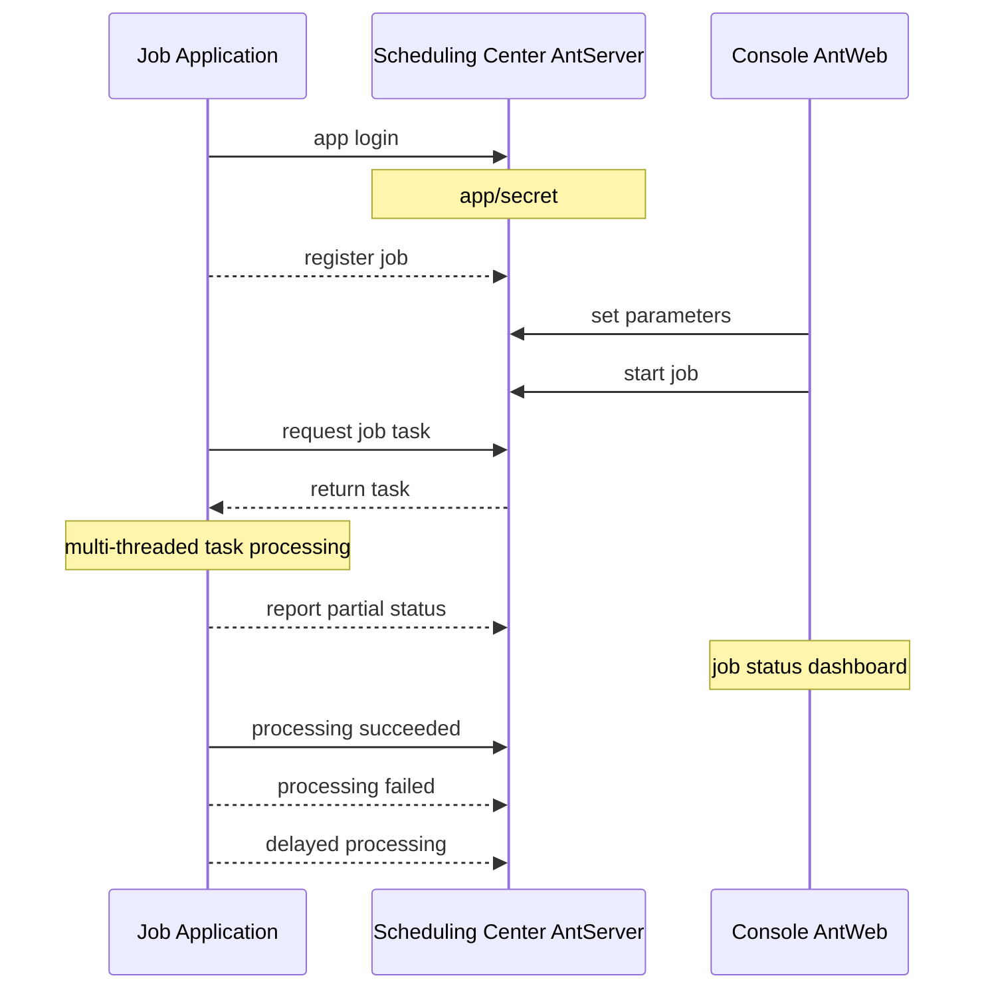
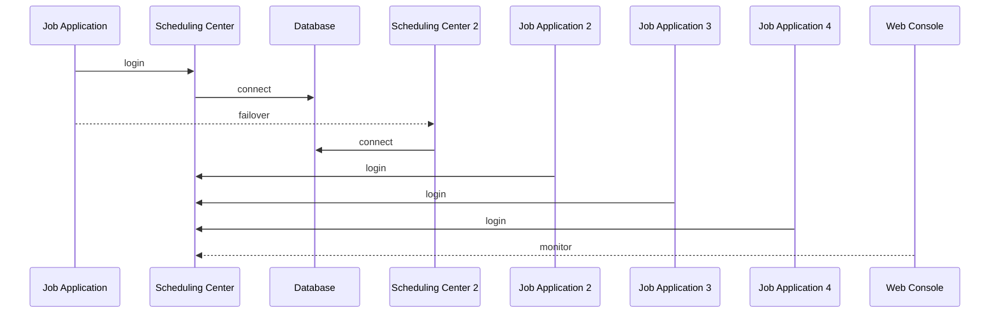

# NewLife.AntJob - アントスケジューリング


[](https://github.com/NewLifeX/AntJob/actions/workflows/test.yml)
[](Doc/多语言本地化.md)


[](https://github.com/NewLifeX/AntJob/graphs/contributors)


<!-- lang:start -->
🌐 [English](README.md) | [简体中文](README.zh-CN.md) | [繁體中文](README.zh-TW.md) | [Español](README.es.md) | [Deutsch](README.de.md) | [Français](README.fr.md) | [Português](README.pt.md) | [Русский](README.ru.md) | [한국어](README.ko.md) | [العربية](README.ar.md)
<!-- lang:end -->


**AntJob** は純粋な .NET で構築された分散タスク／リアルタイムデータスケジューリングプラットフォームです。大きなジョブを時間／データのスライスに分割して並列実行し、柔軟に増減できるワーカーノードへ配信します。失敗時はリトライし、バックフィル（補填）のための再実行も可能で、Web コンソールからリアルタイムに監視できます。

オープンソース： [https://github.com/NewLifeX/AntJob](https://github.com/NewLifeX/AntJob)  
チュートリアル： [https://newlifex.com/blood/antjob](https://newlifex.com/blood/antjob)  
ライブデモ（ホスト環境）： [http://ant.newlifex.com](http://ant.newlifex.com/)  

**目次**： [クイックスタート](#クイックスタート) · [主な機能](#主な機能) · [エコシステムマップ](#エコシステムマップ) · [ドキュメント](#ドキュメント) · [貢献](#貢献) · [新生命開発チーム](#新生命開発チーム) · [ライセンス](#ライセンス)

## クイックスタート

### インストール

```bash
dotnet add package NewLife.AntJob
```

### テンプレート（推奨）

```
dotnet new install NewLife.Templates
# Create a project with an AntJob sample
dotnet new antjob --name TestJob
cd TestJob
dotnet run
```

### 最小サンプル

以下のソースコードは [Samples/HisAgent](https://github.com/NewLifeX/AntJob/tree/master/Samples/HisAgent) にあります。.NET Core 3.1 以降のプロジェクトを作成し、NuGet から AntJob を参照してください。Scheduler をインスタンス化し、ネットワークプロバイダーを構成します。

```csharp
using AntJob;
using HisAgent;
using NewLife.Log;
using NewLife.Model;
using Stardust;

// Enable console logging and intercept all exceptions
XTrace.UseConsole();

var services = ObjectContainer.Current;
services.AddStardust();

services.AddAntJob()
    .AddHandler<HelloJob>();

// Friendly shutdown
var host = services.BuildHost();
await host.RunAsync();
```

最初のスケジュールジョブハンドラーを追加します：

```csharp
using System;
using AntJob;

internal class HelloJob : Handler
{
    public HelloJob() => Job.Cron = "7/30 * * * * ?";

    public override Int32 Execute(JobContext ctx)
    {
        // Time of the current task
        var time = ctx.Task.DataTime;
        WriteLog("NewLife AntJob! Current task time: {0}", time);
        return 1; // Number of successfully processed items
    }
}
```

ジョブハンドラーは `Handler` を継承し、`Execute` をオーバーライドして業務ロジックを実装する必要があります。コンストラクターで設定した Time と Step は初回登録にのみ使用され、以降の変更はコンソールで行います。

または、非同期のスケジュールジョブハンドラーを使用します：

```csharp
using System;
using AntJob;

internal class HelloJob : Handler
{
    public HelloJob() => Job.Cron = "7/30 * * * * ?";

    public override async Task<Int32> ExecuteAsync(JobContext ctx)
    {
        using var span = Tracer?.NewSpan("HelloJob", ctx.Task.DataTime);

        // Time of the current task
        var time = ctx.Task.DataTime;
        WriteLog("NewLife AntJob! Current task time: {0}", time);
        if (!ctx.Task.Data.IsNullOrEmpty()) WriteLog("Data: {0}", ctx.Task.Data);

        var state = Rand.NextString(16);
        var http = new HttpClient { BaseAddress = new Uri("https://newlifex.com") };
        http.SetUserAgent();
        var rs = await http.GetAsync<IDictionary<String, Object>>("/cube/info", new { state });

        if (rs.TryGetValue("state", out var value) && value is String str)
        {
            Trace.Assert(state == str, "Returned state does not match");
        }

        // Number of successfully processed items
        return 1;
    }
}
```

### 実行

初回実行時は、`AntSetting` の構成に基づいて `tcp://127.0.0.1:9999` と `tcp://ant.newlifex.com:9999`（主系／待機系）への接続を自動的に試みます。`Server` に `http(s)://` 形式のアドレスを設定した場合は、自動的に HTTP チャネルへ切り替わり、WebSocket 経由でダウンストリーム通知を受信します。

ログ例：

```sql
21:33:08.470  1 N - Start job scheduling engine [AntJob.Providers.NetworkJobProvider], jobs [1], timer 5s
21:33:08.471  1 N - HelloJob start work False range (2020-04-09 00:00:00, 0001-01-01 00:00:00) Offset=15 Step=10 MaxTask=8
```

### Web コンソールとリセット

AntJob.Web（IIS / Kestrel / Docker）をデプロイし、クライアントの Server 設定をそのサービスアドレスへ変更します。独立した AntServer は不要です：

```json
{
  "Ant": {
    "Server": "https://ant.example.com",
    "AppId": "MyJobApp",
    "Secret": ""
  }
}
```

クライアントはログイン後、HTTP ハートビートを介して `/AntJob/Notify` の WebSocket 長接続を確立し、ジョブ変更やメッセージ到達の通知を受信します。WebSocket が利用できない場合でも、ポーリング周期で動作を継続します。コンソールでジョブを有効化すると、スケジューリングセンターがタスクを時点ごとにスライスして配信します。タスク詳細の確認、エラーのリトライ、履歴を再計算するためのタスク一括リセットが可能です。複数の Agent を起動すればスケールアウトでき、各タスクは必ず 1 つのノードだけが実行し、失敗はポリシーに従ってリトライされます。

### ローカルファイルスケジューリングのみ

`NetworkJobProvider` を構成しない場合は既定のローカル Provider が使用され、単一マシンでのオフラインなデバッグに適しています。

### Docker（例示）

> 公式イメージはまだ提供されていません。組織内でパッケージ化できます：

```
FROM mcr.microsoft.com/dotnet/aspnet:8.0 AS base
WORKDIR /app
COPY ./publish/ .
ENTRYPOINT ["dotnet","AntJob.Web.dll"]
```

### デプロイトポロジー

| トポロジー | 説明 |
| --- | --- |
| シングルインスタンス | Web + Server + JobApp を同一マシンに置き、開発とテストに使用 |
| デュアルセンター高可用 | カンマ区切りの 2 つのスケジューリングセンターアドレス（主系／待機系）で、クライアントは自動フェイルオーバー |
| マルチ実行クラスタ | 業務や負荷でグループ化した複数の実行ノードが、統一されたスケジューリングセンターへ接続 |
| ハイブリッド | 本番環境はデュアルセンター + 複数の実行ノード、テスト／ステージングは別クラスタ |

## 主な機能

AntJob は「アリの引っ越し」の発想で、あらゆる大きなタスクを並列実行できる小さな断片に分割します。この発想は 2008 年の金融危機のさなか、上海・陸家嘴で、金融機関の低コストかつ高効率なデータ分析への切実な需要に応えて生まれました。類似システムには XxlJob、Quartz、Hangfire、Airflow（一部のシナリオ）や自作の定期スクリプトクラスタなどがあります。AntJob は「データ／時間スライス + リトライ + 複数モードの統一」と、企業の既存 .NET エコシステムへの非侵襲な統合を重視しており、兆件規模のスケジューリングと数百億件のデータクレンジング実績で検証されています。

<details>
<summary><b>典型的なユースケース</b> (4)</summary>

| シナリオ | AntJob が適する理由 |
| --- | --- |
| 膨大なログ／注文／取引／デバイスデータ | 増え続けるデータ集合に対する継続的な抽出とリアルタイム計算 |
| 時間ウィンドウによるローリング集計 | 秒／分／時／日／独自 Cron の各ウィンドウをスライス単位で計算 |
| データのバックフィルと再計算 | 履歴範囲をリセットして再実行でき、稼働中のウィンドウに影響しない |
| 高並列のバッチ処理 | 複数のデータセンターへ分散し、ノード数は伸縮自在 |

</details>

<details>
<summary><b>コア機能</b> (11)</summary>

| 機能 | 得られるもの |
| --- | --- |
| 複数のスケジューリングモード | 時間、データウィンドウ、メッセージ、Cron、SQL 文、C# 動的スクリプト |
| ジョブの時間／データスライス | 秒単位の粒度まで対応し、追いかけ実行・バックフィル・一括リセットが可能 |
| 信頼性の高いタスク配信 | 失敗時は遅延リトライを自動実行し、依存先の一時的な障害に耐える |
| 伸縮自在なクラスタ | 実行ノードは本質的にステートレスで、いつでもスケールアウト／インできる |
| 通信プロトコル | HTTP REST + WebSocket ダウンストリーム通知（推奨の既定）に加え、NewLife.Remoting TCP RPC と互換 |
| 可視化モニタリング | Web コンソールでジョブ曲線、タスク状態、オンラインノードをリアルタイム表示 |
| ジョブパネル | コンソールからパラメーターを動的に調整し、実行時統計を確認 |
| プラグイン可能なプロバイダー | ネットワーク、ファイル、ローカル独自ソース向けの `IJobProvider` 実装 |
| 軽量な依存関係 | コアは NewLife 自前のエコシステム（ログ、構成、トレーシング）に依存し、外部の複雑さを抑える |
| クロスプラットフォーム／マルチ TFM | .NET Framework 4.5 から .NET 8/9 まで |
| 厳密名と長期的な互換性 | 企業のプライベートデプロイや二次パッケージ化に便利 |

</details>

<details>
<summary><b>スケジューリングモード</b> (5)</summary>

| モード | 用途、粒度、主要フィールド |
| --- | --- |
| 時間 / Cron | 秒から Cron までの粒度で一般的な定期タスクを実行し、`Job.Time` / `Cron` で駆動。Cron 式は固定の Start+Step 間隔を置き換える |
| データ（時間ウィンドウ） | Start / End で駆動し、新規追加データを時間スライス（秒〜任意のウィンドウ）で処理。欠落したウィンドウは自動補填され、ジャーナル／ログテーブルのローリング計算に最適 |
| メッセージ | パッシブなリアルタイムメッセージ駆動モード。外部からプッシュ／キューされたメッセージの `Body` が 1 つのタスクになる |
| SQL / データ駆動 | データテーブルをスキャンし、主キー／時間でスライス（バッチ）。履歴バックフィルや一括移行でよく使われる拡張コンポーネント |
| C# 動的スクリプト | 小さなロジックの試験やホット更新向け。スクリプトは実行時にコンパイルされ、権限／サンドボックスの制約を受ける |

</details>

<details>
<summary><b>アーキテクチャとコアモジュール</b> (9)</summary>

| コンポーネント | 責務 |
| --- | --- |
| AntJob.Server | スケジューリングセンターのサーバーロジック。Job / Task のメタデータ、スライス、割り当て、リトライポリシー |
| AntJob.Web | NewLife.Cube 上に構築された可視化管理プラットフォーム。マルチテナントの App 分離、権限、モニタリング |
| AntJob（ライブラリ） | クライアント SDK。Scheduler と Handler の抽象、ネットワーク通信、コンテキストラッパー |
| AntJob.Extensions | 拡張スケジューリング種別。SqlMessage、DataHandler、MessageHandler、CSharpHandler など |
| Samples | サンプルプロジェクト（HisAgent、HisData、HisWeb、HelloWork） |
| Scheduler | Handler のライフサイクルとタスク配信を管理する中核のスケジューリングエンジン |
| Handler | 業務モジュールの基底クラス。各モジュールが `Execute` / `ExecuteAsync` を実装 |
| IJobProvider | ネットワーク、ローカル、独自ソースに対応するタスクソースプロバイダー |
| JobContext | 1 つのタスクの実行環境と状態。統計やログのヘルパーを含む |

</details>

<details>
<summary><b>信頼性と整合性</b> (6)</summary>

| 保証 | 仕組み |
| --- | --- |
| タスク割り当ての原子性 | 同じタスク ID は必ず 1 つのノードだけが取得する |
| ステートマシン | 準備完了 -> 処理中 -> 完了 / エラー / キャンセル |
| 自動リトライ | 失敗したタスクは遅延（既定 1 分）後にリトライし、最大 N 回まで（構成可能） |
| リセット機構 | 履歴範囲を一括リセットして再計算（バックフィル／修正） |
| 冪等性 | 業務ロジックは主キー／時間ウィンドウに基づく冪等な書き込みを実装すべき |
| ハートビートとオンラインテーブル | ノードのオンライン／オフラインをリアルタイムに検出し、伸縮自在なスケーリングを支える |

</details>

<details>
<summary><b>設定</b> (7)</summary>

| 項目 | 意味 |
| --- | --- |
| `Server` | スケジューリングセンターのアドレス。`http(s)://` は HTTP + WebSocket チャネル、`tcp://` は RPC 互換チャネルを使用。例：`https://a.example.com,https://b.example.com` や `tcp://a:9999,tcp://b:9999` |
| `AppID` / `Secret` | アプリケーション分離用の資格情報。自動登録または手動配布 |
| `Debug` | より詳細なログを出力するデバッグスイッチ |
| `UseRegistry` | Stardust レジストリ経由でサービスアドレスを解決するかどうか（既定 true）。ゲートウェイ経由で直接接続する場合は false に設定 |
| `MessageIdlePeriod` | メッセージ型ジョブのアイドル要求周期（秒、既定 15）。HTTP チャネルのメッセージ通知が届くと即座に起床する |
| データベース | Web / Server 側の接続は XCode のリバースエンジニアリングによりテーブルを自動作成 |
| Stardust 統合 | Web / Server 側にレジストリ、APM、構成センターの機能を任意で提供 |

</details>

<details>
<summary><b>拡張メカニズム</b> (6)</summary>

| 仕組み | 使い方 |
| --- | --- |
| カスタムハンドラー | `Handler` を継承し、`Execute(JobContext ctx)` をオーバーライドして処理成功件数を返す |
| カスタムデータソースプロバイダー | `IJobProvider` を実装（Kafka / Redis Stream / REST など） |
| メッセージスケジューリング | `MessageHandler` が任意のメッセージ本文をタスクに変換 |
| SQL / データ駆動 | `SqlMessage` + `DataHandler` でデータをスキャンしてスライス |
| 動的スクリプト | `CSharpHandler` によりスクリプトで迅速に試行錯誤できる（本番では権限を制限） |
| プラグインベースのパッケージ化 | 厳密名とマルチ TFM 対応により、Handler を別アセンブリに置いてホットプラグ可能 |

</details>

<details>
<summary><b>パフォーマンスとキャパシティプランニング</b> (7)</summary>

| 項目 | 指針 |
| --- | --- |
| ジョブあたりのスライス量 | タスク履歴は数百億件規模まで。データベースの容量に依存 |
| ノードあたりのスループット | Handler の業務ロジックに依存。フレームワークのスケジューリングオーバーヘッドは最小（インメモリのスケジューリング制御） |
| GC プレッシャー | 内部でオブジェクトプールとキャッシュを使用し、NewLife.Core の最適化を活用 |
| スライス粒度 | 適度に保つ。細かすぎるスライスはスケジューリングメタデータのオーバーヘッドを増やす |
| データベース負荷 | バッチ I/O やキャッシュでデータベース負荷を低減 |
| 大規模な計算ウィンドウ | サブウィンドウループを伴うデータモードを推奨 |
| 実績規模 | 基金 SMS の大量送信、単一テーブル 60 億行のスライス、1 日 1,200 万件の宅配注文、数百億件のデータクレンジング、兆件規模の年間スケジューリング |

</details>

<details>
<summary><b>コア概念</b> (5)</summary>

| 概念 | 意味 |
| --- | --- |
| Job | ジョブ構成。時間／ステップ／Cron／モード／同時実行上限など |
| Task | ジョブをインスタンス化した後の最小実行単位。時点または区間とメッセージ本文を持つ |
| Handler | 業務ロジックの担い手。ライフサイクルは Scheduler が管理 |
| JobContext | 1 つのタスクの実行コンテキスト。Task、統計、ログのヘルパーを含む |
| IJobProvider | タスクソースプロバイダー（ネットワーク／ローカル／カスタム） |

</details>

<details>
<summary><b>他のスケジューラーとの比較</b> (4)</summary>

| システム | AntJob との違い |
| --- | --- |
| Quartz.NET | 純粋なスケジューリング／Cron ライブラリ。AntJob はデータ／メッセージのスライス、再計算、簡易なクラスタシャーディングを追加 |
| Hangfire | 永続化されたバックグラウンドジョブ。AntJob は単発のタスクキューではなく、継続的な時間／データスライスに注力 |
| XXL-JOB | Java エコシステム。AntJob は .NET ネイティブで、複数モードの統一と動的スクリプトを備える |
| Airflow | DAG オーケストレーション。AntJob はより軽量で高頻度のウィンドウ処理に注力し、Airflow を補完できる |

</details>

<details>
<summary><b>FAQ</b> (5)</summary>

| 質問 | 回答 |
| --- | --- |
| 登録直後のジョブが既定で停止しているのはなぜ？ | パラメーター設定前に大量の起動が発生するのを防ぐため。Web コンソールで手動で有効化する |
| 1 か月分のデータを再計算するには？ | ジョブパネルで開始時刻を変更して指定時間範囲をリセットするか、タスクを複数選択してリセットする |
| 失敗したタスクは後続のタスクをブロックする？ | いいえ。失敗したタスクは遅延リトライされ、その間も他のウィンドウのスケジューリングは継続する |
| HTTP/WebSocket だけを使える？ | はい。`Server` に `http://` または `https://` のアドレスを設定すると、クライアントは独立した AntServer なしで HTTP REST + WebSocket 通知を自動的に使用する。`tcp://` アドレスでは RPC 互換チャネルを維持する |
| スクリプトのリスクを抑えるには？ | 使用しない CSharpHandler を無効化するか、最小権限の構成で別プロセスに分離する |

</details>

<details>
<summary><b>v4 アップグレードの進捗</b> (5)</summary>

| 項目 | 状態 |
| --- | --- |
| HTTP アクセス | 完了：AntWeb がスケジューリングサービスを提供し、AntServer は不要。WebSocket ダウンストリーム通知は HTTP チャネルに同梱 |
| 強化された定期スケジューリング | 完了：Cron 式に対応し、固定の Start+Step ステップを段階的に置き換え |
| 事前生成タスク | 計画中：時刻どおりに実行（精度向上、評価予定） |
| アクティブタスクの遅延 | 完了：実行中に遅延を要求でき、失敗としてカウントしない |
| より多くのスケジューリングモード | 計画中：通常の AntAgent。SQL スケジューリング / C# スケジューリングを取り込み、抽出モードとプッシュモードを順次追加 |

</details>

<details>
<summary><b>v4 以降のロードマップ</b> (4)</summary>

| 項目 | 説明 |
| --- | --- |
| アクティブタスク遅延 API | 実行中に遅延を評価し、エラーとしてカウントせず後で実行 |
| プラグイン可能なアラートチャネル | メール / Webhook / WeCom などのチャネル |
| 監視メトリクスのエクスポート | Prometheus / OpenTelemetry 向けの多次元エクスポート |
| オプションの DAG レイヤー | コアが安定した後の DAG / 依存関係オーケストレーション |

</details>

### アーキテクチャ図

コンポーネントトポロジー

```
+----------------------+            +-------------------------+
|  Execution Node(Agent)|  RPC/TCP  |  Scheduling Center(Server)|
|  - Scheduler         |            | - JobService / Task     |
|  - Handlers(business)|            | - State & metadata      |
+----------+-----------+            +-----------+-------------+
           |  Sync logs/tracing (optional Stardust)  |
           v
    +-------------+      Web UI / API      +------------------+
    | DB / Storage|  <------------------>  | Web Console AntWeb|
    +-------------+                         +------------------+
```

ジョブアプリケーション（IJob を実装）



スケジューリングセンターの主従アーキテクチャ



## エコシステムマップ

NewLife は、独立したバージョン管理を行うオープンソースプロジェクトの階層型エコシステムです。以下のマップはすべての NewLife リポジトリで逐語的に同一の内容を共有しており、各プロジェクトはコードリポジトリと主要な NuGet パッケージにリンクしています。

| プロジェクト | 概要 | ダウンロード数 |
| --- | --- | --- |
| **基盤** | | |
| [NewLife.Core](https://github.com/NewLifeX/X) | ログ、構成、キャッシュ、ネットワーク、シリアライズ、スケジューリング、APM トレーシング。 | [](https://www.nuget.org/packages/NewLife.Core) |
| [NewLife.XCode](https://github.com/NewLifeX/NewLife.XCode) | データミドルウェア：単一テーブルで数百億件級、自動シャーディング、読み書き分離、10 種類以上のデータベースに対応。 | [](https://www.nuget.org/packages/NewLife.XCode) |
| [NewLife.Net](https://github.com/NewLifeX/NewLife.Net) | 高性能ネットワークライブラリ：単一マシンで 177 万 pps、14.5 Gbps（TCP 1KB、2026-10 実測）、400 万 Tcp 長接続。 | [](https://www.nuget.org/packages/NewLife.Net) |
| [NewLife.Remoting](https://github.com/NewLifeX/NewLife.Remoting) | CS アプリケーションと IoT デバイス向けのプロトコル通信と RPC フレームワーク。 | [](https://www.nuget.org/packages/NewLife.Remoting) |
| [NewLife.Agent](https://github.com/NewLifeX/NewLife.Agent) | .NET アプリケーションを OS デーモンとしてインストール：Windows サービスと Linux systemd。 | [](https://www.nuget.org/packages/NewLife.Agent) |
| [NewLife.Templates](https://github.com/NewLifeX/NewLife.Zero) | コンソール、Web、API、サービス、データ、IoT 向けの `dotnet new` プロジェクトテンプレート。 | [](https://www.nuget.org/packages/NewLife.Templates) |
| **データとメッセージング** | | |
| [NewLife.Redis](https://github.com/NewLifeX/NewLife.Redis) | マイクロ秒級の遅延、数百万 ops/s のスループット、メッセージキュー内蔵の Redis クライアント。 | [](https://www.nuget.org/packages/NewLife.Redis) |
| [NewLife.RocketMQ](https://github.com/NewLifeX/NewLife.RocketMQ) | Apache RocketMQ と Alibaba Cloud Message Queue に対応した純マネージド RocketMQ クライアント。 | [](https://www.nuget.org/packages/NewLife.RocketMQ) |
| [NewLife.MQTT](https://github.com/NewLifeX/NewLife.MQTT) | MQTT クライアントとサーバー。Alibaba Cloud IoT への接続を含みます。 | [](https://www.nuget.org/packages/NewLife.MQTT) |
| [NewLife.NovaDb](https://github.com/NewLifeX/NewLife.NovaDb) | C# 製ハイブリッドデータベース：組み込み/ネットワークの両モード、リレーショナル、時系列、メッセージキュー、KV を 1 つに。 | [](https://www.nuget.org/packages/NewLife.NovaDb) |
| [NewLife.MySql](https://github.com/NewLifeX/NewLife.MySql) | NewLife データスタック上に構築された MySql ドライバーとヘルパー層。 | [](https://www.nuget.org/packages/NewLife.MySql) |
| **Web、AI、分散** | | |
| [NewLife.Cube](https://github.com/NewLifeX/NewLife.Cube) | 高速管理プラットフォームフレームワーク：権限、SSO、OAuth サーバー、CRUD スキャフォールディング。 | [](https://www.nuget.org/packages/NewLife.Cube) |
| [Stardust](https://github.com/NewLifeX/Stardust) | 分散サービスプラットフォーム：ノード管理、APM、構成センター、登録センター、リリースセンター。 | [](https://www.nuget.org/packages/NewLife.Stardust) |
| [AntJob](https://github.com/NewLifeX/AntJob) | シャーディング、リトライ、バックフィルに対応した分散タスクとリアルタイムデータのスケジューリングプラットフォーム。 | [](https://www.nuget.org/packages/NewLife.AntJob) |
| [NewLife.AI](https://github.com/NewLifeX/NewLife.AI) | 46 社の LLM プロバイダーに統一接続するクライアントと、すぐに使える Web チャットアプリ ChatAI。 | [](https://www.nuget.org/packages/NewLife.AI) |
| **産業と IoT** | | |
| [NewLife.IoT](https://github.com/NewLifeX/NewLife.IoT) | プロトコル契約とデバイス抽象を定義する IoT 標準ライブラリ。 | [](https://www.nuget.org/packages/NewLife.IoT) |
| [NewLife.Modbus](https://github.com/NewLifeX/NewLife.Modbus) | NewLife.IoT 上に実装された Modbus TCP/RTU/ASCII。 | [](https://www.nuget.org/packages/NewLife.Modbus) |
| [NewLife.Siemens](https://github.com/NewLifeX/NewLife.Siemens) | NewLife.IoT 上に実装されたシーメンス PLC プロトコル。 | [](https://www.nuget.org/packages/NewLife.Siemens) |
| [NewLife.Omron](https://github.com/NewLifeX/NewLife.Omron) | NewLife.IoT 上に実装されたオムロン PLC プロトコル。 | [](https://www.nuget.org/packages/NewLife.Omron) |
| [NewLife.Melsec](https://github.com/NewLifeX/NewLife.Melsec) | NewLife.IoT 上に実装された三菱 Melsec PLC プロトコル。 | [](https://www.nuget.org/packages/NewLife.Melsec) |
| [NewLife.OPC](https://github.com/NewLifeX/NewLife.OPC) | 産業データアクセス向けの OPC クライアント。 | — |
| [NewLife.BACnet](https://github.com/NewLifeX/NewLife.BACnet) | BACnet ビル管理プロトコルスタック。 | [](https://www.nuget.org/packages/NewLife.BACnet) |
| [ZeroIoT](https://github.com/NewLifeX/ZeroIoT) | ゲートウェイとデバイス管理を備えた軽量なオープンソース IoT プラットフォーム。 | — |
| **車載テレマティクス** | | |
| [NewLife.JT808](https://github.com/NewLifeX/NewLife.JT808) | JT/T 808 車両位置情報プロトコル：70 以上のメッセージボディ、2011/2013/2019 に対応。 | [](https://www.nuget.org/packages/NewLife.JT808) |
| [NewLife.JT809](https://github.com/NewLifeX/NewLife.JT809) | 運輸管理部門向けの JT/T 809 プラットフォーム間プロトコル。 | [](https://www.nuget.org/packages/NewLife.JT809) |
| [NewLife.JT1078](https://github.com/NewLifeX/NewLife.JT1078) | JT/T 1078 車載ビデオ：RTP 解析、FLV/fMP4 リマックス、ライブ配信。 | [](https://www.nuget.org/packages/NewLife.JT1078) |
| **ドメインコンポーネント** | | |
| [NewLife.Office](https://github.com/NewLifeX/NewLife.Office) | Excel、Word、PPT、PDF など 15 以上のドキュメント形式を 1 パッケージで。 | [](https://www.nuget.org/packages/NewLife.Office) |
| [NewLife.Audio](https://github.com/NewLifeX/NewLife.Audio) | クロスプラットフォーム音声：コーデック、デバイス IO、DSP、コンテナ、ストリーミング。 | [](https://www.nuget.org/packages/NewLife.Audio) |
| [NewLife.Video](https://github.com/NewLifeX/NewLife.Video) | ビデオコーデック、コンテナ形式、フレーム処理、ストリーミング。 | [](https://www.nuget.org/packages/NewLife.Video) |
| [NewLife.Map](https://github.com/NewLifeX/NewLife.Map) | 百度地図、高徳地図、テンセント地図、天地図を統一インターフェイス化。ジオコーディングと座標変換に対応。 | [](https://www.nuget.org/packages/NewLife.Map) |
| [NewLife.IP](https://github.com/NewLifeX/NewLife.IP) | IPv4 位置情報：オフラインのメモリマップデータベースとオンライン API のフォールバック。 | [](https://www.nuget.org/packages/NewLife.IP) |
| **ツールと製品** | | |
| [CrazyCoder](https://github.com/NewLifeX/XCoder) | 開発者向けツールボックス：ネットワーク、シリアルポート、暗号化、正規表現、Modbus、MQTT。 | [](https://www.nuget.org/packages/NewLife.XCoder) |
| [GitCandy](https://github.com/NewLifeX/GitCandy) | セルフホスト型 Git ソースコード管理システム。 | — |
| [LuckyClover](https://github.com/NewLifeX/LuckyClover) | 古いホストから起動した際に対応する .NET ランタイムを自動インストールします。 | — |

> バッジは各プロジェクトの主要パッケージを示します。テーマ、拡張、サテライトパッケージは各 NuGet ページを参照してください。ここに記載していない 30 以上のパッケージ（FTP、LoRa、Office 拡張、各種プロトコルドライバーなど）は [NewLifeX 組織](https://github.com/NewLifeX) と [newlifex.com](https://newlifex.com) で公開しています。 本表は NewLife.Core の README を保守元としています。

## ドキュメント

| ドキュメント | 説明 |
| --- | --- |
| [要件定義](Doc/需求文档.md) | ビジョン、中核目標、7 つの主要モジュールの機能要件、および先送り項目一覧 |
| [機能一覧](Doc/功能清单.md) | 85 機能の実装／テスト／コメントの 3 次元ステータス追跡（必須の分割チェックを含む） |
| [アーキテクチャ](Doc/架构设计.md) | レイヤードアーキテクチャ、コアコンポーネントの責務、主要プロセスのシーケンス図、設計判断 |
| [HTTP と WebSocket のデプロイ](Doc/HTTP与WebSocket部署.md) | ゲートウェイ構成、Redis ブロードキャスト、移行手順、トラブルシューティングチェックリスト |
| [コアコンポーネントのベンチマーク](Doc/Benchmark/核心组件性能测试.md) | 時刻表現、テンプレート置換、SQL フラグメント解析のベンチマークデータとチューニングの指針 |

- チュートリアル： [https://newlifex.com/blood/antjob](https://newlifex.com/blood/antjob)
- ライブデモ： [http://ant.newlifex.com](http://ant.newlifex.com/)
- 多言語 README のルール： [Doc/多语言本地化.md](Doc/多语言本地化.md)

## 貢献

### ビルドとテスト

```bash
dotnet build -c Release
dotnet test -c Release
# Only the main test project (net10.0), used by CI on win-x64 and linux-arm64
dotnet test AntTest/AntTest.csproj -c Release
```

- CI： `.github/workflows/test.yml` がビルド、テスト実行、ローカライズと README の言語切り替えをチェック
- README チェック： `pwsh -File sync-readme-languages.ps1 -Check`、`pwsh -File sync-readme-package.ps1 -Check` と `pwsh -File check-readme-structure.ps1`
- ベンチマーク： `Benchmark/AntJob.Benchmarks`（BenchmarkDotNet）

### リポジトリ構成

```
AntJob/                 Client core library
AntJob.Extensions/      Extension handlers/messages/SQL, etc.
AntJob.Server/          Scheduling-center core service logic (JobService, etc.)
AntJob.Web/             Razor Pages + Cube admin console
AntJob.Data/            Base data models (entity layer)
Samples/                Sample projects (HisAgent, HisData, HisWeb, HelloWork)
AntTest/                Unit/integration tests
Doc/                    Documentation and assets
```

### リリース

`v` で始まるタグ（例：`v5.0.2026.1024`）をプッシュすると `.github/workflows/publish.yml` が起動します。ワークフローは `AntJob`、`AntJob.Extensions`、`AntJob.Web` をパッケージ化して NuGet.org と GitHub Packages へ公開し、対応する `ChangeLog.md` のセクションからノートを取得した GitHub Release を作成します（アセットには nupkg と snupkg が含まれます）。手動実行ではパッケージの公開のみを行い、Release は作成しません。master 上で `AntJob/` または `AntJob.Extensions/` を変更するコミットは、`publish-beta.yml` によってベータパッケージも生成します。

### フィードバック

- 提出前に `dotnet build` と関連テストが通ることを確認し、リポジトリのコードスタイルに従ってください。
- バグや提案は [Issue](https://github.com/NewLifeX/AntJob/issues) で報告してください。Star と PR を歓迎します。

## 新生命開発チーム


新生命チームは 2002 年に設立され、20 年以上にわたり .NET と IoT の技術エコシステムに注力し、100 近いオープンソースプロジェクトを主導し（うち 34 が主要プロジェクト）、電力、物流、医療、産業制御、インターネットなどの業界にソフトウェアとハードウェアを一体化したソリューションを提供しています。「学問に先後なし、達する者が師である」を信条としています。

オープンソースコンポーネントは NuGet で累計 <!--nuget-total:start-->6.48M<!--nuget-total:end--> 回ダウンロードされています（エコシステム全体、2026-10 時点）。

ウェブサイト：https://newlifex.com · オープンソース組織：https://github.com/NewLifeX

<details>
<summary>WeChat 公式アカウント：智能大石头（スキャンしてフォロー）</summary>


</details>

## ライセンス

本プロジェクトは [MIT](https://github.com/NewLifeX/AntJob/blob/master/LICENSE) ライセンスで提供されています © 2002-2026 NewLife Team。自由に使用、変更、再配布できます。

> このプロジェクトがお役に立ったら、Star を付ける、チーム内で共有する、Issue/PR で改善提案を送るなどしていただけると幸いです。
