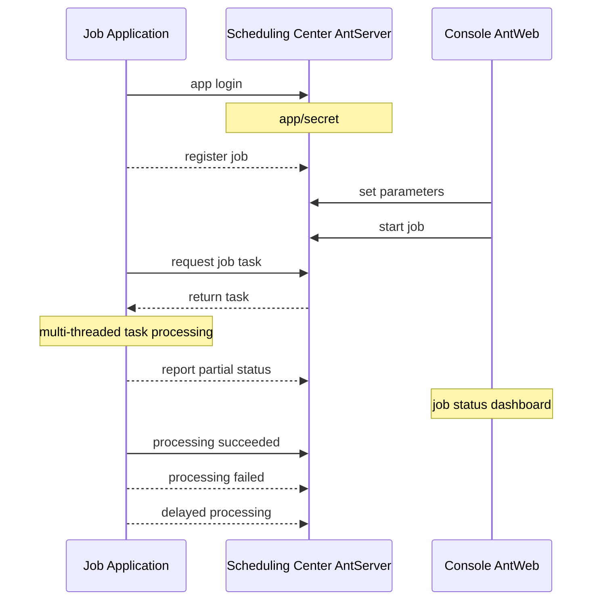
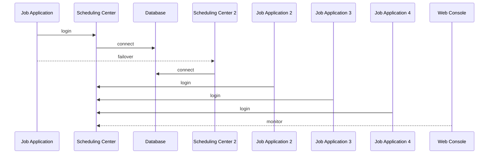

# NewLife.AntJob - Ant 스케줄링


[](https://github.com/NewLifeX/AntJob/actions/workflows/test.yml)
[](Doc/多语言本地化.md)


[](https://github.com/NewLifeX/AntJob/graphs/contributors)


<!-- lang:start -->
🌐 [English](README.md) | [简体中文](README.zh-CN.md) | [繁體中文](README.zh-TW.md) | [Español](README.es.md) | [Deutsch](README.de.md) | [日本語](README.ja.md) | [Français](README.fr.md) | [Português](README.pt.md) | [Русский](README.ru.md) | [العربية](README.ar.md)
<!-- lang:end -->


**AntJob**은 순수 .NET으로 구현한 분산 작업 및 실시간 데이터 스케줄링 플랫폼입니다. 대형 작업을 시간/데이터 슬라이스로 분할해 탄력적인 워커 노드에 분배하고, 실패 시 재시도하며 재실행(백필)로 보완하고, 웹 콘솔에서 실시간으로 모니터링합니다.

오픈소스: [https://github.com/NewLifeX/AntJob](https://github.com/NewLifeX/AntJob)  
튜토리얼: [https://newlifex.com/blood/antjob](https://newlifex.com/blood/antjob)  
라이브 데모(호스팅 환경): [http://ant.newlifex.com](http://ant.newlifex.com/)  

**목차**: [빠른 시작](#빠른-시작) · [주요 기능](#주요-기능) · [생태계 지도](#생태계-지도) · [문서](#문서) · [기여하기](#기여하기) · [뉴라이프 개발팀](#뉴라이프-개발팀) · [라이선스](#라이선스)

## 빠른 시작

### 설치

```bash
dotnet add package NewLife.AntJob
```

### 템플릿(권장)

```
dotnet new install NewLife.Templates
# Create a project with an AntJob sample
dotnet new antjob --name TestJob
cd TestJob
dotnet run
```

### 최소 예제

다음 소스 코드는 [Samples/HisAgent](https://github.com/NewLifeX/AntJob/tree/master/Samples/HisAgent)에 있습니다. .NET Core 3.1+ 프로젝트를 만들고 NuGet에서 AntJob을 참조한 뒤, Scheduler를 인스턴스화하고 네트워크 공급자를 구성합니다.

```csharp
using AntJob;
using HisAgent;
using NewLife.Log;
using NewLife.Model;
using Stardust;

// Enable console logging and intercept all exceptions
XTrace.UseConsole();

var services = ObjectContainer.Current;
services.AddStardust();

services.AddAntJob()
    .AddHandler<HelloJob>();

// Friendly shutdown
var host = services.BuildHost();
await host.RunAsync();
```

첫 번째 예약 작업 핸들러를 추가합니다:

```csharp
using System;
using AntJob;

internal class HelloJob : Handler
{
    public HelloJob() => Job.Cron = "7/30 * * * * ?";

    public override Int32 Execute(JobContext ctx)
    {
        // Time of the current task
        var time = ctx.Task.DataTime;
        WriteLog("NewLife AntJob! Current task time: {0}", time);
        return 1; // Number of successfully processed items
    }
}
```

작업 핸들러는 `Handler`를 상속하고 `Execute`를 재정의해 비즈니스 로직을 구현해야 합니다. 생성자에서 설정한 Time과 Step은 최초 등록에만 사용되며, 이후 변경은 콘솔에서 수행합니다.

또는 비동기 예약 작업 핸들러를 사용할 수 있습니다:

```csharp
using System;
using AntJob;

internal class HelloJob : Handler
{
    public HelloJob() => Job.Cron = "7/30 * * * * ?";

    public override async Task<Int32> ExecuteAsync(JobContext ctx)
    {
        using var span = Tracer?.NewSpan("HelloJob", ctx.Task.DataTime);

        // Time of the current task
        var time = ctx.Task.DataTime;
        WriteLog("NewLife AntJob! Current task time: {0}", time);
        if (!ctx.Task.Data.IsNullOrEmpty()) WriteLog("Data: {0}", ctx.Task.Data);

        var state = Rand.NextString(16);
        var http = new HttpClient { BaseAddress = new Uri("https://newlifex.com") };
        http.SetUserAgent();
        var rs = await http.GetAsync<IDictionary<String, Object>>("/cube/info", new { state });

        if (rs.TryGetValue("state", out var value) && value is String str)
        {
            Trace.Assert(state == str, "Returned state does not match");
        }

        // Number of successfully processed items
        return 1;
    }
}
```

### 실행

최초 실행 시 `AntSetting` 구성에 따라 `tcp://127.0.0.1:9999`와 `tcp://ant.newlifex.com:9999`(액티브/스탠바이)에 자동으로 연결을 시도합니다. `Server`에 `http(s)://` 주소를 설정하면 자동으로 HTTP 채널로 전환하고 WebSocket으로 하향 알림을 수신합니다.

로그 예시:

```sql
21:33:08.470  1 N - Start job scheduling engine [AntJob.Providers.NetworkJobProvider], jobs [1], timer 5s
21:33:08.471  1 N - HelloJob start work False range (2020-04-09 00:00:00, 0001-01-01 00:00:00) Offset=15 Step=10 MaxTask=8
```

### 웹 콘솔과 재설정

AntJob.Web(IIS / Kestrel / Docker)을 배포한 뒤 클라이언트의 Server 설정을 해당 서비스 주소로 변경합니다. 별도의 AntServer는 필요하지 않습니다:

```json
{
  "Ant": {
    "Server": "https://ant.example.com",
    "AppId": "MyJobApp",
    "Secret": ""
  }
}
```

클라이언트는 로그인 후 HTTP 하트비트를 통해 장기 연결인 `/AntJob/Notify` WebSocket을 수립해 작업 변경과 메시지 도착 알림을 수신하며, WebSocket을 사용할 수 없을 때는 폴링 주기로 계속 동작합니다. 콘솔에서 작업을 활성화하면 스케줄링 센터가 시점 기준으로 작업을 분할해 배분하며, 작업 상세 조회, 오류 재시도, 작업 일괄 재설정으로 이력을 재계산할 수 있습니다. Agent를 여러 개 실행해 확장할 수 있고, 특정 작업은 정확히 하나의 노드만 실행하며 실패는 정책에 따라 재시도됩니다.

### 로컬 파일 스케줄링만 사용

`NetworkJobProvider`를 구성하지 않으면 기본 로컬 Provider가 사용되며, 단일 머신에서의 오프라인 디버깅에 적합합니다.

### Docker(예시)

> 아직 공식 이미지는 제공되지 않습니다. 조직 내부에서 직접 패키징할 수 있습니다:

```
FROM mcr.microsoft.com/dotnet/aspnet:8.0 AS base
WORKDIR /app
COPY ./publish/ .
ENTRYPOINT ["dotnet","AntJob.Web.dll"]
```

### 배포 토폴로지

| 토폴로지 | 설명 |
| --- | --- |
| 단일 인스턴스 | 개발 및 테스트를 위해 Web + Server + JobApp을 한 머신에 배포 |
| 이중 센터 고가용성 | 쉼표로 구분한 두 개의 스케줄링 센터 주소(액티브/스탠바이)로, 클라이언트가 자동으로 장애 조치 |
| 다중 실행 클러스터 | 업무나 부하에 따라 그룹화된 여러 실행 노드가 하나의 스케줄링 센터에 연결 |
| 하이브리드 | 운영 환경은 이중 센터 + 다중 실행 노드, 테스트/스테이징은 별도 클러스터 |

## 주요 기능

AntJob은 ‘개미 이사’ 발상으로 대형 작업을 병렬 실행 가능한 작은 조각으로 나눕니다. 이 아이디어는 2008년 금융 위기 당시 상하이 루자쭈이에서 금융 기관의 저비용·고효율 데이터 분석에 대한 절박한 수요에 대응해 탄생했습니다. 비교 대상 시스템으로는 XxlJob, Quartz, Hangfire, Airflow(일부 시나리오)와 자체 구축한 예약 스크립트 클러스터가 있으며, AntJob은 ‘데이터/시간 슬라이싱 + 재시도 + 통합 다중 모드’와 기업의 기존 .NET 생태계에 대한 비침투적 통합을 강조합니다. 이는 조 단위 스케줄링과 수백억 건의 데이터 정리 기록으로 검증되었습니다.

<details>
<summary><b>대표 사용 사례</b> (4)</summary>

| 시나리오 | AntJob이 적합한 이유 |
| --- | --- |
| 대규모 로그 / 주문 / 거래 / 장치 데이터 | 끊임없이 늘어나는 데이터 집합에 대한 지속적 추출과 실시간 연산 |
| 시간 창 기준 롤링 집계 | 초 / 분 / 시 / 일 / 사용자 정의 Cron 창을 슬라이스 단위로 계산 |
| 데이터 백필과 재계산 | 실시간 창에 영향을 주지 않고 과거 구간을 재설정해 재실행 |
| 고동시성 배치 처리 | 여러 데이터 센터에 걸쳐 탄력적인 노드 수로 분산 |

</details>

<details>
<summary><b>핵심 기능</b> (11)</summary>

| 기능 | 제공 효과 |
| --- | --- |
| 다중 스케줄링 모드 | 시간, 데이터 창, 메시지, Cron, SQL 문, C# 동적 스크립트 |
| 작업 시간/데이터 슬라이싱 | 초 단위까지 분할하며 따라잡기, 백필, 일괄 재설정 지원 |
| 신뢰성 있는 작업 전달 | 실패 시 자동 지연 재시도로 일시적인 의존성 장애를 견딤 |
| 탄력적 클러스터 | 본질적으로 무상태인 실행 노드로 언제든 확장하거나 축소 |
| 통신 프로토콜 | HTTP REST + WebSocket 하향 알림(권장 기본값), NewLife.Remoting TCP RPC 호환 |
| 시각적 모니터링 | 실시간 작업 곡선, 작업 상태, 온라인 노드를 보여주는 웹 콘솔 |
| 작업 패널 | 콘솔에서 파라미터를 동적으로 조정하고 런타임 통계를 확인 |
| 플러그형 공급자 | 네트워크, 파일, 로컬 사용자 정의 소스를 위한 `IJobProvider` 구현 |
| 가벼운 의존성 | 코어가 NewLife 자체 생태계(로깅, 구성, 추적)에 의존해 외부 복잡성을 감소 |
| 크로스 플랫폼 및 멀티 TFM | .NET Framework 4.5부터 .NET 8/9까지 |
| 강력한 이름 서명과 장기 호환성 | 기업 내부 배포와 2차 패키징에 편리 |

</details>

<details>
<summary><b>스케줄링 모드</b> (5)</summary>

| 모드 | 사용 사례, 세분성 및 핵심 필드 |
| --- | --- |
| 시간 / Cron | 초에서 Cron까지의 세분성을 갖는 일반 주기 작업으로 `Job.Time` / `Cron`이 구동하며, Cron 식이 고정 Start+Step 간격을 대체 |
| 데이터(시간 창) | 시간 슬라이스(초에서 임의 창까지) 단위로 신규 데이터를 처리하고 Start / End가 구동하며, 누락된 창은 자동 보충되어 저널 및 로그 테이블의 롤링 계산에 적합 |
| 메시지 | 수동적인 실시간 메시지 기반 모드로, 외부 푸시/큐 메시지의 `Body`가 하나의 작업이 됨 |
| SQL / 데이터 기반 | 데이터 테이블을 스캔해 기본 키/시간 기준으로 분할(배치)하며, 과거 백필이나 대량 마이그레이션에 주로 쓰는 확장 컴포넌트 |
| C# 동적 스크립트 | 소규모 로직을 빠르게 실험하고 핫 업데이트하며, 스크립트는 런타임에 컴파일·실행되고 권한/샌드박스 제약을 받음 |

</details>

<details>
<summary><b>아키텍처와 핵심 모듈</b> (9)</summary>

| 컴포넌트 | 역할 |
| --- | --- |
| AntJob.Server | 스케줄링 센터 서버 로직: Job & Task 메타데이터, 슬라이싱, 할당 및 재시도 정책 |
| AntJob.Web | NewLife.Cube 기반 시각적 관리 플랫폼: 멀티 테넌트 App 격리, 권한, 모니터링 |
| AntJob(라이브러리) | 클라이언트 SDK: Scheduler와 Handler 추상화, 네트워크 통신, 컨텍스트 래퍼 |
| AntJob.Extensions | 확장 스케줄링 유형: SqlMessage, DataHandler, MessageHandler, CSharpHandler 등 |
| Samples | 예제 프로젝트(HisAgent, HisData, HisWeb, HelloWork) |
| Scheduler | 핸들러 생명주기와 작업 배분을 관리하는 핵심 스케줄링 엔진 |
| Handler | 비즈니스 모듈의 기본 클래스로, 각 모듈이 `Execute` / `ExecuteAsync`를 구현 |
| IJobProvider | 네트워크, 로컬, 사용자 정의 소스를 지원하는 작업 소스 공급자 |
| JobContext | 하나의 작업에 대한 실행 환경과 상태로, 통계 및 로깅 도우미 포함 |

</details>

<details>
<summary><b>신뢰성과 일관성</b> (6)</summary>

| 보장 | 동작 방식 |
| --- | --- |
| 작업 할당 원자성 | 주어진 작업 ID는 정확히 하나의 노드만 획득 |
| 상태 머신 | Ready -> Processing -> Completed / Error / Cancelled |
| 자동 재시도 | 실패한 작업은 지연 후(기본 1분) 최대 N회(구성 가능) 재시도 |
| 재설정 메커니즘 | 과거 구간을 일괄 재설정해 재계산(백필 / 보정) |
| 멱등성 | 비즈니스 로직은 기본 키/시간 창 기반의 멱등 쓰기를 구현해야 함 |
| 하트비트와 온라인 테이블 | 노드 온라인/오프라인을 실시간 감지해 탄력적 확장 지원 |

</details>

<details>
<summary><b>구성</b> (7)</summary>

| 설정 | 의미 |
| --- | --- |
| `Server` | 스케줄링 센터 주소. `http(s)://`는 HTTP + WebSocket 채널, `tcp://`는 RPC 호환 채널을 사용하며, 예: `https://a.example.com,https://b.example.com` 또는 `tcp://a:9999,tcp://b:9999` |
| `AppID` / `Secret` | 애플리케이션 격리 자격 증명으로, 자동 등록되거나 수동으로 배포됨 |
| `Debug` | 더 자세한 로그를 출력하는 디버그 스위치 |
| `UseRegistry` | Stardust 등록 센터를 통해 서비스 주소를 확인할지 여부(기본 true). 게이트웨이를 통해 직접 연결할 때는 false로 설정 |
| `MessageIdlePeriod` | 메시지형 작업의 유휴 요청 주기(초, 기본 15). HTTP 채널의 메시지 알림이 오면 즉시 깨어남 |
| 데이터베이스 | Web/Server 측 연결은 XCode 역공학을 통해 테이블을 자동 생성 |
| Stardust 통합 | Web/Server 측을 위한 선택적 등록 센터, APM 및 구성 센터 기능 |

</details>

<details>
<summary><b>확장 메커니즘</b> (6)</summary>

| 메커니즘 | 사용 방법 |
| --- | --- |
| 사용자 정의 핸들러 | `Handler`를 상속하고 `Execute(JobContext ctx)`를 재정의해 성공 처리 건수를 반환 |
| 사용자 정의 데이터 소스 공급자 | `IJobProvider` 구현(예: Kafka / Redis Stream / REST) |
| 메시지 스케줄링 | `MessageHandler`가 임의의 메시지 본문을 작업으로 변환 |
| SQL / 데이터 기반 | `SqlMessage` + `DataHandler`가 데이터를 스캔하고 분할 |
| 동적 스크립트 | `CSharpHandler`로 스크립트를 통한 빠른 시행착오 가능(운영 환경에서는 권한 제한) |
| 플러그인 패키징 | 강력한 이름 서명과 멀티 TFM 지원으로 핸들러를 별도 어셈블리에 두고 핫 플러그 가능 |

</details>

<details>
<summary><b>성능과 용량 계획</b> (7)</summary>

| 항목 | 가이드 |
| --- | --- |
| 작업당 슬라이스 양 | 데이터베이스 용량에 따라 최대 수백억 건의 작업 이력 |
| 노드당 처리량 | 핸들러 비즈니스 로직에 따라 달라지며, 프레임워크 스케줄링 오버헤드는 최소(메모리 내 스케줄링 제어) |
| GC 부담 | 내부적으로 객체 풀과 캐시를 사용하며 NewLife.Core 최적화를 활용 |
| 슬라이스 세분성 | 적당하게 유지. 너무 잘게 나누면 스케줄링 메타데이터 오버헤드가 증가 |
| 데이터베이스 부담 | 배치 I/O나 캐시를 사용해 데이터베이스 부하를 감소 |
| 대형 계산 창 | 하위 창 루프를 사용하는 데이터 모드를 선호 |
| 검증된 규모 | 펀드 문자 대량 발송, 단일 테이블 60억 행 슬라이스, 일일 택배 주문 1,200만 건, 수백억 건의 데이터 정리 기록, 연간 조 단위 스케줄링 |

</details>

<details>
<summary><b>핵심 개념</b> (5)</summary>

| 개념 | 의미 |
| --- | --- |
| Job | 작업 구성: 시간/단계/Cron/모드/동시성 제한 등 |
| Task | 작업이 인스턴스화된 뒤의 최소 실행 단위로, 시점 또는 구간과 메시지 본문을 가짐 |
| Handler | 비즈니스 로직의 담체로, 생명주기는 Scheduler가 관리 |
| JobContext | 하나의 작업에 대한 실행 컨텍스트로, Task와 통계 및 로깅 도우미 포함 |
| IJobProvider | 작업 소스 공급자(네트워크/로컬/사용자 정의) |

</details>

<details>
<summary><b>다른 스케줄러와의 비교</b> (4)</summary>

| 시스템 | AntJob과의 차이 |
| --- | --- |
| Quartz.NET | 순수 스케줄링/Cron 라이브러리로, AntJob은 데이터/메시지 슬라이싱, 재계산, 간단한 클러스터 샤딩을 추가 |
| Hangfire | 영속 백그라운드 작업으로, AntJob은 일회성 작업 큐가 아니라 연속적인 시간/데이터 슬라이싱에 집중 |
| XXL-JOB | Java 생태계로, AntJob은 .NET 네이티브이며 통합된 다중 모드와 동적 스크립팅 제공 |
| Airflow | DAG 오케스트레이션으로, AntJob은 더 가볍고 고빈도 창 처리에 집중하며 Airflow를 보완할 수 있음 |

</details>

<details>
<summary><b>자주 묻는 질문(FAQ)</b> (5)</summary>

| 질문 | 답변 |
| --- | --- |
| 등록 후 작업이 기본적으로 중지 상태인 이유는 무엇인가요? | 파라미터를 구성하기 전에 대량으로 시작되는 것을 막기 위해서이며, 웹 콘솔에서 수동으로 활성화합니다 |
| 한 달치 데이터를 다시 계산하려면 어떻게 하나요? | 작업 패널에서 시작 시간을 변경하거나, 지정한 시간 범위를 재설정하거나, 작업을 일괄 선택해 재설정합니다 |
| 실패한 작업이 이후 작업을 막나요? | 아니요. 실패한 작업은 지연 재시도되는 동안 다른 창은 계속 스케줄링됩니다 |
| HTTP/WebSocket만 사용할 수 있나요? | 가능합니다. `Server`를 `http://` 또는 `https://` 주소로 설정하면 클라이언트가 별도의 AntServer 없이 HTTP REST + WebSocket 알림을 자동으로 사용하며, `tcp://` 주소는 RPC 호환 채널을 유지합니다 |
| 스크립트 위험을 제한하려면 어떻게 하나요? | 사용하지 않는 CSharpHandler를 비활성화하거나, 최소 권한 구성으로 별도 프로세스에 격리합니다 |

</details>

<details>
<summary><b>v4 업그레이드 진행 상황</b> (5)</summary>

| 항목 | 상태 |
| --- | --- |
| HTTP 접속 | 완료: AntWeb이 스케줄링 서비스를 제공하므로 AntServer가 필요 없고, WebSocket 하향 알림이 HTTP 채널에 포함됨 |
| 강화된 예약 스케줄링 | 완료: Cron 식을 지원하며 고정 Start+Step 방식을 점진적으로 대체 |
| 사전 생성 작업 | 계획: 정시에 정확히 실행(정확도 향상, 검토 예정) |
| 활성 작업 지연 | 완료: 실행 중 지연을 요청하고 실패로 계산하지 않음 |
| 더 많은 스케줄링 모드 | 계획: 정기 AntAgent, SQL 스케줄링/C# 스케줄링 통합, 이후 추출 및 푸시 모드 추가 |

</details>

<details>
<summary><b>v4 이후 로드맵</b> (4)</summary>

| 항목 | 설명 |
| --- | --- |
| 활성 작업 지연 API | 실행 중 지연을 평가해 오류로 계산하지 않고 나중에 실행 |
| 플러그형 알림 채널 | 이메일 / Webhook / 위챗 워크 등 채널 |
| 모니터링 지표 내보내기 | Prometheus / OpenTelemetry용 다차원 내보내기 |
| 선택적 DAG 계층 | 코어가 안정화된 이후의 DAG / 의존성 오케스트레이션 |

</details>

### 아키텍처 다이어그램

컴포넌트 토폴로지

```
+----------------------+            +-------------------------+
|  Execution Node(Agent)|  RPC/TCP  |  Scheduling Center(Server)|
|  - Scheduler         |            | - JobService / Task     |
|  - Handlers(business)|            | - State & metadata      |
+----------+-----------+            +-----------+-------------+
           |  Sync logs/tracing (optional Stardust)  |
           v
    +-------------+      Web UI / API      +------------------+
    | DB / Storage|  <------------------>  | Web Console AntWeb|
    +-------------+                         +------------------+
```

작업 애플리케이션(IJob 구현)



스케줄링 센터 마스터/슬레이브 아키텍처



## 생태계 지도

NewLife는 독립적으로 버전이 관리되는 오픈소스 프로젝트의 계층형 생태계입니다. 아래 지도는 모든 NewLife 리포지토리에서 그대로 동일하게 공유되며, 각 프로젝트는 코드 리포지토리와 기본 NuGet 패키지로 연결됩니다.

| 프로젝트 | 한 줄 소개 | 다운로드 |
| --- | --- | --- |
| **기반** | | |
| [NewLife.Core](https://github.com/NewLifeX/X) | 로깅, 구성, 캐시, 네트워크, 직렬화, 스케줄링, APM 추적. | [](https://www.nuget.org/packages/NewLife.Core) |
| [NewLife.XCode](https://github.com/NewLifeX/NewLife.XCode) | 데이터 미들웨어: 단일 테이블 수백억 건, 자동 분할 테이블, 읽기/쓰기 분리, 10여 종 데이터베이스 지원. | [](https://www.nuget.org/packages/NewLife.XCode) |
| [NewLife.Net](https://github.com/NewLifeX/NewLife.Net) | 고성능 네트워크 라이브러리: 단일 노드 177만 pps, 14.5 Gbps(TCP 1KB, 2026-10 실측), 400만 Tcp 장기 연결. | [](https://www.nuget.org/packages/NewLife.Net) |
| [NewLife.Remoting](https://github.com/NewLifeX/NewLife.Remoting) | CS 애플리케이션과 IoT 장치를 위한 프로토콜 통신 및 RPC 프레임워크. | [](https://www.nuget.org/packages/NewLife.Remoting) |
| [NewLife.Agent](https://github.com/NewLifeX/NewLife.Agent) | .NET 애플리케이션을 운영체제 데몬으로 설치: Windows 서비스와 Linux systemd. | [](https://www.nuget.org/packages/NewLife.Agent) |
| [NewLife.Templates](https://github.com/NewLifeX/NewLife.Zero) | 콘솔, Web, API, 서비스, 데이터, IoT용 `dotnet new` 프로젝트 템플릿. | [](https://www.nuget.org/packages/NewLife.Templates) |
| **데이터 및 메시징** | | |
| [NewLife.Redis](https://github.com/NewLifeX/NewLife.Redis) | Redis 클라이언트: 마이크로초 수준 지연, 백만 수준 처리량, 메시지 큐 내장. | [](https://www.nuget.org/packages/NewLife.Redis) |
| [NewLife.RocketMQ](https://github.com/NewLifeX/NewLife.RocketMQ) | Apache RocketMQ와 알리바바 클라우드 메시지 큐를 지원하는 순수 관리형 RocketMQ 클라이언트. | [](https://www.nuget.org/packages/NewLife.RocketMQ) |
| [NewLife.MQTT](https://github.com/NewLifeX/NewLife.MQTT) | MQTT 클라이언트와 서버, 알리바바 클라우드 IoT 연결 포함. | [](https://www.nuget.org/packages/NewLife.MQTT) |
| [NewLife.NovaDb](https://github.com/NewLifeX/NewLife.NovaDb) | C# 하이브리드 데이터베이스: 임베디드/네트워크 두 모드, 관계형, 시계열, 메시지 큐, KV를 하나로. | [](https://www.nuget.org/packages/NewLife.NovaDb) |
| [NewLife.MySql](https://github.com/NewLifeX/NewLife.MySql) | NewLife 데이터 스택 위에 구축한 MySql 드라이버와 도우미 계층. | [](https://www.nuget.org/packages/NewLife.MySql) |
| **Web, AI 및 분산** | | |
| [NewLife.Cube](https://github.com/NewLifeX/NewLife.Cube) | 빠른 관리 플랫폼 프레임워크: 권한, SSO, OAuth 서버, CRUD 스캐폴딩. | [](https://www.nuget.org/packages/NewLife.Cube) |
| [Stardust](https://github.com/NewLifeX/Stardust) | 분산 서비스 플랫폼: 노드 관리, APM, 구성 센터, 등록 센터, 배포 센터. | [](https://www.nuget.org/packages/NewLife.Stardust) |
| [AntJob](https://github.com/NewLifeX/AntJob) | 샤딩, 재시도, 백필을 지원하는 분산 작업 및 실시간 데이터 스케줄링 플랫폼. | [](https://www.nuget.org/packages/NewLife.AntJob) |
| [NewLife.AI](https://github.com/NewLifeX/NewLife.AI) | 46개 LLM 공급자를 통합 연결하는 클라이언트와 바로 사용할 수 있는 ChatAI 웹 채팅 애플리케이션. | [](https://www.nuget.org/packages/NewLife.AI) |
| **산업 및 IoT** | | |
| [NewLife.IoT](https://github.com/NewLifeX/NewLife.IoT) | 프로토콜 계약과 장치 추상을 정의하는 IoT 표준 라이브러리. | [](https://www.nuget.org/packages/NewLife.IoT) |
| [NewLife.Modbus](https://github.com/NewLifeX/NewLife.Modbus) | NewLife.IoT 기반으로 구현한 Modbus TCP/RTU/ASCII. | [](https://www.nuget.org/packages/NewLife.Modbus) |
| [NewLife.Siemens](https://github.com/NewLifeX/NewLife.Siemens) | NewLife.IoT 기반으로 구현한 지멘스 PLC 프로토콜. | [](https://www.nuget.org/packages/NewLife.Siemens) |
| [NewLife.Omron](https://github.com/NewLifeX/NewLife.Omron) | NewLife.IoT 기반으로 구현한 오므론 PLC 프로토콜. | [](https://www.nuget.org/packages/NewLife.Omron) |
| [NewLife.Melsec](https://github.com/NewLifeX/NewLife.Melsec) | NewLife.IoT 기반으로 구현한 미쓰비시 Melsec PLC 프로토콜. | [](https://www.nuget.org/packages/NewLife.Melsec) |
| [NewLife.OPC](https://github.com/NewLifeX/NewLife.OPC) | 산업 데이터 수집용 OPC 클라이언트. | — |
| [NewLife.BACnet](https://github.com/NewLifeX/NewLife.BACnet) | BACnet 빌딩 자동화 프로토콜 스택. | [](https://www.nuget.org/packages/NewLife.BACnet) |
| [ZeroIoT](https://github.com/NewLifeX/ZeroIoT) | 게이트웨이와 장치 관리를 갖춘 경량 오픈소스 IoT 플랫폼. | — |
| **차량 텔레매틱스** | | |
| [NewLife.JT808](https://github.com/NewLifeX/NewLife.JT808) | JT/T 808 차량 위치 프로토콜: 70개 이상 메시지 본문, 2011/2013/2019 지원. | [](https://www.nuget.org/packages/NewLife.JT808) |
| [NewLife.JT809](https://github.com/NewLifeX/NewLife.JT809) | 운송 관리 부서를 위한 JT/T 809 플랫폼 간 프로토콜. | [](https://www.nuget.org/packages/NewLife.JT809) |
| [NewLife.JT1078](https://github.com/NewLifeX/NewLife.JT1078) | JT/T 1078 차량용 비디오: RTP 파싱, FLV/fMP4 리먹싱, 라이브 스트리밍. | [](https://www.nuget.org/packages/NewLife.JT1078) |
| **도메인 컴포넌트** | | |
| [NewLife.Office](https://github.com/NewLifeX/NewLife.Office) | Excel, Word, PPT, PDF 등 15개 이상 문서 형식을 하나의 패키지로. | [](https://www.nuget.org/packages/NewLife.Office) |
| [NewLife.Audio](https://github.com/NewLifeX/NewLife.Audio) | 크로스 플랫폼 오디오: 코덱, 장치 IO, DSP, 컨테이너, 스트리밍. | [](https://www.nuget.org/packages/NewLife.Audio) |
| [NewLife.Video](https://github.com/NewLifeX/NewLife.Video) | 비디오 코덱, 컨테이너 형식, 프레임 처리, 스트리밍. | [](https://www.nuget.org/packages/NewLife.Video) |
| [NewLife.Map](https://github.com/NewLifeX/NewLife.Map) | 바이두/고덕/텐센트/톈디투 지도 통합 인터페이스, 지오코딩과 좌표 변환 지원. | [](https://www.nuget.org/packages/NewLife.Map) |
| [NewLife.IP](https://github.com/NewLifeX/NewLife.IP) | IPv4 위치 정보: 오프라인 메모리 매핑 데이터베이스와 온라인 API 이중 소스. | [](https://www.nuget.org/packages/NewLife.IP) |
| **도구 및 제품** | | |
| [CrazyCoder](https://github.com/NewLifeX/XCoder) | 개발자 도구 모음: 네트워크, 시리얼 포트, 암호화, 정규식, Modbus, MQTT. | [](https://www.nuget.org/packages/NewLife.XCoder) |
| [GitCandy](https://github.com/NewLifeX/GitCandy) | 셀프 호스팅 Git 소스 코드 관리 시스템. | — |
| [LuckyClover](https://github.com/NewLifeX/LuckyClover) | 구버전 호스트에서 시작할 때 일치하는 .NET 런타임을 자동으로 설치합니다. | — |

> 배지는 각 프로젝트의 기본 패키지를 나타냅니다. 테마, 확장, 위성 패키지는 해당 NuGet 페이지에서 확인하세요. 여기에 나열하지 않은 30여 개 패키지(FTP, LoRa, Office 확장, 각종 프로토콜 드라이버 등)는 [NewLifeX 조직](https://github.com/NewLifeX)과 [newlifex.com](https://newlifex.com)에서 확인할 수 있습니다. 이 표는 NewLife.Core README에서 관리합니다.

## 문서

| 문서 | 설명 |
| --- | --- |
| [요구사항](Doc/需求文档.md) | 비전, 핵심 목표, 7대 모듈의 기능 요구사항 및 보류 목록 |
| [기능 목록](Doc/功能清单.md) | 85개 기능의 구현/테스트/주석 3차원 상태 추적(필수 분할 점검 포함) |
| [아키텍처](Doc/架构设计.md) | 계층 아키텍처, 핵심 컴포넌트 책임, 주요 프로세스 시퀀스 다이어그램, 설계 결정 |
| [HTTP 및 WebSocket 배포](Doc/HTTP与WebSocket部署.md) | 게이트웨이 구성, Redis 브로드캐스트, 마이그레이션 단계 및 문제 해결 체크리스트 |
| [핵심 컴포넌트 벤치마크](Doc/Benchmark/核心组件性能测试.md) | 시간 표현식, 템플릿 치환, SQL 조각 파싱의 벤치마크 데이터와 튜닝 조언 |

- 튜토리얼: [https://newlifex.com/blood/antjob](https://newlifex.com/blood/antjob)
- 라이브 데모: [http://ant.newlifex.com](http://ant.newlifex.com/)
- 다국어 README 규칙: [Doc/多语言本地化.md](Doc/多语言本地化.md)

## 기여하기

### 빌드 및 테스트

```bash
dotnet build -c Release
dotnet test -c Release
# Only the main test project (net10.0), used by CI on win-x64 and linux-arm64
dotnet test AntTest/AntTest.csproj -c Release
```

- CI: `.github/workflows/test.yml`에서 빌드와 테스트를 실행하고 현지화 및 README 언어 전환기를 검사
- README 검사: `pwsh -File sync-readme-languages.ps1 -Check`, `pwsh -File sync-readme-package.ps1 -Check` 및 `pwsh -File check-readme-structure.ps1`
- 벤치마크: `Benchmark/AntJob.Benchmarks`(BenchmarkDotNet)

### 저장소 구조

```
AntJob/                 Client core library
AntJob.Extensions/      Extension handlers/messages/SQL, etc.
AntJob.Server/          Scheduling-center core service logic (JobService, etc.)
AntJob.Web/             Razor Pages + Cube admin console
AntJob.Data/            Base data models (entity layer)
Samples/                Sample projects (HisAgent, HisData, HisWeb, HelloWork)
AntTest/                Unit/integration tests
Doc/                    Documentation and assets
```

### 릴리스

`v`로 시작하는 태그(예: `v5.0.2026.1024`)를 푸시하면 `.github/workflows/publish.yml`이 실행됩니다. 이 워크플로는 `AntJob`, `AntJob.Extensions`, `AntJob.Web`을 패키징해 NuGet.org와 GitHub Packages에 게시하고, 해당 `ChangeLog.md` 섹션을 릴리스 노트로 사용하는 GitHub Release를 만듭니다(자산에는 nupkg와 snupkg가 포함됨). 수동 실행은 패키지만 게시하며 Release는 만들지 않습니다. master에서 `AntJob/` 또는 `AntJob.Extensions/`를 수정한 커밋은 `publish-beta.yml`을 통해 베타 패키지도 생성합니다.

### 피드백

- 제출 전에 `dotnet build`와 관련 테스트가 통과하는지 확인하고, 저장소 코드 스타일을 따르세요.
- 버그와 제안은 [Issue](https://github.com/NewLifeX/AntJob/issues)로 알려 주세요. Star와 PR을 환영합니다.

## 뉴라이프 개발팀


뉴라이프 팀(NewLife)은 2002년에 설립되어 20여 년간 .NET과 IoT 기술 생태계에 집중하며 100여 개의 오픈소스 프로젝트를 주도하고(이 중 34개가 핵심 프로젝트), 전력, 물류, 의료, 산업 제어, 인터넷 등 산업에 소프트웨어와 하드웨어를 아우르는 통합 솔루션을 제공해 왔습니다. "학문에는 선후가 없으며, 이룬 사람이 스승이다"라는 신조를 따릅니다.

오픈소스 컴포넌트는 NuGet에서 누적 <!--nuget-total:start-->6.48M<!--nuget-total:end-->회 다운로드되었습니다(생태계 전체 기준, 2026-10).

웹사이트: https://newlifex.com · 오픈소스 조직: https://github.com/NewLifeX

<details>
<summary>위챗 공식 계정: 智能大石头(스캔하여 팔로우)</summary>


</details>

## 라이선스

이 프로젝트는 [MIT](https://github.com/NewLifeX/AntJob/blob/master/LICENSE) 라이선스를 따릅니다 © 2002-2026 NewLife Team. 자유롭게 사용, 수정, 재배포할 수 있습니다.

> 이 프로젝트가 도움이 되었다면 Star를 눌러 주시고, 팀에 공유하거나 Issue/PR로 개선 제안을 남겨 주세요.
