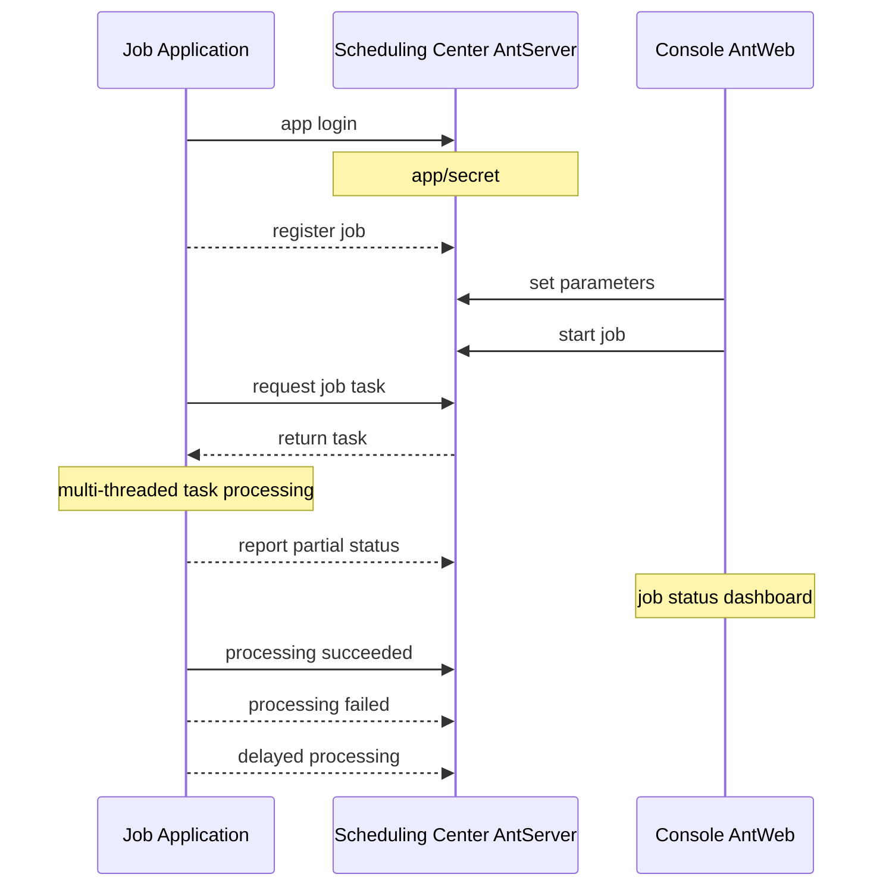
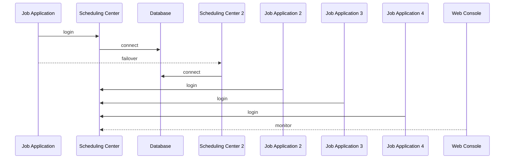

# NewLife.AntJob - Ant Scheduling


[](https://github.com/NewLifeX/AntJob/actions/workflows/test.yml)
[](Doc/多语言本地化.md)


[](https://github.com/NewLifeX/AntJob/graphs/contributors)


<!-- lang:start -->
🌐 [简体中文](README.zh-CN.md) | [繁體中文](README.zh-TW.md) | [Español](README.es.md) | [Deutsch](README.de.md) | [日本語](README.ja.md) | [Français](README.fr.md) | [Português](README.pt.md) | [Русский](README.ru.md) | [한국어](README.ko.md) | [العربية](README.ar.md)
<!-- lang:end -->

**AntJob** is a distributed task and real-time data scheduling platform built purely in .NET: any large job is split into parallel time/data slices, dispatched to elastic worker nodes, retried on failure and replayed for backfill, with a web console for live monitoring.

Open source: [https://github.com/NewLifeX/AntJob](https://github.com/NewLifeX/AntJob)  
Tutorial: [https://newlifex.com/blood/antjob](https://newlifex.com/blood/antjob)  
Live demo (hosted environment): [http://ant.newlifex.com](http://ant.newlifex.com/)  

**Contents**: [Quick Start](#quick-start) · [Main Features](#main-features) · [Ecosystem Map](#ecosystem-map) · [Documentation](#documentation) · [Contributing](#contributing) · [Team](#team) · [License](#license)

## Quick Start

### Install

```bash
dotnet add package NewLife.AntJob
```

### Template (recommended)

```
dotnet new install NewLife.Templates
# Create a project with an AntJob sample
dotnet new antjob --name TestJob
cd TestJob
dotnet run
```

### Minimal example

The following source code is located in [Samples/HisAgent](https://github.com/NewLifeX/AntJob/tree/master/Samples/HisAgent). Create a .NET Core 3.1+ project and reference AntJob from NuGet. Instantiate a Scheduler and configure a network provider.

```csharp
using AntJob;
using HisAgent;
using NewLife.Log;
using NewLife.Model;
using Stardust;

// Enable console logging and intercept all exceptions
XTrace.UseConsole();

var services = ObjectContainer.Current;
services.AddStardust();

services.AddAntJob()
    .AddHandler<HelloJob>();

// Friendly shutdown
var host = services.BuildHost();
await host.RunAsync();
```

Add the first scheduled job handler:

```csharp
using System;
using AntJob;

internal class HelloJob : Handler
{
    public HelloJob() => Job.Cron = "7/30 * * * * ?";

    public override Int32 Execute(JobContext ctx)
    {
        // Time of the current task
        var time = ctx.Task.DataTime;
        WriteLog("NewLife AntJob! Current task time: {0}", time);
        return 1; // Number of successfully processed items
    }
}
```

Job handlers must inherit `Handler` and override `Execute` to implement business logic. The Time and Step set in the constructor are only used for the first registration; later changes are made in the console.

Or use an asynchronous scheduled job handler:

```csharp
using System;
using AntJob;

internal class HelloJob : Handler
{
    public HelloJob() => Job.Cron = "7/30 * * * * ?";

    public override async Task<Int32> ExecuteAsync(JobContext ctx)
    {
        using var span = Tracer?.NewSpan("HelloJob", ctx.Task.DataTime);

        // Time of the current task
        var time = ctx.Task.DataTime;
        WriteLog("NewLife AntJob! Current task time: {0}", time);
        if (!ctx.Task.Data.IsNullOrEmpty()) WriteLog("Data: {0}", ctx.Task.Data);

        var state = Rand.NextString(16);
        var http = new HttpClient { BaseAddress = new Uri("https://newlifex.com") };
        http.SetUserAgent();
        var rs = await http.GetAsync<IDictionary<String, Object>>("/cube/info", new { state });

        if (rs.TryGetValue("state", out var value) && value is String str)
        {
            Trace.Assert(state == str, "Returned state does not match");
        }

        // Number of successfully processed items
        return 1;
    }
}
```

### Run it

On the first run it automatically tries to connect to `tcp://127.0.0.1:9999` and `tcp://ant.newlifex.com:9999` (active/standby), based on the `AntSetting` configuration. If `Server` is configured with an `http(s)://` address, it automatically switches to the HTTP channel and receives downstream notifications over WebSocket.

Log example:

```sql
21:33:08.470  1 N - Start job scheduling engine [AntJob.Providers.NetworkJobProvider], jobs [1], timer 5s
21:33:08.471  1 N - HelloJob start work False range (2020-04-09 00:00:00, 0001-01-01 00:00:00) Offset=15 Step=10 MaxTask=8
```

### Web console and reset

Deploy AntJob.Web (IIS / Kestrel / Docker) and then change the client's Server setting to point at its service address. No separate AntServer is required:

```json
{
  "Ant": {
    "Server": "https://ant.example.com",
    "AppId": "MyJobApp",
    "Secret": ""
  }
}
```

After the client logs in, it establishes a long-lived `/AntJob/Notify` WebSocket connection through HTTP heartbeats to receive job-change and message-arrival notifications; when WebSocket is unavailable, it still works on the polling interval. Once a job is enabled in the console, the scheduling center slices tasks by time point and dispatches them: you can view task details, retry errors and batch-reset tasks to recompute history. Run several Agents to scale out — any given task is executed by exactly one node, and failures are retried according to policy.

### Local file scheduling only

When `NetworkJobProvider` is not configured, the default local Provider is used, which is suitable for offline debugging on a single machine.

### Docker (illustrative)

> No official image is provided yet; you can package one inside your organization:

```
FROM mcr.microsoft.com/dotnet/aspnet:8.0 AS base
WORKDIR /app
COPY ./publish/ .
ENTRYPOINT ["dotnet","AntJob.Web.dll"]
```

### Deployment topologies

| Topology | Description |
| --- | --- |
| Single instance | Web + Server + JobApp on the same machine for development and testing |
| Dual-center high availability | Two scheduling-center addresses separated by commas (active/standby), with automatic client failover |
| Multi-execution cluster | Several execution nodes, grouped by business or load, connecting to a unified scheduling center |
| Hybrid | Dual centers + multiple execution nodes in production; separate clusters for test/staging |

## Main Features

AntJob uses the "ants moving house" idea to split any large task into small pieces that can run in parallel. The idea was born in Lujiazui, Shanghai, during the 2008 financial crisis, in response to financial institutions' urgent need for low-cost, high-efficiency data analysis. Comparable systems include XxlJob, Quartz, Hangfire, Airflow (in some scenarios) and self-built scheduled-script clusters; AntJob emphasizes "data/time slicing + retry + unified multiple modes" and non-intrusive integration with an enterprise's existing .NET ecosystem, validated by trillion-scale scheduling and tens of billions of data-cleaning records.

<details>
<summary><b>Typical Use Cases</b> (4)</summary>

| Scenario | Why AntJob fits |
| --- | --- |
| Massive logs / orders / transactions / device data | Continuous extraction and real-time computing over ever-growing data sets |
| Rolling aggregation by time window | Second / minute / hour / day / custom Cron windows are computed slice by slice |
| Data backfill and recalculation | Historical ranges can be reset and replayed without affecting live windows |
| High-concurrency batch processing | Distributed across data centers with an elastic number of nodes |

</details>

<details>
<summary><b>Core Capabilities</b> (11)</summary>

| Capability | What it gives you |
| --- | --- |
| Multiple scheduling modes | Time, data window, message, Cron, SQL statements and C# dynamic scripts |
| Job time/data slicing | Down to second-level granularity, with catch-up, backfill and batch reset |
| Reliable task delivery | Automatic delayed retry on failure, tolerating transient dependency failures |
| Elastic cluster | Naturally stateless execution nodes that scale out or in at any time |
| Communication protocols | HTTP REST + WebSocket downstream notifications (recommended default), compatible with NewLife.Remoting TCP RPC |
| Visual monitoring | Web console for real-time job curves, task status and online nodes |
| Job panel | Dynamic parameter adjustment plus runtime statistics from the console |
| Pluggable providers | `IJobProvider` implementations for network, file and local custom sources |
| Light dependencies | The core relies on NewLife's own ecosystem (logging, configuration, tracing), reducing external complexity |
| Cross-platform and multi-TFM | From .NET Framework 4.5 to .NET 8/9 |
| Strong naming and long-term compatibility | Convenient for enterprise private deployment and secondary packaging |

</details>

<details>
<summary><b>Scheduling Modes</b> (5)</summary>

| Mode | Use case, granularity and key fields |
| --- | --- |
| Time / Cron | General periodic tasks at second-to-Cron granularity, driven by `Job.Time` / `Cron`; Cron expressions replace fixed Start+Step intervals |
| Data (time window) | Processes newly added data by time slice (second to any window), driven by Start / End; missing windows are filled automatically, ideal for rolling computation over journal and log tables |
| Message | Passive, real-time message-driven mode: the `Body` of an external push/queue message becomes a task |
| SQL / data-driven | Scans a data table and slices it by primary key/time (batch); an extension component often used for historical backfill or bulk migration |
| C# dynamic script | Quick experiments and hot updates for small logic; the script is compiled and executed at runtime, subject to permission/sandbox limits |

</details>

<details>
<summary><b>Architecture and Core Modules</b> (9)</summary>

| Component | Responsibility |
| --- | --- |
| AntJob.Server | Scheduling-center server logic: Job & Task metadata, slicing, assignment and retry policy |
| AntJob.Web | Visual management platform built on NewLife.Cube: multi-tenant App isolation, permissions, monitoring |
| AntJob (library) | Client SDK: Scheduler and Handler abstractions, network communication, context wrappers |
| AntJob.Extensions | Extended scheduling types: SqlMessage, DataHandler, MessageHandler, CSharpHandler, etc. |
| Samples | Example projects (HisAgent, HisData, HisWeb, HelloWork) |
| Scheduler | Core scheduling engine that manages handler lifecycles and task dispatch |
| Handler | Base class for business modules; each module implements `Execute` / `ExecuteAsync` |
| IJobProvider | Task source provider supporting network, local and custom sources |
| JobContext | Execution environment and state of one task, including statistics and logging helpers |

</details>

<details>
<summary><b>Reliability and Consistency</b> (6)</summary>

| Guarantee | How it works |
| --- | --- |
| Atomic task assignment | A given task ID is acquired by exactly one node |
| State machine | Ready -> Processing -> Completed / Error / Cancelled |
| Automatic retry | Failed tasks are retried after a delay (1 minute by default), up to N times (configurable) |
| Reset mechanism | Batch-reset a historical range for recalculation (backfill / correction) |
| Idempotency | Business logic should implement idempotent writes based on primary keys/time windows |
| Heartbeat and online table | Real-time detection of node online/offline, supporting elastic scaling |

</details>

<details>
<summary><b>Configuration</b> (7)</summary>

| Setting | Meaning |
| --- | --- |
| `Server` | Scheduling-center address(es). `http(s)://` uses the HTTP + WebSocket channel, `tcp://` uses the RPC-compatible channel, e.g. `https://a.example.com,https://b.example.com` or `tcp://a:9999,tcp://b:9999` |
| `AppID` / `Secret` | Application isolation credentials, auto-registered or manually distributed |
| `Debug` | Debug switch that outputs more detailed logs |
| `UseRegistry` | Whether to resolve service addresses through the Stardust registry (default true); set it to false when connecting directly through a gateway |
| `MessageIdlePeriod` | Idle request period for message-type jobs in seconds (default 15); an HTTP-channel message notification wakes it up immediately |
| Database | Web/Server side connections automatically create tables through XCode reverse engineering |
| Stardust integration | Optional registry, APM and configuration-center capabilities for the Web/Server side |

</details>

<details>
<summary><b>Extension Mechanisms</b> (6)</summary>

| Mechanism | How to use it |
| --- | --- |
| Custom handler | Inherit `Handler`, override `Execute(JobContext ctx)` and return the number of successfully processed items |
| Custom data-source provider | Implement `IJobProvider` (for example Kafka / Redis Stream / REST) |
| Message scheduling | `MessageHandler` turns an arbitrary message body into tasks |
| SQL / data-driven | `SqlMessage` + `DataHandler` scan and slice data |
| Dynamic scripts | `CSharpHandler` allows rapid trial and error through scripts (restrict permissions in production) |
| Plugin-based packaging | Strong naming and multi-TFM support let handlers live in separate assemblies and be hot-plugged |

</details>

<details>
<summary><b>Performance and Capacity Planning</b> (7)</summary>

| Item | Guidance |
| --- | --- |
| Per-job slice volume | Up to tens of billions of task history records, depending on database capacity |
| Per-node throughput | Depends on the handler business logic; framework scheduling overhead is minimal (in-memory scheduling control) |
| GC pressure | Object pools and caches are used internally, leveraging NewLife.Core optimizations |
| Slice granularity | Keep it moderate; slices that are too fine increase scheduling metadata overhead |
| Database pressure | Use batch I/O or caching to reduce database load |
| Large computation windows | Prefer Data mode with a sub-window loop |
| Proven scale | Fund SMS mass-sending, 6 billion rows sliced from a single table, 12 million express orders per day, tens of billions of data-cleaning records and trillion-scale annual scheduling |

</details>

<details>
<summary><b>Core Concepts</b> (5)</summary>

| Concept | Meaning |
| --- | --- |
| Job | Job configuration: time/step/Cron/mode/concurrency limit, etc. |
| Task | The smallest execution unit after a job is instantiated, with a time point or interval and message body |
| Handler | Business-logic carrier whose lifecycle is managed by the Scheduler |
| JobContext | Execution context of one task, including the Task, statistics and logging helpers |
| IJobProvider | Task-source provider (network/local/custom) |

</details>

<details>
<summary><b>Comparison with Other Schedulers</b> (4)</summary>

| System | How AntJob differs |
| --- | --- |
| Quartz.NET | A pure scheduling/Cron library; AntJob adds data/message slicing, recalculation and simple cluster sharding |
| Hangfire | Persistent background jobs; AntJob focuses on continuous time/data slicing rather than a one-off task queue |
| XXL-JOB | Java ecosystem; AntJob is .NET-native with unified multiple modes and dynamic scripting |
| Airflow | DAG orchestration; AntJob is lighter and focuses on high-frequency window processing, and can complement Airflow |

</details>

<details>
<summary><b>FAQ</b> (5)</summary>

| Question | Answer |
| --- | --- |
| Why are jobs stopped by default after registration? | To prevent a large number of starts before parameters are configured; enable them manually in the Web console |
| How do I recalculate a month of data? | Change the start time in the job panel, reset the specified time range, or batch-select tasks and reset them |
| Do failed tasks block subsequent ones? | No; failed tasks are retried with a delay while other windows continue to be scheduled |
| Can I use only HTTP/WebSocket? | Yes. Set `Server` to an `http://` or `https://` address and the client automatically uses HTTP REST + WebSocket notifications without a separate AntServer; `tcp://` addresses keep the RPC-compatible channel |
| How do I limit script risk? | Disable the unused CSharpHandler, or isolate it in a separate process with a least-privilege configuration |

</details>

<details>
<summary><b>v4 Upgrade Progress</b> (5)</summary>

| Item | Status |
| --- | --- |
| HTTP access | Done: AntWeb provides scheduling services, no AntServer required; WebSocket downstream notifications ship with the HTTP channel |
| Enhanced scheduled scheduling | Done: Cron expressions are supported, gradually replacing fixed Start+Step stepping |
| Pre-generated tasks | Planned: execute exactly on time (accuracy improvement, to be evaluated) |
| Active task delay | Done: request a delay during execution without counting it as a failure |
| More scheduling modes | Planned: regular AntAgent, incorporating SQL scheduling / C# scheduling, with extraction and push modes to follow |

</details>

<details>
<summary><b>Roadmap Beyond v4</b> (4)</summary>

| Item | Description |
| --- | --- |
| Active task delay API | Evaluate a delay during execution and run later without counting it as an error |
| Pluggable alert channels | Email / Webhook / WeCom and other channels |
| Monitoring metric export | Multi-dimensional export for Prometheus / OpenTelemetry |
| Optional DAG layer | DAG / dependency orchestration after the core stabilizes |

</details>

### Architecture diagrams

Component topology

```
+----------------------+            +-------------------------+
|  Execution Node(Agent)|  RPC/TCP  |  Scheduling Center(Server)|
|  - Scheduler         |            | - JobService / Task     |
|  - Handlers(business)|            | - State & metadata      |
+----------+-----------+            +-----------+-------------+
           |  Sync logs/tracing (optional Stardust)  |
           v
    +-------------+      Web UI / API      +------------------+
    | DB / Storage|  <------------------>  | Web Console AntWeb|
    +-------------+                         +------------------+
```

Job application (implements IJob)



Scheduling-center master/slave architecture



## Ecosystem Map

NewLife is a layered ecosystem of independently versioned open-source projects. The map below is shared verbatim by every NewLife repository; each project links to its repository and its primary NuGet package.

| Project | What it does | Downloads |
| --- | --- | --- |
| **Foundation** | | |
| [NewLife.Core](https://github.com/NewLifeX/X) | Logging, configuration, caching, networking, serialization, scheduling and APM tracing. | [](https://www.nuget.org/packages/NewLife.Core) |
| [NewLife.XCode](https://github.com/NewLifeX/NewLife.XCode) | Data middleware: single tables at the tens-of-billions scale, automatic sharding, read-write splitting, 10+ databases. | [](https://www.nuget.org/packages/NewLife.XCode) |
| [NewLife.Net](https://github.com/NewLifeX/NewLife.Net) | High-performance network library: 1.77M pps / 14.5 Gbps on a single machine (TCP 1KB, 2026-10), 4M long-lived TCP connections. | [](https://www.nuget.org/packages/NewLife.Net) |
| [NewLife.Remoting](https://github.com/NewLifeX/NewLife.Remoting) | Protocol communication and RPC framework for client/server applications and IoT devices. | [](https://www.nuget.org/packages/NewLife.Remoting) |
| [NewLife.Agent](https://github.com/NewLifeX/NewLife.Agent) | Installs .NET applications as OS daemons: Windows services and Linux systemd. | [](https://www.nuget.org/packages/NewLife.Agent) |
| [NewLife.Templates](https://github.com/NewLifeX/NewLife.Zero) | `dotnet new` project templates for console, web, API, service, data and IoT projects. | [](https://www.nuget.org/packages/NewLife.Templates) |
| **Data & Messaging** | | |
| [NewLife.Redis](https://github.com/NewLifeX/NewLife.Redis) | Redis client with microsecond latency, millions of ops/s and built-in message queues. | [](https://www.nuget.org/packages/NewLife.Redis) |
| [NewLife.RocketMQ](https://github.com/NewLifeX/NewLife.RocketMQ) | Pure managed RocketMQ client for Apache RocketMQ and Alibaba Cloud Message Queue. | [](https://www.nuget.org/packages/NewLife.RocketMQ) |
| [NewLife.MQTT](https://github.com/NewLifeX/NewLife.MQTT) | MQTT client and server, including Alibaba Cloud IoT connectivity. | [](https://www.nuget.org/packages/NewLife.MQTT) |
| [NewLife.NovaDb](https://github.com/NewLifeX/NewLife.NovaDb) | Hybrid database in C#: embedded or networked, relational, time-series, message queue and KV in one. | [](https://www.nuget.org/packages/NewLife.NovaDb) |
| [NewLife.MySql](https://github.com/NewLifeX/NewLife.MySql) | MySql driver and helper layer built on the NewLife data stack. | [](https://www.nuget.org/packages/NewLife.MySql) |
| **Web, AI & Distributed** | | |
| [NewLife.Cube](https://github.com/NewLifeX/NewLife.Cube) | Rapid admin-platform framework: permissions, SSO, OAuth server and CRUD scaffolding. | [](https://www.nuget.org/packages/NewLife.Cube) |
| [Stardust](https://github.com/NewLifeX/Stardust) | Distributed service platform: node management, APM, configuration center, registry and release center. | [](https://www.nuget.org/packages/NewLife.Stardust) |
| [AntJob](https://github.com/NewLifeX/AntJob) | Distributed task and real-time data scheduling platform with sharding, retries and backfill. | [](https://www.nuget.org/packages/NewLife.AntJob) |
| [NewLife.AI](https://github.com/NewLifeX/NewLife.AI) | Unified client for 46 LLM providers plus ChatAI, a ready-to-run web chat application. | [](https://www.nuget.org/packages/NewLife.AI) |
| **Industrial & IoT** | | |
| [NewLife.IoT](https://github.com/NewLifeX/NewLife.IoT) | IoT standard library defining protocol contracts and device abstractions. | [](https://www.nuget.org/packages/NewLife.IoT) |
| [NewLife.Modbus](https://github.com/NewLifeX/NewLife.Modbus) | Modbus TCP/RTU/ASCII implementation on top of NewLife.IoT. | [](https://www.nuget.org/packages/NewLife.Modbus) |
| [NewLife.Siemens](https://github.com/NewLifeX/NewLife.Siemens) | Siemens PLC protocol on top of NewLife.IoT. | [](https://www.nuget.org/packages/NewLife.Siemens) |
| [NewLife.Omron](https://github.com/NewLifeX/NewLife.Omron) | Omron PLC protocol on top of NewLife.IoT. | [](https://www.nuget.org/packages/NewLife.Omron) |
| [NewLife.Melsec](https://github.com/NewLifeX/NewLife.Melsec) | Mitsubishi Melsec PLC protocol on top of NewLife.IoT. | [](https://www.nuget.org/packages/NewLife.Melsec) |
| [NewLife.OPC](https://github.com/NewLifeX/NewLife.OPC) | OPC client for industrial data access. | — |
| [NewLife.BACnet](https://github.com/NewLifeX/NewLife.BACnet) | BACnet building-automation protocol stack. | [](https://www.nuget.org/packages/NewLife.BACnet) |
| [ZeroIoT](https://github.com/NewLifeX/ZeroIoT) | Lightweight open-source IoT platform with gateway and device management. | — |
| **Vehicle Telematics** | | |
| [NewLife.JT808](https://github.com/NewLifeX/NewLife.JT808) | JT/T 808 vehicle positioning protocol: 70+ message bodies, 2011/2013/2019. | [](https://www.nuget.org/packages/NewLife.JT808) |
| [NewLife.JT809](https://github.com/NewLifeX/NewLife.JT809) | JT/T 809 platform-to-platform protocol for transport authorities. | [](https://www.nuget.org/packages/NewLife.JT809) |
| [NewLife.JT1078](https://github.com/NewLifeX/NewLife.JT1078) | JT/T 1078 in-vehicle video: RTP parsing, FLV/fMP4 remuxing and live streaming. | [](https://www.nuget.org/packages/NewLife.JT1078) |
| **Domain Components** | | |
| [NewLife.Office](https://github.com/NewLifeX/NewLife.Office) | One package for Excel, Word, PPT, PDF and 15+ document formats. | [](https://www.nuget.org/packages/NewLife.Office) |
| [NewLife.Audio](https://github.com/NewLifeX/NewLife.Audio) | Cross-platform audio: codecs, device I/O, DSP, containers and streaming. | [](https://www.nuget.org/packages/NewLife.Audio) |
| [NewLife.Video](https://github.com/NewLifeX/NewLife.Video) | Video codecs, container formats, frame processing and streaming. | [](https://www.nuget.org/packages/NewLife.Video) |
| [NewLife.Map](https://github.com/NewLifeX/NewLife.Map) | Unified interface over Baidu, AMap, Tencent and Tianditu with geocoding and coordinate conversion. | [](https://www.nuget.org/packages/NewLife.Map) |
| [NewLife.IP](https://github.com/NewLifeX/NewLife.IP) | IPv4 geolocation with an offline memory-mapped database and an online API fallback. | [](https://www.nuget.org/packages/NewLife.IP) |
| **Tools & Products** | | |
| [CrazyCoder](https://github.com/NewLifeX/XCoder) | Developer toolbox: network, serial port, crypto, regex, Modbus and MQTT. | [](https://www.nuget.org/packages/NewLife.XCoder) |
| [GitCandy](https://github.com/NewLifeX/GitCandy) | Self-hosted Git source code management system. | — |
| [LuckyClover](https://github.com/NewLifeX/LuckyClover) | Installs the matching .NET runtime automatically when launched from an older host. | — |

> Badges show the primary package of each project; theme, extension and satellite packages are listed on their NuGet pages. The 30+ packages not listed here (FTP, LoRa, Office extensions, protocol drivers and more) are available under the [NewLifeX organization](https://github.com/NewLifeX) and on [newlifex.com](https://newlifex.com). This table is maintained in the NewLife.Core README.

## Documentation

| Document | Description |
| --- | --- |
| [Requirements](Doc/需求文档.md) | Vision, core goals, functional requirements of the 7 major modules and the deferred list |
| [Feature list](Doc/功能清单.md) | Three-dimensional implementation/test/comment status tracking of 85 features (including the mandatory split check) |
| [Architecture](Doc/架构设计.md) | Layered architecture, core component responsibilities, key process sequence diagrams, design decisions |
| [HTTP and WebSocket deployment](Doc/HTTP与WebSocket部署.md) | Gateway configuration, Redis broadcast, migration steps and troubleshooting checklist |
| [Core component benchmarks](Doc/Benchmark/核心组件性能测试.md) | Benchmark data and tuning advice for time expressions, template replacement and SQL fragment parsing |

- Tutorial: [https://newlifex.com/blood/antjob](https://newlifex.com/blood/antjob)
- Live demo: [http://ant.newlifex.com](http://ant.newlifex.com/)
- Multi-language README rules: [Doc/多语言本地化.md](Doc/多语言本地化.md)

## Contributing

### Build and test

```bash
dotnet build -c Release
dotnet test -c Release
# Only the main test project (net10.0), used by CI on win-x64 and linux-arm64
dotnet test AntTest/AntTest.csproj -c Release
```

- CI: `.github/workflows/test.yml` builds, runs tests and checks localization plus the README language switcher
- README checks: `pwsh -File sync-readme-languages.ps1 -Check`, `pwsh -File sync-readme-package.ps1 -Check` and `pwsh -File check-readme-structure.ps1`
- Benchmarks: `Benchmark/AntJob.Benchmarks` (BenchmarkDotNet)

### Repository layout

```
AntJob/                 Client core library
AntJob.Extensions/      Extension handlers/messages/SQL, etc.
AntJob.Server/          Scheduling-center core service logic (JobService, etc.)
AntJob.Web/             Razor Pages + Cube admin console
AntJob.Data/            Base data models (entity layer)
Samples/                Sample projects (HisAgent, HisData, HisWeb, HelloWork)
AntTest/                Unit/integration tests
Doc/                    Documentation and assets
```

### Release

Push a `v`-prefixed tag (for example `v5.0.2026.1024`) to trigger `.github/workflows/publish.yml`. The workflow packs `AntJob`, `AntJob.Extensions` and `AntJob.Web`, publishes them to NuGet.org and GitHub Packages, and creates a GitHub Release whose notes are taken from the matching `ChangeLog.md` section (assets include nupkg and snupkg). A manual run only publishes packages and does not create a Release. Commits touching `AntJob/` or `AntJob.Extensions/` on master also produce beta packages through `publish-beta.yml`.

### Feedback

- Before submitting, make sure `dotnet build` and the relevant tests pass; follow the repository code style.
- Report bugs and suggestions via [Issue](https://github.com/NewLifeX/AntJob/issues); Stars and PRs are welcome.

## Team


Founded in 2002, the NewLife team has spent more than two decades on the .NET and IoT ecosystem, maintains nearly 100 open-source projects (34 of them core to this map), and delivers integrated software and hardware solutions for power, logistics, healthcare, industrial control and internet industries. We live by the motto "learning has no seniority — mastery earns respect".

Open-source components have been downloaded <!--nuget-total:start-->6.48M<!--nuget-total:end--> times from NuGet (ecosystem-wide, as of 2026-10).

Website: https://newlifex.com · Open source organization: https://github.com/NewLifeX

<details>
<summary>WeChat Official Account: 智能大石头 (scan to follow)</summary>


</details>

## License

This project is licensed under [MIT](https://github.com/NewLifeX/AntJob/blob/master/LICENSE) © 2002-2026 NewLife Team. You may use, modify and redistribute it freely.

> If this project is helpful to you, welcome to Star it, share it with your team, or provide improvement suggestions via Issue/PR.
