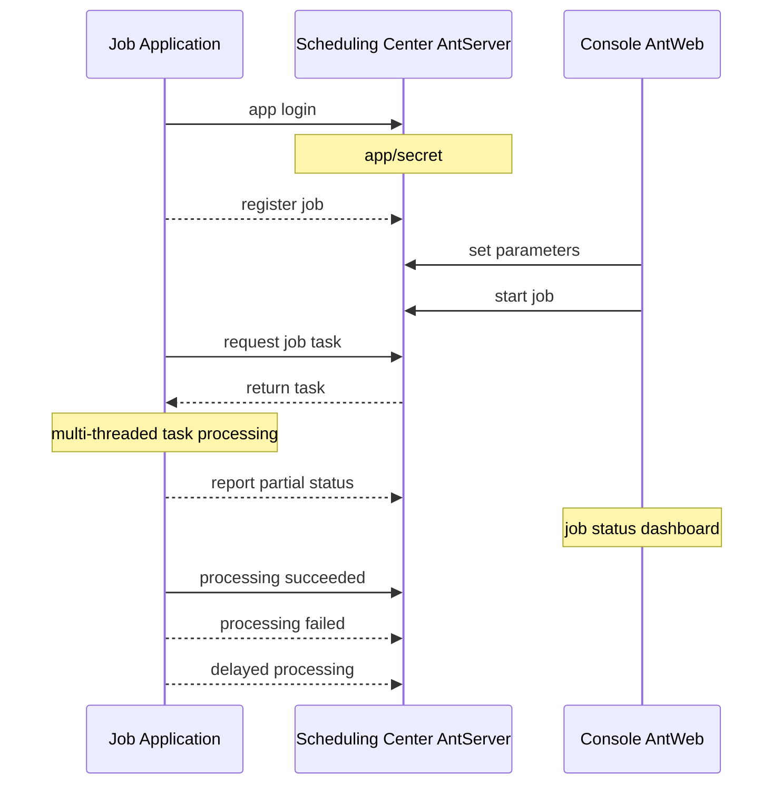
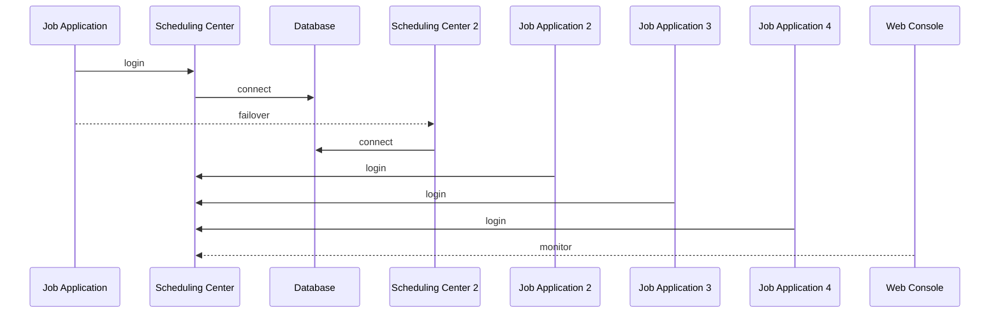

# NewLife.AntJob - Agendamento Ant


[](https://github.com/NewLifeX/AntJob/actions/workflows/test.yml)
[](Doc/多语言本地化.md)


[](https://github.com/NewLifeX/AntJob/graphs/contributors)


<!-- lang:start -->
🌐 [English](README.md) | [简体中文](README.zh-CN.md) | [繁體中文](README.zh-TW.md) | [Español](README.es.md) | [Deutsch](README.de.md) | [日本語](README.ja.md) | [Français](README.fr.md) | [Русский](README.ru.md) | [한국어](README.ko.md) | [العربية](README.ar.md)
<!-- lang:end -->


**AntJob** é uma plataforma distribuída de agendamento de tarefas e de dados em tempo real, construída inteiramente em .NET: qualquer job de grande porte é dividido em fatias paralelas de tempo/dados, despachado para nós de execução elásticos, repetido em caso de falha e reprocessado para recarga (backfill), com um console web para monitoramento ao vivo.

Código aberto: [https://github.com/NewLifeX/AntJob](https://github.com/NewLifeX/AntJob)  
Tutorial: [https://newlifex.com/blood/antjob](https://newlifex.com/blood/antjob)  
Demonstração ao vivo (ambiente hospedado): [http://ant.newlifex.com](http://ant.newlifex.com/)  

**Conteúdo**: [Início rápido](#início-rápido) · [Recursos principais](#recursos-principais) · [Mapa do ecossistema](#mapa-do-ecossistema) · [Documentação](#documentação) · [Contribuição](#contribuição) · [Equipe](#equipe) · [Licença](#licença)

## Início rápido

### Instalação

```bash
dotnet add package NewLife.AntJob
```

### Modelo (recomendado)

```
dotnet new install NewLife.Templates
# Create a project with an AntJob sample
dotnet new antjob --name TestJob
cd TestJob
dotnet run
```

### Exemplo mínimo

O código-fonte a seguir está em [Samples/HisAgent](https://github.com/NewLifeX/AntJob/tree/master/Samples/HisAgent). Crie um projeto .NET Core 3.1+ e referencie o AntJob a partir do NuGet. Instancie um Scheduler e configure um provedor de rede.

```csharp
using AntJob;
using HisAgent;
using NewLife.Log;
using NewLife.Model;
using Stardust;

// Enable console logging and intercept all exceptions
XTrace.UseConsole();

var services = ObjectContainer.Current;
services.AddStardust();

services.AddAntJob()
    .AddHandler<HelloJob>();

// Friendly shutdown
var host = services.BuildHost();
await host.RunAsync();
```

Adicione o primeiro handler de job agendado:

```csharp
using System;
using AntJob;

internal class HelloJob : Handler
{
    public HelloJob() => Job.Cron = "7/30 * * * * ?";

    public override Int32 Execute(JobContext ctx)
    {
        // Time of the current task
        var time = ctx.Task.DataTime;
        WriteLog("NewLife AntJob! Current task time: {0}", time);
        return 1; // Number of successfully processed items
    }
}
```

Os handlers de job devem herdar de `Handler` e sobrescrever `Execute` para implementar a lógica de negócio. O Time e o Step definidos no construtor são usados apenas no primeiro registro; alterações posteriores são feitas no console.

Ou use um handler de job agendado assíncrono:

```csharp
using System;
using AntJob;

internal class HelloJob : Handler
{
    public HelloJob() => Job.Cron = "7/30 * * * * ?";

    public override async Task<Int32> ExecuteAsync(JobContext ctx)
    {
        using var span = Tracer?.NewSpan("HelloJob", ctx.Task.DataTime);

        // Time of the current task
        var time = ctx.Task.DataTime;
        WriteLog("NewLife AntJob! Current task time: {0}", time);
        if (!ctx.Task.Data.IsNullOrEmpty()) WriteLog("Data: {0}", ctx.Task.Data);

        var state = Rand.NextString(16);
        var http = new HttpClient { BaseAddress = new Uri("https://newlifex.com") };
        http.SetUserAgent();
        var rs = await http.GetAsync<IDictionary<String, Object>>("/cube/info", new { state });

        if (rs.TryGetValue("state", out var value) && value is String str)
        {
            Trace.Assert(state == str, "Returned state does not match");
        }

        // Number of successfully processed items
        return 1;
    }
}
```

### Executar

Na primeira execução, ele tenta se conectar automaticamente a `tcp://127.0.0.1:9999` e `tcp://ant.newlifex.com:9999` (ativo/standby), com base na configuração `AntSetting`. Se `Server` estiver configurado com um endereço `http(s)://`, ele passa automaticamente para o canal HTTP e recebe notificações downstream via WebSocket.

Exemplo de log:

```sql
21:33:08.470  1 N - Start job scheduling engine [AntJob.Providers.NetworkJobProvider], jobs [1], timer 5s
21:33:08.471  1 N - HelloJob start work False range (2020-04-09 00:00:00, 0001-01-01 00:00:00) Offset=15 Step=10 MaxTask=8
```

### Console web e redefinição

Implante o AntJob.Web (IIS / Kestrel / Docker) e depois altere a configuração Server do cliente para apontar para o endereço do seu serviço. Não é necessário um AntServer separado:

```json
{
  "Ant": {
    "Server": "https://ant.example.com",
    "AppId": "MyJobApp",
    "Secret": ""
  }
}
```

Após o login do cliente, ele estabelece uma conexão WebSocket de longa duração em `/AntJob/Notify`, mantida por heartbeats HTTP, para receber notificações de alteração de job e de chegada de mensagens; quando o WebSocket não está disponível, ele continua funcionando no intervalo de polling. Depois de habilitar um job no console, o centro de agendamento fatia as tarefas por ponto no tempo e as despacha: é possível ver os detalhes da tarefa, repetir erros e redefinir tarefas em lote para recalcular o histórico. Execute vários Agents para escalar horizontalmente — qualquer tarefa é executada por exatamente um nó, e as falhas são repetidas conforme a política.

### Apenas agendamento local em arquivo

Quando `NetworkJobProvider` não está configurado, usa-se o Provider local padrão, adequado para depuração offline em uma única máquina.

### Docker (ilustrativo)

> Ainda não há imagem oficial; você pode empacotar uma dentro da sua organização:

```
FROM mcr.microsoft.com/dotnet/aspnet:8.0 AS base
WORKDIR /app
COPY ./publish/ .
ENTRYPOINT ["dotnet","AntJob.Web.dll"]
```

### Topologias de implantação

| Topologia | Descrição |
| --- | --- |
| Instância única | Web + Server + JobApp na mesma máquina, para desenvolvimento e testes |
| Alta disponibilidade com dois centros | Dois endereços de centro de agendamento separados por vírgula (ativo/standby), com failover automático do cliente |
| Cluster de múltiplas execuções | Vários nós de execução, agrupados por negócio ou carga, conectados a um centro de agendamento unificado |
| Híbrido | Dois centros + múltiplos nós de execução em produção; clusters separados para teste/homologação |

## Recursos principais

O AntJob usa a ideia das "formigas mudando de casa" para dividir qualquer tarefa grande em pequenas partes que podem ser executadas em paralelo. A ideia nasceu em Lujiazui, Xangai, durante a crise financeira de 2008, em resposta à necessidade urgente das instituições financeiras por análise de dados de baixo custo e alta eficiência. Sistemas comparáveis incluem XxlJob, Quartz, Hangfire, Airflow (em alguns cenários) e clusters caseiros de scripts agendados; o AntJob enfatiza "fatiamento de dados/tempo + repetição + vários modos unificados" e a integração não intrusiva com o ecossistema .NET já existente na empresa, validado por agendamentos em escala de trilhões e dezenas de bilhões de registros de limpeza de dados.

<details>
<summary><b>Casos de uso típicos</b> (4)</summary>

| Cenário | Por que o AntJob se encaixa |
| --- | --- |
| Logs / pedidos / transações / dados de dispositivos em grande volume | Extração contínua e cálculo em tempo real sobre conjuntos de dados sempre crescentes |
| Agregação contínua por janela de tempo | Janelas por segundo / minuto / hora / dia / Cron personalizado são calculadas fatia a fatia |
| Recarga e recálculo de dados | Faixas históricas podem ser redefinidas e reprocessadas sem afetar as janelas ativas |
| Processamento em lote de alta concorrência | Distribuído entre data centers com um número elástico de nós |

</details>

<details>
<summary><b>Capacidades essenciais</b> (11)</summary>

| Capacidade | O que ela oferece |
| --- | --- |
| Múltiplos modos de agendamento | Tempo, janela de dados, mensagem, Cron, instruções SQL e scripts dinâmicos C# |
| Fatiamento de tempo/dados do job | Até granularidade de segundos, com recuperação, recarga e redefinição em lote |
| Entrega confiável de tarefas | Repetição automática com atraso em caso de falha, tolerando falhas transitórias de dependências |
| Cluster elástico | Nós de execução naturalmente sem estado que escalam para cima ou para baixo a qualquer momento |
| Protocolos de comunicação | HTTP REST + notificações downstream por WebSocket (padrão recomendado), compatível com o RPC TCP do NewLife.Remoting |
| Monitoramento visual | Console web com curvas de jobs em tempo real, status das tarefas e nós online |
| Painel do job | Ajuste dinâmico de parâmetros e estatísticas de execução pelo console |
| Provedores plugáveis | Implementações de `IJobProvider` para fontes de rede, arquivo e locais personalizadas |
| Dependências leves | O núcleo depende do próprio ecossistema NewLife (log, configuração, rastreamento), reduzindo a complexidade externa |
| Multiplataforma e multi-TFM | Do .NET Framework 4.5 ao .NET 8/9 |
| Nome forte e compatibilidade de longo prazo | Conveniente para implantação privada e empacotamento secundário em empresas |

</details>

<details>
<summary><b>Modos de agendamento</b> (5)</summary>

| Modo | Caso de uso, granularidade e campos principais |
| --- | --- |
| Tempo / Cron | Tarefas periódicas gerais com granularidade de segundos até Cron, controladas por `Job.Time` / `Cron`; expressões Cron substituem os intervalos fixos Start+Step |
| Dados (janela de tempo) | Processa dados recém-adicionados por fatia de tempo (de segundos até qualquer janela), controlado por Start / End; janelas ausentes são preenchidas automaticamente, ideal para cálculo contínuo sobre tabelas de diário e logs |
| Mensagem | Modo passivo e em tempo real, orientado a mensagens: o `Body` de uma mensagem externa de push/fila se torna uma tarefa |
| SQL / orientado a dados | Varre uma tabela e a fatia por chave primária/tempo (lote); componente de extensão comum para recarga histórica ou migração em massa |
| Script dinâmico C# | Experimentos rápidos e atualização a quente para lógicas pequenas; o script é compilado e executado em tempo de execução, sujeito a limites de permissão/sandbox |

</details>

<details>
<summary><b>Arquitetura e módulos centrais</b> (9)</summary>

| Componente | Responsabilidade |
| --- | --- |
| AntJob.Server | Lógica do servidor do centro de agendamento: metadados de Job e Task, fatiamento, atribuição e política de repetição |
| AntJob.Web | Plataforma de gestão visual construída sobre o NewLife.Cube: isolamento multi-tenant por App, permissões, monitoramento |
| AntJob (biblioteca) | SDK do cliente: abstrações Scheduler e Handler, comunicação de rede, wrappers de contexto |
| AntJob.Extensions | Tipos de agendamento estendidos: SqlMessage, DataHandler, MessageHandler, CSharpHandler etc. |
| Samples | Projetos de exemplo (HisAgent, HisData, HisWeb, HelloWork) |
| Scheduler | Motor de agendamento central que gerencia o ciclo de vida dos handlers e o despacho de tarefas |
| Handler | Classe base dos módulos de negócio; cada módulo implementa `Execute` / `ExecuteAsync` |
| IJobProvider | Provedor de fontes de tarefas com suporte a rede, locais e fontes personalizadas |
| JobContext | Ambiente de execução e estado de uma tarefa, incluindo estatísticas e helpers de log |

</details>

<details>
<summary><b>Confiabilidade e consistência</b> (6)</summary>

| Garantia | Como funciona |
| --- | --- |
| Atribuição atômica de tarefas | Um determinado ID de tarefa é adquirido por exatamente um nó |
| Máquina de estados | Pronto -> Processando -> Concluído / Erro / Cancelado |
| Repetição automática | Tarefas com falha são repetidas após um atraso (1 minuto por padrão), até N vezes (configurável) |
| Mecanismo de redefinição | Redefine em lote uma faixa histórica para recálculo (recarga / correção) |
| Idempotência | A lógica de negócio deve implementar gravações idempotentes com base em chaves primárias/janelas de tempo |
| Heartbeat e tabela de nós online | Detecção em tempo real de nós online/offline, com suporte a escalonamento elástico |

</details>

<details>
<summary><b>Configuração</b> (7)</summary>

| Configuração | Significado |
| --- | --- |
| `Server` | Endereço(s) do centro de agendamento. `http(s)://` usa o canal HTTP + WebSocket, `tcp://` usa o canal compatível com RPC, por exemplo `https://a.example.com,https://b.example.com` ou `tcp://a:9999,tcp://b:9999` |
| `AppID` / `Secret` | Credenciais de isolamento da aplicação, registradas automaticamente ou distribuídas manualmente |
| `Debug` | Chave de depuração que gera logs mais detalhados |
| `UseRegistry` | Se os endereços de serviço devem ser resolvidos pelo registro do Stardust (padrão true); defina false ao conectar diretamente por um gateway |
| `MessageIdlePeriod` | Período de requisições ociosas para jobs do tipo mensagem, em segundos (padrão 15); uma notificação de mensagem pelo canal HTTP o acorda imediatamente |
| Banco de dados | As conexões do lado Web/Server criam tabelas automaticamente por meio da engenharia reversa do XCode |
| Integração com Stardust | Recursos opcionais de registro, APM e centro de configuração para o lado Web/Server |

</details>

<details>
<summary><b>Mecanismos de extensão</b> (6)</summary>

| Mecanismo | Como usar |
| --- | --- |
| Handler personalizado | Herde de `Handler`, sobrescreva `Execute(JobContext ctx)` e retorne o número de itens processados com sucesso |
| Provedor de fonte de dados personalizado | Implemente `IJobProvider` (por exemplo Kafka / Redis Stream / REST) |
| Agendamento por mensagem | `MessageHandler` transforma qualquer corpo de mensagem em tarefas |
| SQL / orientado a dados | `SqlMessage` + `DataHandler` varrem e fatiam dados |
| Scripts dinâmicos | `CSharpHandler` permite tentativa e erro rápida por meio de scripts (restrinja as permissões em produção) |
| Empacotamento por plugin | Nome forte e suporte multi-TFM permitem que os handlers fiquem em assemblies separados e sejam plugados a quente |

</details>

<details>
<summary><b>Desempenho e planejamento de capacidade</b> (7)</summary>

| Item | Orientação |
| --- | --- |
| Volume de fatias por job | Até dezenas de bilhões de registros de histórico de tarefas, dependendo da capacidade do banco |
| Throughput por nó | Depende da lógica de negócio do handler; a sobrecarga de agendamento do framework é mínima (controle de agendamento em memória) |
| Pressão de GC | Pools de objetos e caches são usados internamente, aproveitando as otimizações do NewLife.Core |
| Granularidade da fatia | Mantenha-a moderada; fatias muito finas aumentam a sobrecarga de metadados de agendamento |
| Pressão no banco | Use E/S em lote ou cache para reduzir a carga do banco |
| Janelas de cálculo grandes | Prefira o modo Dados com um laço de subjanelas |
| Escala comprovada | Envio em massa de SMS de fundos, 6 bilhões de linhas fatiadas de uma única tabela, 12 milhões de pedidos expressos por dia, dezenas de bilhões de registros de limpeza de dados e agendamento anual em escala de trilhões |

</details>

<details>
<summary><b>Conceitos centrais</b> (5)</summary>

| Conceito | Significado |
| --- | --- |
| Job | Configuração do job: tempo/step/Cron/modo/limite de concorrência etc. |
| Task | A menor unidade de execução após a instanciação de um job, com um ponto no tempo ou intervalo e corpo de mensagem |
| Handler | Portador da lógica de negócio cujo ciclo de vida é gerenciado pelo Scheduler |
| JobContext | Contexto de execução de uma tarefa, incluindo a Task, estatísticas e helpers de log |
| IJobProvider | Provedor de fontes de tarefas (rede/local/personalizado) |

</details>

<details>
<summary><b>Comparação com outros agendadores</b> (4)</summary>

| Sistema | Como o AntJob se diferencia |
| --- | --- |
| Quartz.NET | Biblioteca pura de agendamento/Cron; o AntJob adiciona fatiamento de dados/mensagens, recálculo e sharding de cluster simples |
| Hangfire | Jobs em background persistentes; o AntJob foca no fatiamento contínuo de tempo/dados, e não em uma fila de tarefas pontuais |
| XXL-JOB | Ecossistema Java; o AntJob é nativo em .NET, com múltiplos modos unificados e script dinâmico |
| Airflow | Orquestração em DAG; o AntJob é mais leve e foca no processamento de janelas de alta frequência, podendo complementar o Airflow |

</details>

<details>
<summary><b>Perguntas frequentes</b> (5)</summary>

| Pergunta | Resposta |
| --- | --- |
| Por que os jobs ficam parados por padrão após o registro? | Para evitar uma grande quantidade de inícios antes da configuração dos parâmetros; habilite-os manualmente no console web |
| Como recalcular um mês de dados? | Altere o horário de início no painel do job, redefina a faixa de tempo especificada, ou selecione tarefas em lote e as redefina |
| Tarefas com falha bloqueiam as seguintes? | Não; tarefas com falha são repetidas com atraso enquanto outras janelas continuam sendo agendadas |
| Posso usar apenas HTTP/WebSocket? | Sim. Defina `Server` como um endereço `http://` ou `https://` e o cliente usará automaticamente HTTP REST + notificações WebSocket, sem um AntServer separado; endereços `tcp://` mantêm o canal compatível com RPC |
| Como limitar o risco de scripts? | Desabilite o CSharpHandler não utilizado, ou isole-o em um processo separado com uma configuração de privilégio mínimo |

</details>

<details>
<summary><b>Progresso da atualização para v4</b> (5)</summary>

| Item | Status |
| --- | --- |
| Acesso HTTP | Concluído: o AntWeb fornece o serviço de agendamento, sem necessidade de AntServer; as notificações downstream por WebSocket vêm junto com o canal HTTP |
| Agendamento programado aprimorado | Concluído: expressões Cron são suportadas, substituindo gradualmente o passo fixo Start+Step |
| Tarefas pré-geradas | Planejado: execução exatamente no horário (melhoria de precisão, a avaliar) |
| Atraso ativo da tarefa | Concluído: solicitar um atraso durante a execução sem contá-lo como falha |
| Mais modos de agendamento | Planejado: AntAgent regular, incorporando agendamento SQL / agendamento C#, com modos de extração e push em seguida |

</details>

<details>
<summary><b>Roadmap após a v4</b> (4)</summary>

| Item | Descrição |
| --- | --- |
| API de atraso ativo da tarefa | Avaliar um atraso durante a execução e executar mais tarde sem contá-lo como erro |
| Canais de alerta plugáveis | Canais como E-mail / Webhook / WeCom |
| Exportação de métricas de monitoramento | Exportação multidimensional para Prometheus / OpenTelemetry |
| Camada DAG opcional | Orquestração de DAG / dependências após a estabilização do núcleo |

</details>

### Diagramas de arquitetura

Topologia de componentes

```
+----------------------+            +-------------------------+
|  Execution Node(Agent)|  RPC/TCP  |  Scheduling Center(Server)|
|  - Scheduler         |            | - JobService / Task     |
|  - Handlers(business)|            | - State & metadata      |
+----------+-----------+            +-----------+-------------+
           |  Sync logs/tracing (optional Stardust)  |
           v
    +-------------+      Web UI / API      +------------------+
    | DB / Storage|  <------------------>  | Web Console AntWeb|
    +-------------+                         +------------------+
```

Aplicação de job (implementa IJob)



Arquitetura mestre/escravo do centro de agendamento



## Mapa do ecossistema

NewLife é um ecossistema em camadas de projetos open source versionados de forma independente. O mapa abaixo é compartilhado literalmente por todos os repositórios NewLife; cada projeto tem links para o seu repositório e para o seu pacote principal no NuGet.

| Projeto | O que faz | Downloads |
| --- | --- | --- |
| **Base** | | |
| [NewLife.Core](https://github.com/NewLifeX/X) | Log, configuração, cache, rede, serialização, agendamento e rastreamento APM. | [](https://www.nuget.org/packages/NewLife.Core) |
| [NewLife.XCode](https://github.com/NewLifeX/NewLife.XCode) | Middleware de dados: tabelas únicas na escala de dezenas de bilhões de linhas, particionamento automático, separação de leitura e escrita, mais de 10 bancos de dados. | [](https://www.nuget.org/packages/NewLife.XCode) |
| [NewLife.Net](https://github.com/NewLifeX/NewLife.Net) | Biblioteca de rede de alto desempenho: 1,77M pps / 14,5 Gbps em uma máquina (TCP 1KB, 2026-10), 4M de conexões TCP persistentes. | [](https://www.nuget.org/packages/NewLife.Net) |
| [NewLife.Remoting](https://github.com/NewLifeX/NewLife.Remoting) | Framework de comunicação por protocolo e RPC para aplicações cliente/servidor e dispositivos IoT. | [](https://www.nuget.org/packages/NewLife.Remoting) |
| [NewLife.Agent](https://github.com/NewLifeX/NewLife.Agent) | Instala aplicações .NET como daemons do sistema operacional: serviços do Windows e systemd do Linux. | [](https://www.nuget.org/packages/NewLife.Agent) |
| [NewLife.Templates](https://github.com/NewLifeX/NewLife.Zero) | Modelos de projeto `dotnet new` para console, web, API, serviço, dados e IoT. | [](https://www.nuget.org/packages/NewLife.Templates) |
| **Dados e mensagens** | | |
| [NewLife.Redis](https://github.com/NewLifeX/NewLife.Redis) | Cliente Redis com latência em microssegundos, milhões de operações por segundo e filas de mensagens integradas. | [](https://www.nuget.org/packages/NewLife.Redis) |
| [NewLife.RocketMQ](https://github.com/NewLifeX/NewLife.RocketMQ) | Cliente RocketMQ totalmente gerenciado para Apache RocketMQ e Alibaba Cloud Message Queue. | [](https://www.nuget.org/packages/NewLife.RocketMQ) |
| [NewLife.MQTT](https://github.com/NewLifeX/NewLife.MQTT) | Cliente e servidor MQTT, incluindo conectividade com o Alibaba Cloud IoT. | [](https://www.nuget.org/packages/NewLife.MQTT) |
| [NewLife.NovaDb](https://github.com/NewLifeX/NewLife.NovaDb) | Banco de dados híbrido em C#: embarcado ou em rede, relacional, séries temporais, fila de mensagens e KV em um só. | [](https://www.nuget.org/packages/NewLife.NovaDb) |
| [NewLife.MySql](https://github.com/NewLifeX/NewLife.MySql) | Driver MySql e camada auxiliar construídos sobre a pilha de dados NewLife. | [](https://www.nuget.org/packages/NewLife.MySql) |
| **Web, IA e distribuído** | | |
| [NewLife.Cube](https://github.com/NewLifeX/NewLife.Cube) | Framework de plataforma administrativa rápida: permissões, SSO, servidor OAuth e scaffolding CRUD. | [](https://www.nuget.org/packages/NewLife.Cube) |
| [Stardust](https://github.com/NewLifeX/Stardust) | Plataforma de serviços distribuídos: gestão de nós, APM, centro de configuração, registro e centro de publicação. | [](https://www.nuget.org/packages/NewLife.Stardust) |
| [AntJob](https://github.com/NewLifeX/AntJob) | Plataforma distribuída de tarefas e agendamento de dados em tempo real, com particionamento, repetição e reprocessamento. | [](https://www.nuget.org/packages/NewLife.AntJob) |
| [NewLife.AI](https://github.com/NewLifeX/NewLife.AI) | Cliente unificado para 46 provedores de LLM, além do ChatAI, uma aplicação web de chat pronta para uso. | [](https://www.nuget.org/packages/NewLife.AI) |
| **Industrial e IoT** | | |
| [NewLife.IoT](https://github.com/NewLifeX/NewLife.IoT) | Biblioteca padrão de IoT que define contratos de protocolo e abstrações de dispositivos. | [](https://www.nuget.org/packages/NewLife.IoT) |
| [NewLife.Modbus](https://github.com/NewLifeX/NewLife.Modbus) | Implementação Modbus TCP/RTU/ASCII sobre NewLife.IoT. | [](https://www.nuget.org/packages/NewLife.Modbus) |
| [NewLife.Siemens](https://github.com/NewLifeX/NewLife.Siemens) | Protocolo Siemens PLC sobre NewLife.IoT. | [](https://www.nuget.org/packages/NewLife.Siemens) |
| [NewLife.Omron](https://github.com/NewLifeX/NewLife.Omron) | Protocolo Omron PLC sobre NewLife.IoT. | [](https://www.nuget.org/packages/NewLife.Omron) |
| [NewLife.Melsec](https://github.com/NewLifeX/NewLife.Melsec) | Protocolo Mitsubishi Melsec PLC sobre NewLife.IoT. | [](https://www.nuget.org/packages/NewLife.Melsec) |
| [NewLife.OPC](https://github.com/NewLifeX/NewLife.OPC) | Cliente OPC para acesso a dados industriais. | — |
| [NewLife.BACnet](https://github.com/NewLifeX/NewLife.BACnet) | Pilha do protocolo de automação predial BACnet. | [](https://www.nuget.org/packages/NewLife.BACnet) |
| [ZeroIoT](https://github.com/NewLifeX/ZeroIoT) | Plataforma IoT de código aberto leve, com gestão de gateways e dispositivos. | — |
| **Telemática veicular** | | |
| [NewLife.JT808](https://github.com/NewLifeX/NewLife.JT808) | Protocolo de posicionamento veicular JT/T 808: mais de 70 corpos de mensagem, 2011/2013/2019. | [](https://www.nuget.org/packages/NewLife.JT808) |
| [NewLife.JT809](https://github.com/NewLifeX/NewLife.JT809) | Protocolo plataforma-a-plataforma JT/T 809 para autoridades de transporte. | [](https://www.nuget.org/packages/NewLife.JT809) |
| [NewLife.JT1078](https://github.com/NewLifeX/NewLife.JT1078) | Vídeo veicular JT/T 1078: análise RTP, remux para FLV/fMP4 e transmissão ao vivo. | [](https://www.nuget.org/packages/NewLife.JT1078) |
| **Componentes de domínio** | | |
| [NewLife.Office](https://github.com/NewLifeX/NewLife.Office) | Um pacote para Excel, Word, PPT, PDF e mais de 15 formatos de documento. | [](https://www.nuget.org/packages/NewLife.Office) |
| [NewLife.Audio](https://github.com/NewLifeX/NewLife.Audio) | Áudio multiplataforma: codecs, E/S de dispositivos, DSP, contêineres e streaming. | [](https://www.nuget.org/packages/NewLife.Audio) |
| [NewLife.Video](https://github.com/NewLifeX/NewLife.Video) | Codecs de vídeo, formatos de contêiner, processamento de frames e streaming. | [](https://www.nuget.org/packages/NewLife.Video) |
| [NewLife.Map](https://github.com/NewLifeX/NewLife.Map) | Interface unificada sobre Baidu, AMap, Tencent e Tianditu, com geocodificação e conversão de coordenadas. | [](https://www.nuget.org/packages/NewLife.Map) |
| [NewLife.IP](https://github.com/NewLifeX/NewLife.IP) | Geolocalização IPv4 com banco de dados offline mapeado em memória e API online como alternativa. | [](https://www.nuget.org/packages/NewLife.IP) |
| **Ferramentas e produtos** | | |
| [CrazyCoder](https://github.com/NewLifeX/XCoder) | Caixa de ferramentas do desenvolvedor: rede, porta serial, criptografia, regex, Modbus e MQTT. | [](https://www.nuget.org/packages/NewLife.XCoder) |
| [GitCandy](https://github.com/NewLifeX/GitCandy) | Sistema auto-hospedado de gerenciamento de código-fonte Git. | — |
| [LuckyClover](https://github.com/NewLifeX/LuckyClover) | Instala automaticamente o runtime .NET correspondente quando iniciado em um host mais antigo. | — |

> Os badges mostram o pacote principal de cada projeto; pacotes de tema, extensão e satélites estão listados nas respectivas páginas do NuGet. Os mais de 30 pacotes não listados aqui (FTP, LoRa, extensões do Office, drivers de protocolo e outros) estão disponíveis na [organização NewLifeX](https://github.com/NewLifeX) e em [newlifex.com](https://newlifex.com). Esta tabela é mantida no README do NewLife.Core.

## Documentação

| Documento | Descrição |
| --- | --- |
| [Requisitos](Doc/需求文档.md) | Visão, objetivos centrais, requisitos funcionais dos 7 módulos principais e a lista de itens adiados |
| [Lista de funcionalidades](Doc/功能清单.md) | Acompanhamento tridimensional de implementação/teste/comentários de 85 funcionalidades (incluindo a verificação obrigatória de divisão) |
| [Arquitetura](Doc/架构设计.md) | Arquitetura em camadas, responsabilidades dos componentes centrais, diagramas de sequência dos processos principais, decisões de projeto |
| [Implantação HTTP e WebSocket](Doc/HTTP与WebSocket部署.md) | Configuração de gateway, broadcast com Redis, etapas de migração e checklist de solução de problemas |
| [Benchmarks dos componentes centrais](Doc/Benchmark/核心组件性能测试.md) | Dados de benchmark e recomendações de ajuste para expressões de tempo, substituição de templates e análise de fragmentos SQL |

- Tutorial: [https://newlifex.com/blood/antjob](https://newlifex.com/blood/antjob)
- Demonstração ao vivo: [http://ant.newlifex.com](http://ant.newlifex.com/)
- Regras de README multilíngue: [Doc/多语言本地化.md](Doc/多语言本地化.md)

## Contribuição

### Compilar e testar

```bash
dotnet build -c Release
dotnet test -c Release
# Only the main test project (net10.0), used by CI on win-x64 and linux-arm64
dotnet test AntTest/AntTest.csproj -c Release
```

- CI: `.github/workflows/test.yml` compila, executa os testes e verifica a localização e o seletor de idiomas do README
- Verificações do README: `pwsh -File sync-readme-languages.ps1 -Check`, `pwsh -File sync-readme-package.ps1 -Check` e `pwsh -File check-readme-structure.ps1`
- Benchmarks: `Benchmark/AntJob.Benchmarks` (BenchmarkDotNet)

### Estrutura do repositório

```
AntJob/                 Client core library
AntJob.Extensions/      Extension handlers/messages/SQL, etc.
AntJob.Server/          Scheduling-center core service logic (JobService, etc.)
AntJob.Web/             Razor Pages + Cube admin console
AntJob.Data/            Base data models (entity layer)
Samples/                Sample projects (HisAgent, HisData, HisWeb, HelloWork)
AntTest/                Unit/integration tests
Doc/                    Documentation and assets
```

### Lançamento

Envie uma tag com prefixo `v` (por exemplo `v5.0.2026.1024`) para acionar `.github/workflows/publish.yml`. O workflow empacota `AntJob`, `AntJob.Extensions` e `AntJob.Web`, publica-os no NuGet.org e no GitHub Packages, e cria um GitHub Release cujas notas vêm da seção correspondente do `ChangeLog.md` (os assets incluem nupkg e snupkg). Uma execução manual apenas publica os pacotes e não cria um Release. Commits que tocam `AntJob/` ou `AntJob.Extensions/` no master também geram pacotes beta por meio de `publish-beta.yml`.

### Feedback

- Antes de enviar, verifique se `dotnet build` e os testes relevantes passam; siga o estilo de código do repositório.
- Relate bugs e sugestões via [Issue](https://github.com/NewLifeX/AntJob/issues); Stars e PRs são bem-vindos.

## Equipe


Fundada em 2002, a equipe NewLife dedica-se há mais de duas décadas ao ecossistema .NET e de IoT, mantém cerca de 100 projetos de código aberto (34 deles principais) e oferece soluções integradas de software e hardware para os setores de energia, logística, saúde, controle industrial e internet. Seguimos o lema "não há hierarquia no aprendizado — o domínio conquista o respeito".

Os componentes de código aberto já foram baixados <!--nuget-total:start-->6.48M<!--nuget-total:end--> vezes no NuGet (todo o ecossistema, até 2026-10).

Website: https://newlifex.com · Organização de código aberto: https://github.com/NewLifeX

<details>
<summary>Conta oficial no WeChat: 智能大石头 (escaneie para seguir)</summary>


</details>

## Licença

Este projeto está licenciado sob a [MIT](https://github.com/NewLifeX/AntJob/blob/master/LICENSE) © 2002-2026 Equipe NewLife. Você pode usá-lo, modificá-lo e redistribuí-lo livremente.

> Se este projeto for útil para você, fique à vontade para dar uma Star, compartilhá-lo com sua equipe ou enviar sugestões de melhoria via Issue/PR.
