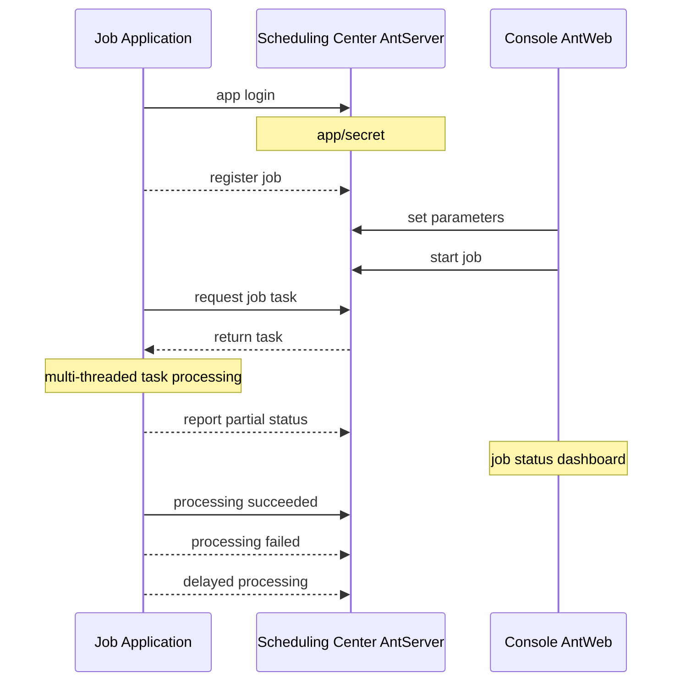
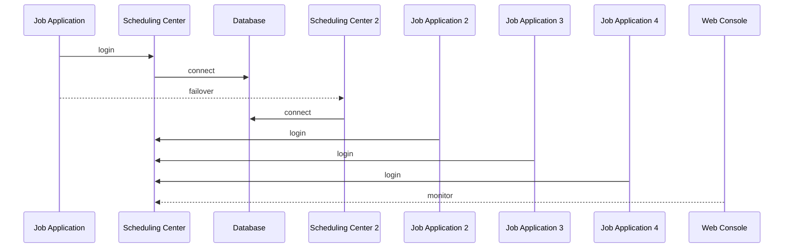

# NewLife.AntJob — планирование Ant


[](https://github.com/NewLifeX/AntJob/actions/workflows/test.yml)
[](Doc/多语言本地化.md)


[](https://github.com/NewLifeX/AntJob/graphs/contributors)


<!-- lang:start -->
🌐 [English](README.md) | [简体中文](README.zh-CN.md) | [繁體中文](README.zh-TW.md) | [Español](README.es.md) | [Deutsch](README.de.md) | [日本語](README.ja.md) | [Français](README.fr.md) | [Português](README.pt.md) | [한국어](README.ko.md) | [العربية](README.ar.md)
<!-- lang:end -->


**AntJob** — распределённая платформа планирования заданий и обработки данных в реальном времени, полностью написанная на .NET: любое большое задание разбивается на параллельные срезы времени/данных, распределяется по эластичным исполнительным узлам, повторяется при сбоях и перезапускается для дозаполнения, а веб-консоль обеспечивает мониторинг в реальном времени.

Исходный код: [https://github.com/NewLifeX/AntJob](https://github.com/NewLifeX/AntJob)  
Учебник: [https://newlifex.com/blood/antjob](https://newlifex.com/blood/antjob)  
Демо (публичный стенд): [http://ant.newlifex.com](http://ant.newlifex.com/)  

**Содержание**: [Быстрый старт](#быстрый-старт) · [Основные возможности](#основные-возможности) · [Карта экосистемы](#карта-экосистемы) · [Документация](#документация) · [Участие](#участие) · [Команда](#команда) · [Лицензия](#лицензия)

## Быстрый старт

### Установка

```bash
dotnet add package NewLife.AntJob
```

### Шаблон (рекомендуется)

```
dotnet new install NewLife.Templates
# Create a project with an AntJob sample
dotnet new antjob --name TestJob
cd TestJob
dotnet run
```

### Минимальный пример

Приведённый ниже исходный код находится в [Samples/HisAgent](https://github.com/NewLifeX/AntJob/tree/master/Samples/HisAgent). Создайте проект .NET Core 3.1+ и подключите AntJob из NuGet. Создайте экземпляр Scheduler и настройте сетевой провайдер.

```csharp
using AntJob;
using HisAgent;
using NewLife.Log;
using NewLife.Model;
using Stardust;

// Enable console logging and intercept all exceptions
XTrace.UseConsole();

var services = ObjectContainer.Current;
services.AddStardust();

services.AddAntJob()
    .AddHandler<HelloJob>();

// Friendly shutdown
var host = services.BuildHost();
await host.RunAsync();
```

Добавьте первый обработчик планового задания:

```csharp
using System;
using AntJob;

internal class HelloJob : Handler
{
    public HelloJob() => Job.Cron = "7/30 * * * * ?";

    public override Int32 Execute(JobContext ctx)
    {
        // Time of the current task
        var time = ctx.Task.DataTime;
        WriteLog("NewLife AntJob! Current task time: {0}", time);
        return 1; // Number of successfully processed items
    }
}
```

Обработчики заданий должны наследовать `Handler` и переопределять `Execute`, реализуя бизнес-логику. Time и Step, заданные в конструкторе, используются только при первой регистрации; позже они меняются в консоли.

Или используйте асинхронный обработчик планового задания:

```csharp
using System;
using AntJob;

internal class HelloJob : Handler
{
    public HelloJob() => Job.Cron = "7/30 * * * * ?";

    public override async Task<Int32> ExecuteAsync(JobContext ctx)
    {
        using var span = Tracer?.NewSpan("HelloJob", ctx.Task.DataTime);

        // Time of the current task
        var time = ctx.Task.DataTime;
        WriteLog("NewLife AntJob! Current task time: {0}", time);
        if (!ctx.Task.Data.IsNullOrEmpty()) WriteLog("Data: {0}", ctx.Task.Data);

        var state = Rand.NextString(16);
        var http = new HttpClient { BaseAddress = new Uri("https://newlifex.com") };
        http.SetUserAgent();
        var rs = await http.GetAsync<IDictionary<String, Object>>("/cube/info", new { state });

        if (rs.TryGetValue("state", out var value) && value is String str)
        {
            Trace.Assert(state == str, "Returned state does not match");
        }

        // Number of successfully processed items
        return 1;
    }
}
```

### Запуск

При первом запуске он автоматически пытается подключиться к `tcp://127.0.0.1:9999` и `tcp://ant.newlifex.com:9999` (основной/резервный) согласно конфигурации `AntSetting`. Если в `Server` указан адрес `http(s)://`, клиент автоматически переключается на HTTP-канал и получает нисходящие уведомления по WebSocket.

Пример журнала:

```sql
21:33:08.470  1 N - Start job scheduling engine [AntJob.Providers.NetworkJobProvider], jobs [1], timer 5s
21:33:08.471  1 N - HelloJob start work False range (2020-04-09 00:00:00, 0001-01-01 00:00:00) Offset=15 Step=10 MaxTask=8
```

### Веб-консоль и сброс

Разверните AntJob.Web (IIS / Kestrel / Docker) и укажите в настройке Server клиента адрес его сервиса. Отдельный AntServer не требуется:

```json
{
  "Ant": {
    "Server": "https://ant.example.com",
    "AppId": "MyJobApp",
    "Secret": ""
  }
}
```

После входа клиент устанавливает долгоживущее WebSocket-соединение `/AntJob/Notify`, поддерживаемое HTTP-пульсом, и получает уведомления об изменении заданий и приходе сообщений; когда WebSocket недоступен, работа продолжается по интервалу опроса. Как только задание включено в консоли, центр планирования нарезает задачи по моментам времени и раздаёт их: можно просматривать сведения о задачах, повторять ошибки и массово сбрасывать задачи для пересчёта истории. Запустите несколько агентов для масштабирования — любую задачу выполняет ровно один узел, а сбои повторяются согласно политике.

### Только локальное планирование из файлов

Когда `NetworkJobProvider` не настроен, используется локальный провайдер по умолчанию — он подходит для автономной отладки на одной машине.

### Docker (пример)

> Официальный образ пока не предоставляется; вы можете упаковать свой внутри организации:

```
FROM mcr.microsoft.com/dotnet/aspnet:8.0 AS base
WORKDIR /app
COPY ./publish/ .
ENTRYPOINT ["dotnet","AntJob.Web.dll"]
```

### Топологии развёртывания

| Топология | Описание |
| --- | --- |
| Один экземпляр | Web + Server + JobApp на одной машине для разработки и тестирования |
| Два центра с высокой доступностью | Два адреса центра планирования через запятую (основной/резервный) с автоматическим переключением клиента |
| Кластер из нескольких исполнителей | Несколько исполнительных узлов, сгруппированных по бизнесу или нагрузке, подключённых к единому центру планирования |
| Гибридная | Два центра + несколько исполнительных узлов в продакшене; отдельные кластеры для теста/предпродакшена |

## Основные возможности

AntJob использует идею «муравьи перетаскивают дом»: любое большое задание разбивается на небольшие части, которые могут выполняться параллельно. Идея родилась в Шанхае, в Луцзяцзуе, во время финансового кризиса 2008 года как ответ на насущную потребность финансовых организаций в недорогом и высокоэффективном анализе данных. Среди сравнимых систем — XxlJob, Quartz, Hangfire, Airflow (в ряде сценариев) и самописные кластеры плановых скриптов; AntJob делает акцент на «срезах данных/времени + повторах + единых множественных режимах» и неинтрузивной интеграции с существующей корпоративной экосистемой .NET, что подтверждено планированием триллионного масштаба и десятками миллиардов записей очистки данных.

<details>
<summary><b>Типичные сценарии</b> (4)</summary>

| Сценарий | Почему подходит AntJob |
| --- | --- |
| Массивные журналы / заказы / транзакции / данные устройств | Непрерывная выборка и вычисления в реальном времени по постоянно растущим наборам данных |
| Скользящая агрегация по временным окнам | Секундные / минутные / часовые / суточные / произвольные Cron-окна вычисляются срез за срезом |
| Дозаполнение и пересчёт данных | Исторические диапазоны можно сбрасывать и проигрывать заново, не затрагивая текущие окна |
| Пакетная обработка с высоким параллелизмом | Распределяется по дата-центрам с эластичным числом узлов |

</details>

<details>
<summary><b>Ключевые возможности</b> (11)</summary>

| Возможность | Что это даёт |
| --- | --- |
| Несколько режимов планирования | Время, окно данных, сообщения, Cron, SQL-запросы и динамические скрипты C# |
| Нарезка задания по времени/данным | Вплоть до секундной гранулярности, с догоняющей обработкой, дозаполнением и массовым сбросом |
| Надёжная доставка задач | Автоматический повтор с задержкой при сбое, устойчивость к временным отказам зависимостей |
| Эластичный кластер | Исполнительные узлы без сохранения состояния, масштабируемые в любой момент |
| Протоколы связи | HTTP REST + нисходящие уведомления WebSocket (рекомендуемый вариант по умолчанию), совместимость с TCP RPC из NewLife.Remoting |
| Визуальный мониторинг | Веб-консоль с кривыми заданий в реальном времени, статусами задач и онлайн-узлами |
| Панель задания | Динамическая корректировка параметров и статистика выполнения из консоли |
| Подключаемые провайдеры | Реализации `IJobProvider` для сети, файлов и локальных пользовательских источников |
| Лёгкие зависимости | Ядро опирается на собственную экосистему NewLife (логирование, конфигурация, трассировка), снижая внешнюю сложность |
| Кроссплатформенность и несколько TFM | От .NET Framework 4.5 до .NET 8/9 |
| Строгое именование сборок и долгосрочная совместимость | Удобно для корпоративного приватного развёртывания и повторной упаковки |

</details>

<details>
<summary><b>Режимы планирования</b> (5)</summary>

| Режим | Сценарий, гранулярность и ключевые поля |
| --- | --- |
| Время / Cron | Обычные периодические задачи с гранулярностью от секунд до Cron, управляемые `Job.Time` / `Cron`; Cron-выражения заменяют фиксированные интервалы Start+Step |
| Данные (временное окно) | Обрабатывает вновь поступившие данные по временным срезам (от секунд до любого окна), управляется Start / End; пропущенные окна заполняются автоматически — идеально для скользящих вычислений по журнальным и лог-таблицам |
| Сообщение | Пассивный режим реального времени, управляемый сообщениями: `Body` внешнего сообщения push/очереди становится задачей |
| SQL / на основе данных | Сканирует таблицу данных и нарезает её по первичному ключу/времени (пакетами); расширяющий компонент, часто используемый для исторического дозаполнения или массовой миграции |
| Динамический скрипт C# | Быстрые эксперименты и горячие обновления небольшой логики; скрипт компилируется и выполняется во время работы с учётом ограничений прав/песочницы |

</details>

<details>
<summary><b>Архитектура и ключевые модули</b> (9)</summary>

| Компонент | Ответственность |
| --- | --- |
| AntJob.Server | Логика сервера центра планирования: метаданные Job & Task, нарезка, назначение и политика повторов |
| AntJob.Web | Платформа визуального управления на NewLife.Cube: изоляция приложений (мультитенантность), права, мониторинг |
| AntJob (библиотека) | Клиентский SDK: абстракции Scheduler и Handler, сетевое взаимодействие, обёртки контекста |
| AntJob.Extensions | Расширенные типы планирования: SqlMessage, DataHandler, MessageHandler, CSharpHandler и др. |
| Samples | Примеры проектов (HisAgent, HisData, HisWeb, HelloWork) |
| Scheduler | Ядро планирования, управляющее жизненным циклом обработчиков и диспетчеризацией задач |
| Handler | Базовый класс бизнес-модулей; каждый модуль реализует `Execute` / `ExecuteAsync` |
| IJobProvider | Поставщик источников задач: сеть, локальные и пользовательские источники |
| JobContext | Среда выполнения и состояние одной задачи, включая статистику и помощники логирования |

</details>

<details>
<summary><b>Надёжность и согласованность</b> (6)</summary>

| Гарантия | Как это работает |
| --- | --- |
| Атомарное назначение задач | Задача с данным ID захватывается ровно одним узлом |
| Конечный автомат | Ready -> Processing -> Completed / Error / Cancelled |
| Автоматический повтор | Сбойные задачи повторяются с задержкой (по умолчанию 1 минута), до N раз (настраивается) |
| Механизм сброса | Массовый сброс исторического диапазона для пересчёта (дозаполнение / исправление) |
| Идемпотентность | Бизнес-логика должна выполнять идемпотентные записи с учётом первичных ключей/временных окон |
| Пульс и таблица онлайн-узлов | Обнаружение подключения/отключения узлов в реальном времени, поддержка эластичного масштабирования |

</details>

<details>
<summary><b>Конфигурация</b> (7)</summary>

| Настройка | Значение |
| --- | --- |
| `Server` | Адрес(а) центра планирования. `http(s)://` использует канал HTTP + WebSocket, `tcp://` — RPC-совместимый канал, например `https://a.example.com,https://b.example.com` или `tcp://a:9999,tcp://b:9999` |
| `AppID` / `Secret` | Учётные данные изоляции приложения, регистрируются автоматически или выдаются вручную |
| `Debug` | Отладочный переключатель, выводящий более подробные журналы |
| `UseRegistry` | Разрешать ли адреса служб через реестр Stardust (по умолчанию true); задайте false при прямом подключении через шлюз |
| `MessageIdlePeriod` | Период простоя запросов для заданий типа «сообщение» в секундах (по умолчанию 15); HTTP-уведомление о сообщении немедленно его будит |
| База данных | Подключения на стороне Web/Server автоматически создают таблицы через реверс-инжиниринг XCode |
| Интеграция со Stardust | Необязательные возможности реестра, APM и центра конфигурации для Web/Server |

</details>

<details>
<summary><b>Механизмы расширения</b> (6)</summary>

| Механизм | Как использовать |
| --- | --- |
| Собственный обработчик | Наследуйте `Handler`, переопределите `Execute(JobContext ctx)` и верните количество успешно обработанных элементов |
| Собственный поставщик источника данных | Реализуйте `IJobProvider` (например, Kafka / Redis Stream / REST) |
| Планирование сообщений | `MessageHandler` превращает произвольное тело сообщения в задачи |
| SQL / на основе данных | `SqlMessage` + `DataHandler` сканируют и нарезают данные |
| Динамические скрипты | `CSharpHandler` позволяет быстро экспериментировать через скрипты (ограничьте права в продакшене) |
| Плагинная упаковка | Строгое именование и поддержка нескольких TFM позволяют размещать обработчики в отдельных сборках и подключать их на лету |

</details>

<details>
<summary><b>Производительность и планирование мощностей</b> (7)</summary>

| Пункт | Рекомендация |
| --- | --- |
| Объём срезов на задание | До десятков миллиардов записей истории задач в зависимости от ёмкости базы данных |
| Пропускная способность узла | Зависит от бизнес-логики обработчика; накладные расходы планирования минимальны (управление планированием в памяти) |
| Давление на GC | Внутри используются пулы объектов и кэши с оптимизациями NewLife.Core |
| Гранулярность срезов | Держите умеренной; слишком мелкие срезы увеличивают накладные расходы на метаданные планирования |
| Давление на БД | Используйте пакетный ввод-вывод или кэширование, чтобы снизить нагрузку на базу данных |
| Большие окна вычислений | Предпочитайте режим Data с циклом по подокнам |
| Подтверждённый масштаб | Массовая SMS-рассылка в фондах, 6 млрд строк, нарезанных из одной таблицы, 12 млн экспресс-заказов в день, десятки миллиардов записей очистки данных и триллионный годовой объём планирования |

</details>

<details>
<summary><b>Ключевые понятия</b> (5)</summary>

| Понятие | Значение |
| --- | --- |
| Job | Конфигурация задания: время/шаг/Cron/режим/лимит параллелизма и т. д. |
| Task | Мельчайшая единица выполнения после создания экземпляра задания: момент времени или интервал и тело сообщения |
| Handler | Носитель бизнес-логики, жизненным циклом которого управляет Scheduler |
| JobContext | Контекст выполнения одной задачи: Task, статистика и помощники логирования |
| IJobProvider | Поставщик источников задач (сеть/локальный/пользовательский) |

</details>

<details>
<summary><b>Сравнение с другими планировщиками</b> (4)</summary>

| Система | Чем отличается AntJob |
| --- | --- |
| Quartz.NET | Чистая библиотека планирования/Cron; AntJob добавляет срезы данных/сообщений, пересчёт и простой шардинг кластера |
| Hangfire | Постоянные фоновые задания; AntJob ориентирован на непрерывные срезы времени/данных, а не на разовую очередь задач |
| XXL-JOB | Экосистема Java; AntJob нативно для .NET, с едиными множественными режимами и динамическими скриптами |
| Airflow | Оркестрация DAG; AntJob легче и ориентирован на высокочастотную обработку окон, может дополнять Airflow |

</details>

<details>
<summary><b>Частые вопросы (FAQ)</b> (5)</summary>

| Вопрос | Ответ |
| --- | --- |
| Почему задания после регистрации по умолчанию остановлены? | Чтобы избежать массовых запусков до настройки параметров; включайте их вручную в веб-консоли |
| Как пересчитать данные за месяц? | Измените время начала на панели задания, сбросьте указанный временной диапазон или массово выберите задачи и сбросьте их |
| Блокируют ли сбойные задачи последующие? | Нет; сбойные задачи повторяются с задержкой, а остальные окна продолжают планироваться |
| Можно ли использовать только HTTP/WebSocket? | Да. Укажите в `Server` адрес `http://` или `https://`, и клиент автоматически использует HTTP REST + уведомления WebSocket без отдельного AntServer; адреса `tcp://` сохраняют RPC-совместимый канал |
| Как ограничить риск скриптов? | Отключите неиспользуемый CSharpHandler или изолируйте его в отдельном процессе с минимальными правами |

</details>

<details>
<summary><b>Прогресс обновления v4</b> (5)</summary>

| Пункт | Статус |
| --- | --- |
| HTTP-доступ | Готово: AntWeb предоставляет сервисы планирования, AntServer не нужен; нисходящие уведомления WebSocket поставляются вместе с HTTP-каналом |
| Улучшенное планирование по расписанию | Готово: поддерживаются Cron-выражения, постепенно заменяющие фиксированный шаг Start+Step |
| Предварительно сгенерированные задачи | Запланировано: выполнение точно по времени (повышение точности, требует оценки) |
| Активная задержка задачи | Готово: запрос задержки во время выполнения без учёта как сбоя |
| Больше режимов планирования | Запланировано: регулярный AntAgent со встроенным SQL-планированием / планированием на C#, затем режимы извлечения и отправки |

</details>

<details>
<summary><b>Дорожная карта после v4</b> (4)</summary>

| Пункт | Описание |
| --- | --- |
| API активной задержки задачи | Оценивать задержку при выполнении и запускать позже, не считая это ошибкой |
| Подключаемые каналы оповещений | Email / Webhook / WeCom и другие каналы |
| Экспорт метрик мониторинга | Многомерный экспорт для Prometheus / OpenTelemetry |
| Необязательный слой DAG | Оркестрация DAG / зависимостей после стабилизации ядра |

</details>

### Схемы архитектуры

Топология компонентов

```
+----------------------+            +-------------------------+
|  Execution Node(Agent)|  RPC/TCP  |  Scheduling Center(Server)|
|  - Scheduler         |            | - JobService / Task     |
|  - Handlers(business)|            | - State & metadata      |
+----------+-----------+            +-----------+-------------+
           |  Sync logs/tracing (optional Stardust)  |
           v
    +-------------+      Web UI / API      +------------------+
    | DB / Storage|  <------------------>  | Web Console AntWeb|
    +-------------+                         +------------------+
```

Приложение-задание (реализует IJob)



Архитектура «главный/подчинённый» центра планирования



## Карта экосистемы

NewLife — это многоуровневая экосистема независимо версионируемых open-source проектов. Карта ниже дословно используется во всех репозиториях NewLife; каждый проект ссылается на свой репозиторий и свой основной пакет NuGet.

| Проект | Что делает | Загрузки |
| --- | --- | --- |
| **Базовый** | | |
| [NewLife.Core](https://github.com/NewLifeX/X) | Логирование, конфигурация, кэширование, сеть, сериализация, планирование и APM-трассировка. | [](https://www.nuget.org/packages/NewLife.Core) |
| [NewLife.XCode](https://github.com/NewLifeX/NewLife.XCode) | Промежуточное ПО данных: отдельные таблицы масштаба десятков миллиардов строк, автоматическое секционирование, разделение чтения и записи, более 10 баз данных. | [](https://www.nuget.org/packages/NewLife.XCode) |
| [NewLife.Net](https://github.com/NewLifeX/NewLife.Net) | Высокопроизводительная сетевая библиотека: 1,77M pps / 14,5 Гбит/с на машину (TCP 1KB, 2026-10), 4M долгоживущих TCP-соединений. | [](https://www.nuget.org/packages/NewLife.Net) |
| [NewLife.Remoting](https://github.com/NewLifeX/NewLife.Remoting) | Протокольная связь и RPC-фреймворк для клиент-серверных приложений и IoT-устройств. | [](https://www.nuget.org/packages/NewLife.Remoting) |
| [NewLife.Agent](https://github.com/NewLifeX/NewLife.Agent) | Устанавливает .NET-приложения как демоны ОС: службы Windows и systemd в Linux. | [](https://www.nuget.org/packages/NewLife.Agent) |
| [NewLife.Templates](https://github.com/NewLifeX/NewLife.Zero) | Шаблоны проектов `dotnet new` для консоли, web, API, службы, данных и IoT. | [](https://www.nuget.org/packages/NewLife.Templates) |
| **Данные и обмен сообщениями** | | |
| [NewLife.Redis](https://github.com/NewLifeX/NewLife.Redis) | Клиент Redis с микросекундной задержкой, миллионами операций в секунду и встроенными очередями сообщений. | [](https://www.nuget.org/packages/NewLife.Redis) |
| [NewLife.RocketMQ](https://github.com/NewLifeX/NewLife.RocketMQ) | Полностью управляемый клиент RocketMQ для Apache RocketMQ и Alibaba Cloud Message Queue. | [](https://www.nuget.org/packages/NewLife.RocketMQ) |
| [NewLife.MQTT](https://github.com/NewLifeX/NewLife.MQTT) | Клиент и сервер MQTT, включая подключение к Alibaba Cloud IoT. | [](https://www.nuget.org/packages/NewLife.MQTT) |
| [NewLife.NovaDb](https://github.com/NewLifeX/NewLife.NovaDb) | Гибридная база данных на C#: встроенная или сетевая, реляционная, временных рядов, очередь сообщений и KV в одном. | [](https://www.nuget.org/packages/NewLife.NovaDb) |
| [NewLife.MySql](https://github.com/NewLifeX/NewLife.MySql) | Драйвер MySql и вспомогательный слой на основе стека данных NewLife. | [](https://www.nuget.org/packages/NewLife.MySql) |
| **Web, AI и распределённые системы** | | |
| [NewLife.Cube](https://github.com/NewLifeX/NewLife.Cube) | Фреймворк быстрой разработки админ-платформ: права, SSO, сервер OAuth и CRUD-скаффолдинг. | [](https://www.nuget.org/packages/NewLife.Cube) |
| [Stardust](https://github.com/NewLifeX/Stardust) | Распределённая сервисная платформа: управление узлами, APM, центр конфигурации, реестр и центр публикации. | [](https://www.nuget.org/packages/NewLife.Stardust) |
| [AntJob](https://github.com/NewLifeX/AntJob) | Распределённая платформа задач и планирования данных в реальном времени с секционированием, повторами и дозаполнением. | [](https://www.nuget.org/packages/NewLife.AntJob) |
| [NewLife.AI](https://github.com/NewLifeX/NewLife.AI) | Единый клиент для 46 поставщиков LLM плюс ChatAI — готовое веб-приложение для чата. | [](https://www.nuget.org/packages/NewLife.AI) |
| **Промышленность и IoT** | | |
| [NewLife.IoT](https://github.com/NewLifeX/NewLife.IoT) | Стандартная библиотека IoT, определяющая контракты протоколов и абстракции устройств. | [](https://www.nuget.org/packages/NewLife.IoT) |
| [NewLife.Modbus](https://github.com/NewLifeX/NewLife.Modbus) | Реализация Modbus TCP/RTU/ASCII поверх NewLife.IoT. | [](https://www.nuget.org/packages/NewLife.Modbus) |
| [NewLife.Siemens](https://github.com/NewLifeX/NewLife.Siemens) | Протокол Siemens PLC поверх NewLife.IoT. | [](https://www.nuget.org/packages/NewLife.Siemens) |
| [NewLife.Omron](https://github.com/NewLifeX/NewLife.Omron) | Протокол Omron PLC поверх NewLife.IoT. | [](https://www.nuget.org/packages/NewLife.Omron) |
| [NewLife.Melsec](https://github.com/NewLifeX/NewLife.Melsec) | Протокол Mitsubishi Melsec PLC поверх NewLife.IoT. | [](https://www.nuget.org/packages/NewLife.Melsec) |
| [NewLife.OPC](https://github.com/NewLifeX/NewLife.OPC) | Клиент OPC для доступа к промышленным данным. | — |
| [NewLife.BACnet](https://github.com/NewLifeX/NewLife.BACnet) | Стек протокола автоматизации зданий BACnet. | [](https://www.nuget.org/packages/NewLife.BACnet) |
| [ZeroIoT](https://github.com/NewLifeX/ZeroIoT) | Лёгкая open-source платформа IoT с управлением шлюзами и устройствами. | — |
| **Телематика транспорта** | | |
| [NewLife.JT808](https://github.com/NewLifeX/NewLife.JT808) | Протокол позиционирования транспорта JT/T 808: более 70 типов сообщений, 2011/2013/2019. | [](https://www.nuget.org/packages/NewLife.JT808) |
| [NewLife.JT809](https://github.com/NewLifeX/NewLife.JT809) | Межплатформенный протокол JT/T 809 для органов управления транспортом. | [](https://www.nuget.org/packages/NewLife.JT809) |
| [NewLife.JT1078](https://github.com/NewLifeX/NewLife.JT1078) | Автомобильное видео JT/T 1078: разбор RTP, ремультиплексирование в FLV/fMP4 и прямая трансляция. | [](https://www.nuget.org/packages/NewLife.JT1078) |
| **Прикладные компоненты** | | |
| [NewLife.Office](https://github.com/NewLifeX/NewLife.Office) | Один пакет для Excel, Word, PPT, PDF и более 15 форматов документов. | [](https://www.nuget.org/packages/NewLife.Office) |
| [NewLife.Audio](https://github.com/NewLifeX/NewLife.Audio) | Кроссплатформенное аудио: кодеки, ввод-вывод устройств, DSP, контейнеры и потоковая передача. | [](https://www.nuget.org/packages/NewLife.Audio) |
| [NewLife.Video](https://github.com/NewLifeX/NewLife.Video) | Видеокодеки, форматы контейнеров, обработка кадров и потоковая передача. | [](https://www.nuget.org/packages/NewLife.Video) |
| [NewLife.Map](https://github.com/NewLifeX/NewLife.Map) | Единый интерфейс к Baidu, AMap, Tencent и Tianditu с геокодированием и преобразованием координат. | [](https://www.nuget.org/packages/NewLife.Map) |
| [NewLife.IP](https://github.com/NewLifeX/NewLife.IP) | Геолокация IPv4 с офлайн-базой, отображаемой в память, и онлайн-API как резервом. | [](https://www.nuget.org/packages/NewLife.IP) |
| **Инструменты и продукты** | | |
| [CrazyCoder](https://github.com/NewLifeX/XCoder) | Инструменты разработчика: сеть, последовательный порт, шифрование, регулярные выражения, Modbus и MQTT. | [](https://www.nuget.org/packages/NewLife.XCoder) |
| [GitCandy](https://github.com/NewLifeX/GitCandy) | Самостоятельно размещаемая система управления исходным кодом Git. | — |
| [LuckyClover](https://github.com/NewLifeX/LuckyClover) | Автоматически устанавливает подходящую среду выполнения .NET при запуске на старом хосте. | — |

> Бейджи показывают основной пакет каждого проекта; пакеты тем, расширений и сателлитов перечислены на соответствующих страницах NuGet. Более 30 пакетов, не перечисленных здесь (FTP, LoRa, расширения Office, драйверы протоколов и другие), доступны в [организации NewLifeX](https://github.com/NewLifeX) и на [newlifex.com](https://newlifex.com). Эта таблица ведётся в README проекта NewLife.Core.

## Документация

| Документ | Описание |
| --- | --- |
| [Требования](Doc/需求文档.md) | Видение, ключевые цели, функциональные требования 7 основных модулей и список отложенного |
| [Список функций](Doc/功能清单.md) | Трёхмерное отслеживание статуса «реализация/тесты/комментарии» для 85 функций (включая обязательную проверку разбиения) |
| [Архитектура](Doc/架构设计.md) | Слоистая архитектура, ответственность ключевых компонентов, диаграммы последовательностей ключевых процессов, проектные решения |
| [Развёртывание HTTP и WebSocket](Doc/HTTP与WebSocket部署.md) | Настройка шлюза, широковещание Redis, шаги миграции и контрольный список устранения неполадок |
| [Бенчмарки ключевых компонентов](Doc/Benchmark/核心组件性能测试.md) | Данные бенчмарков и советы по настройке для временных выражений, подстановки шаблонов и разбора фрагментов SQL |

- Учебник: [https://newlifex.com/blood/antjob](https://newlifex.com/blood/antjob)
- Демо: [http://ant.newlifex.com](http://ant.newlifex.com/)
- Правила многоязычных README: [Doc/多语言本地化.md](Doc/多语言本地化.md)

## Участие

### Сборка и тесты

```bash
dotnet build -c Release
dotnet test -c Release
# Only the main test project (net10.0), used by CI on win-x64 and linux-arm64
dotnet test AntTest/AntTest.csproj -c Release
```

- CI: `.github/workflows/test.yml` выполняет сборку, запускает тесты и проверяет локализацию, а также переключатель языков в README
- Проверки README: `pwsh -File sync-readme-languages.ps1 -Check`, `pwsh -File sync-readme-package.ps1 -Check` и `pwsh -File check-readme-structure.ps1`
- Бенчмарки: `Benchmark/AntJob.Benchmarks` (BenchmarkDotNet)

### Структура репозитория

```
AntJob/                 Client core library
AntJob.Extensions/      Extension handlers/messages/SQL, etc.
AntJob.Server/          Scheduling-center core service logic (JobService, etc.)
AntJob.Web/             Razor Pages + Cube admin console
AntJob.Data/            Base data models (entity layer)
Samples/                Sample projects (HisAgent, HisData, HisWeb, HelloWork)
AntTest/                Unit/integration tests
Doc/                    Documentation and assets
```

### Релиз

Отправьте тег с префиксом `v` (например, `v5.0.2026.1024`), чтобы запустить `.github/workflows/publish.yml`. Рабочий процесс упаковывает `AntJob`, `AntJob.Extensions` и `AntJob.Web`, публикует их в NuGet.org и GitHub Packages и создаёт GitHub Release, примечания которого берутся из соответствующего раздела `ChangeLog.md` (артефакты включают nupkg и snupkg). Ручной запуск только публикует пакеты и не создаёт Release. Коммиты, затрагивающие `AntJob/` или `AntJob.Extensions/` в master, также порождают бета-пакеты через `publish-beta.yml`.

### Обратная связь

- Перед отправкой убедитесь, что `dotnet build` и соответствующие тесты проходят; соблюдайте стиль кода репозитория.
- Сообщайте об ошибках и предложениях через [Issue](https://github.com/NewLifeX/AntJob/issues); Stars и PR приветствуются.

## Команда


Команда NewLife основана в 2002 году и более двух десятилетий работает в экосистеме .NET и IoT, поддерживает около 100 проектов с открытым кодом (34 из них — основные) и предлагает интегрированные программно-аппаратные решения для энергетики, логистики, здравоохранения, промышленной автоматизации и интернет-отрасли. Мы следуем девизу «в учении нет старших — мастерство приносит уважение».

Open-source компоненты скачали <!--nuget-total:start-->6.48M<!--nuget-total:end--> раз с NuGet (по всей экосистеме, по состоянию на 2026-10).

Сайт: https://newlifex.com · Организация open source: https://github.com/NewLifeX

<details>
<summary>Официальный аккаунт WeChat: 智能大石头 (отсканируйте, чтобы подписаться)</summary>


</details>

## Лицензия

Этот проект распространяется по лицензии [MIT](https://github.com/NewLifeX/AntJob/blob/master/LICENSE) © 2002-2026 Команда NewLife. Вы можете свободно использовать, изменять и распространять его.

> Если проект оказался полезен, поставьте Star, поделитесь им с командой или предложите улучшения через Issue/PR.
