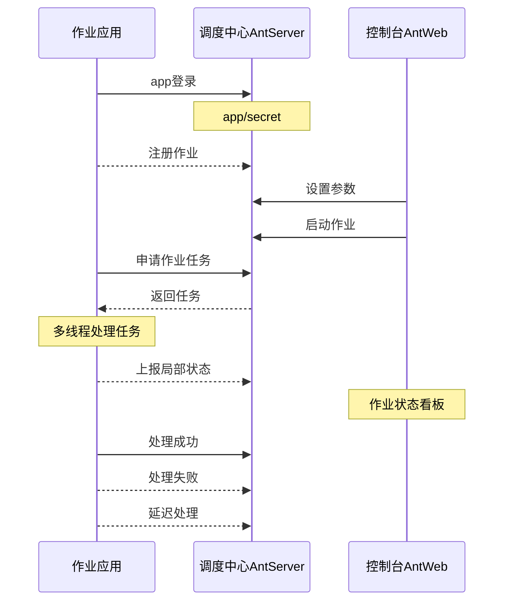
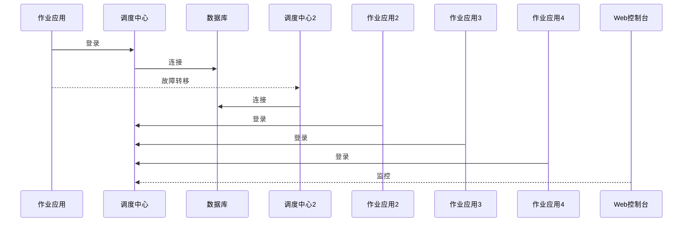

# NewLife.AntJob - 蚂蚁调度


[](https://github.com/NewLifeX/AntJob/actions/workflows/test.yml)
[](Doc/多语言本地化.md)


[](https://github.com/NewLifeX/AntJob/graphs/contributors)


<!-- lang:start -->
🌐 [English](README.md) | [繁體中文](README.zh-TW.md) | [Español](README.es.md) | [Deutsch](README.de.md) | [日本語](README.ja.md) | [Français](README.fr.md) | [Português](README.pt.md) | [Русский](README.ru.md) | [한국어](README.ko.md) | [العربية](README.ar.md)
<!-- lang:end -->

**AntJob（蚂蚁调度）** 是纯 .NET 打造的分布式任务与实时数据调度平台：把任意大任务切成可并行的时间/数据分片，分派到弹性执行节点，失败自动重试、历史可批量重置，并提供可视化控制台。

开源地址：[https://github.com/NewLifeX/AntJob](https://github.com/NewLifeX/AntJob)  
使用教程：[https://newlifex.com/blood/antjob](https://newlifex.com/blood/antjob)  
体验地址（托管演示环境）：[http://ant.newlifex.com](http://ant.newlifex.com/)  

> ℹ️ 本中文版与 [English README](README.md) 同批维护；若两者内容不一致，以英文版为对外口径。

**目录**：[快速开始](#快速开始) · [主要功能](#主要功能) · [生态版图](#生态版图) · [文档与示例](#文档与示例) · [参与贡献](#参与贡献) · [新生命开发团队](#新生命开发团队) · [许可证](#许可证)

## 快速开始

### 安装

```bash
dotnet add package NewLife.AntJob
```

### 模板方式（推荐）

```
dotnet new install NewLife.Templates
# 创建一个带 AntJob 示例的工程
dotnet new antjob --name TestJob
cd TestJob
dotnet run
```

### 最小示例

以下源码位于 [Samples/HisAgent](https://github.com/NewLifeX/AntJob/tree/master/Samples/HisAgent)。新建 .NET Core 3.1+ 项目，从 NuGet 引用 AntJob，实例化一个调度器 Scheduler，配置网络提供者。

```csharp
using AntJob;
using HisAgent;
using NewLife.Log;
using NewLife.Model;
using Stardust;

// 启用控制台日志，拦截所有异常
XTrace.UseConsole();

var services = ObjectContainer.Current;
services.AddStardust();

services.AddAntJob()
    .AddHandler<HelloJob>();

// 友好退出
var host = services.BuildHost();
await host.RunAsync();
```

添加第一个定时调度作业处理器：

```csharp
using System;
using AntJob;

internal class HelloJob : Handler
{
    public HelloJob() => Job.Cron = "7/30 * * * * ?";

    public override Int32 Execute(JobContext ctx)
    {
        // 当前任务时间
        var time = ctx.Task.DataTime;
        WriteLog("新生命蚂蚁调度系统！当前任务时间：{0}", time);
        return 1; // 成功处理数据量
    }
}
```

作业处理器必须继承 `Handler` 并重写 `Execute` 实现业务逻辑。构造函数中设定的 Time、Step 仅首次注册使用，后续修改在控制台完成。

或者使用异步处理的定时调度作业处理器：

```csharp
using System;
using AntJob;

internal class HelloJob : Handler
{
    public HelloJob() => Job.Cron = "7/30 * * * * ?";

    public override async Task<Int32> ExecuteAsync(JobContext ctx)
    {
        using var span = Tracer?.NewSpan("HelloJob", ctx.Task.DataTime);

        // 当前任务时间
        var time = ctx.Task.DataTime;
        WriteLog("新生命蚂蚁调度系统！当前任务时间：{0}", time);
        if (!ctx.Task.Data.IsNullOrEmpty()) WriteLog("数据：{0}", ctx.Task.Data);

        var state = Rand.NextString(16);
        var http = new HttpClient { BaseAddress = new Uri("https://newlifex.com") };
        http.SetUserAgent();
        var rs = await http.GetAsync<IDictionary<String, Object>>("/cube/info", new { state });

        if (rs.TryGetValue("state", out var value) && value is String str)
        {
            Trace.Assert(state == str, "返回状态不一致");
        }

        // 成功处理数据量
        return 1;
    }
}
```

### 编译与运行

首次运行会自动尝试连接 `tcp://127.0.0.1:9999` 与 `tcp://ant.newlifex.com:9999`（主备机制），来源于 `AntSetting` 配置。若 `Server` 配置为 `http(s)://` 地址，则自动切换到 HTTP 通道，并通过 WebSocket 接收下行通知。

日志示例：

```sql
21:33:08.470  1 N - 启动任务调度引擎[AntJob.Providers.NetworkJobProvider]，作业[1]项，定时5秒
21:33:08.471  1 N - HelloJob 开始工作 False 区间（2020-04-09 00:00:00, 0001-01-01 00:00:00） Offset=15 Step=10 MaxTask=8
```

### Web 控制台与重置

部署 AntJob.Web（IIS / Kestrel / Docker）后修改客户端配置 Server 指向其服务地址即可，无需独立 AntServer：

```json
{
  "Ant": {
    "Server": "https://ant.example.com",
    "AppId": "MyJobApp",
    "Secret": ""
  }
}
```

客户端登录后经 HTTP 心跳建立 `/AntJob/Notify` WebSocket 长连接，接收作业变更与消息到达通知；WebSocket 不可用时仍按轮询周期工作。在控制台启用作业后，调度中心按时间点切分任务并分发，可查看任务明细、错误重试、批量重置以回溯计算。多开若干 Agent 即可横向扩容：任一任务只会被一个节点执行，失败按策略重试。

### 仅本地文件调度

不配置 `NetworkJobProvider` 时使用默认本地 Provider，适合单机离线调试。

### Docker（示意）

> 官方暂未提供镜像，可在企业内封装：

```
FROM mcr.microsoft.com/dotnet/aspnet:8.0 AS base
WORKDIR /app
COPY ./publish/ .
ENTRYPOINT ["dotnet","AntJob.Web.dll"]
```

### 典型部署拓扑

| 拓扑 | 说明 |
| --- | --- |
| 单实例 | Web + Server + JobApp 同机部署，适合开发测试 |
| 双中心高可用 | 两个调度中心地址逗号分隔（主备切换），客户端自动 Failover |
| 多执行集群 | 若干执行节点（按业务或负载分组），统一连接调度中心 |
| 混合 | 生产使用双中心 + 多执行节点；测试/预发独立集群 |

## 主要功能

AntJob 以“蚂蚁搬家”思想把任意大任务切分成可并行的小片段。该思想诞生于 2008 年金融危机期间的上海陆家嘴，回应金融机构对低成本、高效率数据分析能力的紧急诉求。对标 XxlJob、Quartz、Hangfire、Airflow（部分场景）、自研定时脚本集群等；AntJob 更强调“数据/时间切片 + 重试 + 多模式统一”和对企业内已有 .NET 生态的无侵入集成，历经万亿级年度调度与百亿级数据清洗实践打磨。

<details>
<summary><b>典型场景</b>（4 项）</summary>

| 场景 | 适配原因 |
| --- | --- |
| 海量日志 / 订单 / 交易 / 设备数据 | 持续抽取与实时计算不断增长的数据集 |
| 按时间窗口滚动汇总 | 秒 / 分 / 小时 / 天 / 自定义 Cron 窗口逐片计算 |
| 数据补算与重算 | 历史区间可重置回放，不影响在线窗口 |
| 高并发批处理 | 跨多机房分发，节点数弹性伸缩 |

</details>

<details>
<summary><b>核心特性</b>（11 项）</summary>

| 特性 | 价值 |
| --- | --- |
| 多调度模式 | 定时 (Time)、数据窗口 (Data)、消息 (Message)、Cron、SQL 语句、C# 动态脚本 |
| 作业时间/数据切片 | 精细到秒级，支持追赶、回溯补齐、批量重置 |
| 任务可靠投递 | 失败自动延迟重试，容忍暂时性依赖失败 |
| 集群弹性 | 天然无状态执行节点，可随时扩缩容 |
| 通信协议 | HTTP REST + WebSocket 下行通知（默认推荐），兼容 NewLife.Remoting TCP RPC |
| 监控可视化 | Web 控制台实时查看作业曲线、任务状态、节点在线 |
| 作业面板 | 控制台动态调整参数，并提供运行态统计 |
| 可插拔提供者 | `IJobProvider` 实现网络、文件、本地自定义源 |
| 轻依赖 | 核心依赖 NewLife 自家生态（日志、配置、追踪），减少外部复杂度 |
| 跨平台与多 TFM | 支持从 .NET Framework 4.5 到 .NET 8/9 |
| 强命名与长期兼容 | 方便企业私有化与二次封装 |

</details>

<details>
<summary><b>调度模式</b>（5 项）</summary>

| 模式 | 适用场景、粒度与关键字段 |
| --- | --- |
| Time / Cron | 通用周期性任务，粒度秒级至 Cron；由 `Job.Time` / `Cron` 驱动，支持 Cron 表达式替代 Start+Step 固定间隔 |
| Data（时间窗口） | 按时间分片处理新增数据，粒度秒级至任意窗口；由 Start / End 驱动，自动补齐窗口，适合流水表、日志表滚动计算 |
| Message | 被动消息驱动，实时触发；外部推送/队列消息的 `Body` 转成任务 |
| SQL / 数据驱动 | 扫描数据表按主键/时间切片，批量执行；扩展组件，常用于历史补算或批量迁移 |
| C# 动态脚本 | 快速试验、小逻辑热更；运行时编译执行（受权限/沙箱限制） |

</details>

<details>
<summary><b>架构与核心模块</b>（9 项）</summary>

| 组件 | 职责 |
| --- | --- |
| AntJob.Server | 调度中心服务端逻辑：Job & Task 元数据、分片、分配、重试策略 |
| AntJob.Web | 基于 NewLife.Cube 的可视化管理平台：多租户 App 隔离、权限、监控 |
| AntJob（库） | 客户端 SDK：Scheduler + Handler 抽象、网络通信、上下文封装 |
| AntJob.Extensions | 扩展调度类型：SqlMessage、DataHandler、MessageHandler、CSharpHandler 等 |
| Samples | 示例项目（HisAgent、HisData、HisWeb、HelloWork） |
| Scheduler | 作业调度核心引擎，管理处理器生命周期与任务分发 |
| Handler | 作业处理器基类，各业务模块继承并实现 `Execute` / `ExecuteAsync` |
| IJobProvider | 任务来源提供者，支持网络、本地与自定义源 |
| JobContext | 一次任务执行环境与状态，含统计与日志辅助 |

</details>

<details>
<summary><b>可靠性与一致性</b>（6 项）</summary>

| 保证 | 实现方式 |
| --- | --- |
| 任务原子分配 | 同一任务 ID 只会被一个节点获取 |
| 状态机 | 就绪 -> 处理中 -> 完成 / 错误 / 取消 |
| 自动重试 | 失败后按延迟（默认 1 分钟）重试，最多 N 次（可配置） |
| 重置机制 | 批量重置历史区间重新计算（补算 / 校正） |
| 幂等性 | 业务层建议基于主键/时间窗口实现幂等写入 |
| 心跳与在线表 | 实时发现节点上下线，支持弹性扩容 |

</details>

<details>
<summary><b>配置</b>（7 项）</summary>

| 配置 | 含义 |
| --- | --- |
| `Server` | 调度中心地址，支持多地址；`http(s)://` 走 HTTP + WebSocket 通道，`tcp://` 走 RPC 兼容通道，例如 `https://a.example.com,https://b.example.com` 或 `tcp://a:9999,tcp://b:9999` |
| `AppID` / `Secret` | 应用隔离凭据（可自动注册或手动分发） |
| `Debug` | 调试开关，输出更详细日志 |
| `UseRegistry` | 是否使用星尘注册中心解析服务地址，默认 true；经网关直连时建议设为 false |
| `MessageIdlePeriod` | 消息型作业空闲申请周期（秒），默认 15；HTTP 通道收到消息通知会立即唤醒 |
| 数据库 | Web/Server 侧连接通过 XCode 自动反向工程创建表 |
| Stardust 集成 | Web/Server 侧可选接入注册中心、APM、配置中心能力 |

</details>

<details>
<summary><b>扩展机制</b>（6 项）</summary>

| 机制 | 用法 |
| --- | --- |
| 自定义 Handler | 继承 `Handler`，重写 `Execute(JobContext ctx)` 返回成功处理数量 |
| 自定义数据来源 Provider | 实现 `IJobProvider`（如 Kafka / Redis Stream / REST） |
| 消息调度 | `MessageHandler` 推送任意消息体形成任务 |
| SQL / 数据驱动 | `SqlMessage` + `DataHandler` 扫描数据并切片 |
| 动态脚本 | `CSharpHandler` 允许以脚本方式快速试错（生产需限制权限） |
| 插件化封装 | 强命名与多 TFM 支持在独立程序集封装处理器后热插拔 |

</details>

<details>
<summary><b>性能与容量规划</b>（7 项）</summary>

| 项目 | 说明 |
| --- | --- |
| 单作业切片规模 | 可达百亿级任务历史记录（视数据库能力） |
| 单节点吞吐 | 依据 Handler 业务逻辑；框架调度开销极低（内存级调度控制） |
| GC 压力 | 内部使用对象池/缓存，依赖 NewLife.Core 优化 |
| 切片粒度 | 适度控制，过细会增加调度元数据开销 |
| 数据库压力 | 使用批量 IO 或缓存减少数据库压力 |
| 大计算窗口 | 优先 Data 模式 + 子窗口循环 |
| 实证规模 | 基金短信群发、单表 60 亿行切片、快递 1200 万/日订单处理、百亿级数据清洗、万亿级年度调度 |

</details>

<details>
<summary><b>核心概念</b>（5 项）</summary>

| 概念 | 含义 |
| --- | --- |
| Job | 作业配置（时间/步进/Cron/模式/并发限制等） |
| Task | 作业实例化后的最小执行单元（带时间点或区间、消息体） |
| Handler | 业务逻辑载体，生命周期由 Scheduler 管理 |
| JobContext | 一次任务执行上下文（含 Task、统计、日志辅助） |
| IJobProvider | 任务来源提供者（网络/本地/自定义） |

</details>

<details>
<summary><b>与常见调度系统对比</b>（4 项）</summary>

| 系统 | AntJob 差异点 |
| --- | --- |
| Quartz.NET | 纯定时/Cron 库；AntJob 追加数据/消息切片、重算与简单集群分片 |
| Hangfire | 持久化后台任务；AntJob 专注“时间/数据”连续切片而非一次性任务队列 |
| XXL-JOB | Java 生态；AntJob 为 .NET 原生 + 多模式统一 + 动态脚本 |
| Airflow | DAG 编排；AntJob 更轻量，聚焦高频窗口处理，可与 Airflow 互补 |

</details>

<details>
<summary><b>常见问题</b>（5 项）</summary>

| 问题 | 回答 |
| --- | --- |
| 作业注册后为什么默认停止? | 防止未配置参数即大量启动，需在 Web 控制台手动启用 |
| 如何回溯重算一个月数据? | 在作业面板修改开始时间、重置指定时间段，或批量选择任务重置 |
| 任务失败是否会阻塞后续? | 不会；失败任务延迟重试，其它窗口继续调度 |
| 能否只用 Http/WebSocket 接入? | 可以。`Server` 配置为 `http://` 或 `https://` 地址即可，客户端自动使用 HTTP REST + WebSocket 通知，无需独立 AntServer；`tcp://` 地址继续走 RPC 兼容通道 |
| 如何限制脚本风险? | 关闭未使用的 CSharpHandler，或隔离运行进程 + 最小权限配置 |

</details>

<details>
<summary><b>v4 架构升级进展</b>（5 项）</summary>

| 项目 | 状态 |
| --- | --- |
| Http 接入 | 已完成：AntWeb 提供调度服务，无需 AntServer；WebSocket 下行通知已随 HTTP 通道落地 |
| 增强定时调度 | 已完成：支持 Cron 表达式，逐步替代 Start+Step 固定步进 |
| 提前生成任务 | 待评估：到点即执行，提升精度 |
| 任务主动延迟 | 已完成：执行中请求延迟但不计失败，提高鲁棒性 |
| 扩充调度模式 | 规划中：常态化 AntAgent，纳入 Sql 调度 / C# 调度，后续增加抽取、推送等模式 |

</details>

<details>
<summary><b>v4 之外的 Roadmap</b>（4 项）</summary>

| 项目 | 说明 |
| --- | --- |
| 任务主动延迟 API | 执行中评估延时再执行，但不计错 |
| 可插拔告警渠道 | 邮件 / Webhook / 企业微信等 |
| 监控指标导出 | 多维度导出，支持 Prometheus / OpenTelemetry |
| 可选 DAG 扩展层 | 核心稳定后提供 DAG / 依赖编排 |

</details>

### 架构示意图

组件拓扑

```
+----------------------+            +-------------------------+
|   执行节点 (Agent)   |  RPC/TCP   |   调度中心 (Server)     |
|  - Scheduler         | <--------> | - JobService / Task逻辑 |
|  - Handlers(业务)    |            | - 状态 & 元数据存储      |
+----------+-----------+            +-----------+-------------+
           |  同步日志/追踪 (可选对接 Stardust)  |
           v                                          
    +-------------+      Web UI / API      +------------------+
    | 数据库/存储 |  <------------------>  |  Web 控制台 AntWeb |
    +-------------+                         +------------------+
```

计算型应用（实现 IJob）



调度中心主从架构



## 生态版图

NewLife 生态按依赖分层，各项目独立版本、独立发版。下面的版图在所有 NewLife 仓库中逐字一致；每个项目链接到代码仓库与主 NuGet 包。

| 项目 | 一句话定位 | 下载量 |
| --- | --- | --- |
| **基础底座** | | |
| [NewLife.Core](https://github.com/NewLifeX/X) | 日志、配置、缓存、网络、序列化、定时调度与 APM 追踪。 | [](https://www.nuget.org/packages/NewLife.Core) |
| [NewLife.XCode](https://github.com/NewLifeX/NewLife.XCode) | 数据中间件：单表百亿级、自动分表、读写分离，支持 10 多种数据库。 | [](https://www.nuget.org/packages/NewLife.XCode) |
| [NewLife.Net](https://github.com/NewLifeX/NewLife.Net) | 高性能网络库：单机 177 万 pps、14.5 Gbps（TCP 1KB，2026-10 实测），400 万 Tcp 长连接。 | [](https://www.nuget.org/packages/NewLife.Net) |
| [NewLife.Remoting](https://github.com/NewLifeX/NewLife.Remoting) | 协议通信与 RPC 框架，面向 CS 应用与物联网设备。 | [](https://www.nuget.org/packages/NewLife.Remoting) |
| [NewLife.Agent](https://github.com/NewLifeX/NewLife.Agent) | 把 .NET 应用安装为操作系统守护进程：Windows 服务与 Linux systemd。 | [](https://www.nuget.org/packages/NewLife.Agent) |
| [NewLife.Templates](https://github.com/NewLifeX/NewLife.Zero) | `dotnet new` 项目模板：控制台、Web、WebApi、服务、数据与物联网。 | [](https://www.nuget.org/packages/NewLife.Templates) |
| **数据存储与消息** | | |
| [NewLife.Redis](https://github.com/NewLifeX/NewLife.Redis) | Redis 客户端：微秒级延迟、百万级吞吐，内置消息队列。 | [](https://www.nuget.org/packages/NewLife.Redis) |
| [NewLife.RocketMQ](https://github.com/NewLifeX/NewLife.RocketMQ) | 纯托管 RocketMQ 客户端，支持 Apache RocketMQ 与阿里云消息队列。 | [](https://www.nuget.org/packages/NewLife.RocketMQ) |
| [NewLife.MQTT](https://github.com/NewLifeX/NewLife.MQTT) | MQTT 客户端与服务端，客户端支持阿里云物联网。 | [](https://www.nuget.org/packages/NewLife.MQTT) |
| [NewLife.NovaDb](https://github.com/NewLifeX/NewLife.NovaDb) | C# 混合数据库：嵌入/网络双模，关系型、时序、消息队列与 KV 于一体。 | [](https://www.nuget.org/packages/NewLife.NovaDb) |
| [NewLife.MySql](https://github.com/NewLifeX/NewLife.MySql) | MySql 驱动与数据访问辅助层，基于 NewLife 数据栈实现。 | [](https://www.nuget.org/packages/NewLife.MySql) |
| **Web、AI 与分布式** | | |
| [NewLife.Cube](https://github.com/NewLifeX/NewLife.Cube) | 魔方快速开发平台：用户权限、SSO、OAuth 服务端与 CRUD 脚手架。 | [](https://www.nuget.org/packages/NewLife.Cube) |
| [Stardust](https://github.com/NewLifeX/Stardust) | 星尘分布式服务平台：节点管理、APM、配置中心、注册中心与发布中心。 | [](https://www.nuget.org/packages/NewLife.Stardust) |
| [AntJob](https://github.com/NewLifeX/AntJob) | 蚂蚁调度：分布式任务与实时数据平台，支持分片、重试与回溯补算。 | [](https://www.nuget.org/packages/NewLife.AntJob) |
| [NewLife.AI](https://github.com/NewLifeX/NewLife.AI) | 统一接入 46 家大模型服务商，附带开箱即用的 ChatAI Web 对话应用。 | [](https://www.nuget.org/packages/NewLife.AI) |
| **工业与物联网** | | |
| [NewLife.IoT](https://github.com/NewLifeX/NewLife.IoT) | IoT 标准库，定义物联网通信协议契约与设备抽象。 | [](https://www.nuget.org/packages/NewLife.IoT) |
| [NewLife.Modbus](https://github.com/NewLifeX/NewLife.Modbus) | Modbus TCP/RTU/ASCII，基于 NewLife.IoT 实现。 | [](https://www.nuget.org/packages/NewLife.Modbus) |
| [NewLife.Siemens](https://github.com/NewLifeX/NewLife.Siemens) | 西门子 PLC 协议，基于 NewLife.IoT 实现。 | [](https://www.nuget.org/packages/NewLife.Siemens) |
| [NewLife.Omron](https://github.com/NewLifeX/NewLife.Omron) | 欧姆龙 PLC 协议，基于 NewLife.IoT 实现。 | [](https://www.nuget.org/packages/NewLife.Omron) |
| [NewLife.Melsec](https://github.com/NewLifeX/NewLife.Melsec) | 三菱 Melsec PLC 协议，基于 NewLife.IoT 实现。 | [](https://www.nuget.org/packages/NewLife.Melsec) |
| [NewLife.OPC](https://github.com/NewLifeX/NewLife.OPC) | OPC 客户端，用于工业数据采集。 | — |
| [NewLife.BACnet](https://github.com/NewLifeX/NewLife.BACnet) | BACnet 楼宇自控协议栈。 | [](https://www.nuget.org/packages/NewLife.BACnet) |
| [ZeroIoT](https://github.com/NewLifeX/ZeroIoT) | 开源轻量级 IoT 平台，含网关与设备管理。 | — |
| **车联网** | | |
| [NewLife.JT808](https://github.com/NewLifeX/NewLife.JT808) | JT/T 808 车辆定位协议：70+ 消息体，覆盖 2011/2013/2019 三个版本。 | [](https://www.nuget.org/packages/NewLife.JT808) |
| [NewLife.JT809](https://github.com/NewLifeX/NewLife.JT809) | JT/T 809 部标平台互联协议，面向运输管理部门。 | [](https://www.nuget.org/packages/NewLife.JT809) |
| [NewLife.JT1078](https://github.com/NewLifeX/NewLife.JT1078) | JT/T 1078 车载视频：RTP 解析、FLV/fMP4 转封装与直播推送。 | [](https://www.nuget.org/packages/NewLife.JT1078) |
| **领域组件** | | |
| [NewLife.Office](https://github.com/NewLifeX/NewLife.Office) | 一个包覆盖 Excel、Word、PPT、PDF 等 15+ 文档格式。 | [](https://www.nuget.org/packages/NewLife.Office) |
| [NewLife.Audio](https://github.com/NewLifeX/NewLife.Audio) | 跨平台音频：编解码、设备 IO、DSP、容器与流式处理。 | [](https://www.nuget.org/packages/NewLife.Audio) |
| [NewLife.Video](https://github.com/NewLifeX/NewLife.Video) | 视频编解码、封装格式、帧处理与流媒体。 | [](https://www.nuget.org/packages/NewLife.Video) |
| [NewLife.Map](https://github.com/NewLifeX/NewLife.Map) | 百度/高德/腾讯/天地图统一接口，支持地理编码与坐标转换。 | [](https://www.nuget.org/packages/NewLife.Map) |
| [NewLife.IP](https://github.com/NewLifeX/NewLife.IP) | IPv4 归属地：离线内存映射库 + 在线 API 双源。 | [](https://www.nuget.org/packages/NewLife.IP) |
| **工具与产品** | | |
| [CrazyCoder](https://github.com/NewLifeX/XCoder) | 码神工具：网络、串口、加解密、正则、Modbus 与 MQTT。 | [](https://www.nuget.org/packages/NewLife.XCoder) |
| [GitCandy](https://github.com/NewLifeX/GitCandy) | 自托管 Git 源代码管理系统。 | — |
| [LuckyClover](https://github.com/NewLifeX/LuckyClover) | 从低版本宿主启动时，自动安装匹配的 .NET 运行时。 | — |

> 徽章取各项目主包；主题包、扩展包与卫星包见对应 NuGet 页面。未在表中列出的 30 多个包（FTP、LoRa、Office 扩展、各类协议驱动等）见 [NewLifeX 组织](https://github.com/NewLifeX) 与 [newlifex.com](https://newlifex.com)。 本表以 NewLife.Core README 为维护源。

## 文档与示例

| 文档 | 说明 |
| --- | --- |
| [需求文档](Doc/需求文档.md) | 愿景、核心目标、7 大模块的功能需求与暂缓清单 |
| [功能清单](Doc/功能清单.md) | 85 项功能点的实现/测试/注释三维状态追踪（含强制拆分检查） |
| [架构设计](Doc/架构设计.md) | 分层架构、核心组件职责、关键流程时序图、设计决策 |
| [HTTP 与 WebSocket 部署](Doc/HTTP与WebSocket部署.md) | 网关配置、Redis 广播、迁移步骤与排查清单 |
| [核心组件性能测试](Doc/Benchmark/核心组件性能测试.md) | 时间表达式、模板替换、SQL 片段解析基准数据与优化建议 |

- 使用教程：[https://newlifex.com/blood/antjob](https://newlifex.com/blood/antjob)
- 在线体验：[http://ant.newlifex.com](http://ant.newlifex.com/)
- 多语言 README 规范：[Doc/多语言本地化.md](Doc/多语言本地化.md)

## 参与贡献

### 构建与测试

```bash
dotnet build -c Release
dotnet test -c Release
# 仅主测试工程（net10.0），CI 在 win-x64 与 linux-arm64 上运行
dotnet test AntTest/AntTest.csproj -c Release
```

- CI：`.github/workflows/test.yml` 负责构建、测试、本地化与 README 语言切换行校验
- README 校验：`pwsh -File sync-readme-languages.ps1 -Check`、`pwsh -File sync-readme-package.ps1 -Check` 与 `pwsh -File check-readme-structure.ps1`
- 性能基准：`Benchmark/AntJob.Benchmarks`（BenchmarkDotNet）

### 目录结构

```
AntJob/                 客户端核心库
AntJob.Extensions/      扩展处理器/消息/SQL等
AntJob.Server/          调度中心核心服务逻辑 (JobService 等)
AntJob.Web/             Razor Pages + Cube 管理后台
AntJob.Data/            基础数据模型 (实体层)
Samples/                示例项目（HisAgent、HisData、HisWeb、HelloWork）
AntTest/                单元/集成测试
Doc/                    文档与资源
```

### 发版

推送 `v` 前缀标签（如 `v5.0.2026.1024`）触发 `.github/workflows/publish.yml`，打包 `AntJob`、`AntJob.Extensions`、`AntJob.Web` 并推送到 NuGet.org 与 GitHub Packages，同时创建 GitHub Release（说明取自 `ChangeLog.md` 对应版本段落，附件含 nupkg 与 snupkg）。手工触发只发包、不创建 Release。master 上改动 `AntJob/` 或 `AntJob.Extensions/` 的提交还会经 `publish-beta.yml` 产出 beta 包。

### 反馈

- 提交前请确保 `dotnet build` 与相关测试通过，并遵循仓库代码风格。
- 通过 [Issue](https://github.com/NewLifeX/AntJob/issues) 反馈缺陷与建议；欢迎 Star 与 PR。

## 新生命开发团队


新生命团队成立于 2002 年，二十余年专注 .NET 与物联网技术生态，主导开源项目近百个（生态版图收录 34 个主干项目），为电力、物流、医疗、工控、互联网等行业提供软硬件一体化解决方案；以“学无先后达者为师”为信条。

开源组件在 NuGet 累计下载 <!--nuget-total:start-->6.48M<!--nuget-total:end--> 次（全生态口径，截至 2026-10）。

网站：https://newlifex.com · 开源组织：https://github.com/NewLifeX

<details>
<summary>微信公众号：智能大石头（扫码关注）</summary>


</details>

## 许可证

本项目采用 [MIT](https://github.com/NewLifeX/AntJob/blob/master/LICENSE) 许可证，可自由使用、修改与再分发。MIT License © 2002-2026 新生命开发团队。

> 如果本项目对你有帮助，欢迎 Star、推荐给团队，或通过 Issue/PR 提出改进建议。
