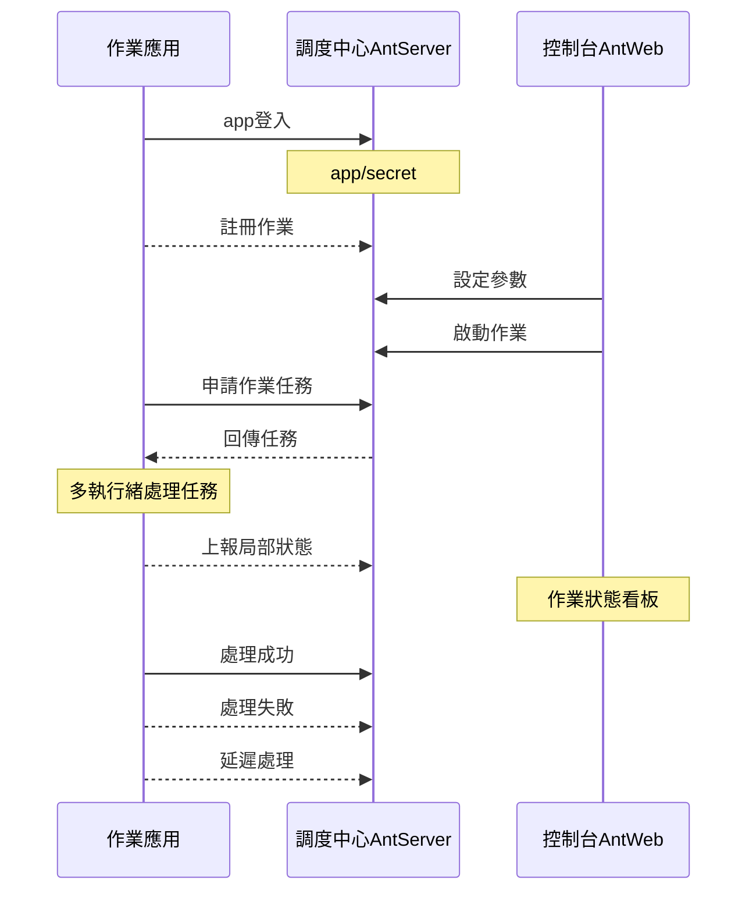
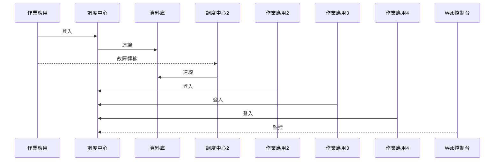

# AntJob - 分散式作業排程平台


[](https://github.com/NewLifeX/AntJob/actions/workflows/test.yml)
[](Doc/多语言本地化.md)


[](https://github.com/NewLifeX/AntJob/graphs/contributors)


<!-- lang:start -->
🌐 [English](README.md) | [简体中文](README.zh-CN.md) | [Español](README.es.md) | [Deutsch](README.de.md) | [日本語](README.ja.md) | [Français](README.fr.md) | [Português](README.pt.md) | [Русский](README.ru.md) | [한국어](README.ko.md) | [العربية](README.ar.md)
<!-- lang:end -->

**AntJob（螞蟻調度）** 是純 .NET 打造的分散式任務與即時資料排程平台：把任意大任務切成可平行執行的時間／資料分片，分派到彈性執行節點，失敗自動重試、歷史可批次重置，並提供視覺化控制台。

開源位址：[https://github.com/NewLifeX/AntJob](https://github.com/NewLifeX/AntJob)  
使用教學：[https://newlifex.com/blood/antjob](https://newlifex.com/blood/antjob)  
體驗位址（託管示範環境）：[http://ant.newlifex.com](http://ant.newlifex.com/)  


**目錄**：[快速開始](#快速開始) · [主要功能](#主要功能) · [生態版圖](#生態版圖) · [文件與範例](#文件與範例) · [參與貢獻](#參與貢獻) · [新生命開發團隊](#新生命開發團隊) · [授權](#授權)

## 快速開始

### 安裝

```bash
dotnet add package NewLife.AntJob
```

### 範本方式（建議）

```
dotnet new install NewLife.Templates
# 建立一個帶 AntJob 範例的專案
dotnet new antjob --name TestJob
cd TestJob
dotnet run
```

### 最小範例

以下原始碼位於 [Samples/HisAgent](https://github.com/NewLifeX/AntJob/tree/master/Samples/HisAgent)。建立 .NET Core 3.1+ 專案，從 NuGet 引用 AntJob，具現化一個排程器 Scheduler，設定網路提供者。

```csharp
using AntJob;
using HisAgent;
using NewLife.Log;
using NewLife.Model;
using Stardust;

// 啟用主控台日誌，攔截所有例外
XTrace.UseConsole();

var services = ObjectContainer.Current;
services.AddStardust();

services.AddAntJob()
    .AddHandler<HelloJob>();

// 友善結束
var host = services.BuildHost();
await host.RunAsync();
```

加入第一個定時排程作業處理器：

```csharp
using System;
using AntJob;

internal class HelloJob : Handler
{
    public HelloJob() => Job.Cron = "7/30 * * * * ?";

    public override Int32 Execute(JobContext ctx)
    {
        // 目前任務時間
        var time = ctx.Task.DataTime;
        WriteLog("新生命螞蟻調度系統！目前任務時間：{0}", time);
        return 1; // 成功處理資料量
    }
}
```

作業處理器必須繼承 `Handler` 並覆寫 `Execute` 實作業務邏輯。建構函式中設定的 Time、Step 僅首次註冊使用，後續修改在控制台完成。

或者使用非同步處理的定時排程作業處理器：

```csharp
using System;
using AntJob;

internal class HelloJob : Handler
{
    public HelloJob() => Job.Cron = "7/30 * * * * ?";

    public override async Task<Int32> ExecuteAsync(JobContext ctx)
    {
        using var span = Tracer?.NewSpan("HelloJob", ctx.Task.DataTime);

        // 目前任務時間
        var time = ctx.Task.DataTime;
        WriteLog("新生命螞蟻調度系統！目前任務時間：{0}", time);
        if (!ctx.Task.Data.IsNullOrEmpty()) WriteLog("資料：{0}", ctx.Task.Data);

        var state = Rand.NextString(16);
        var http = new HttpClient { BaseAddress = new Uri("https://newlifex.com") };
        http.SetUserAgent();
        var rs = await http.GetAsync<IDictionary<String, Object>>("/cube/info", new { state });

        if (rs.TryGetValue("state", out var value) && value is String str)
        {
            Trace.Assert(state == str, "回傳狀態不一致");
        }

        // 成功處理資料量
        return 1;
    }
}
```

### 編譯與執行

首次執行會自動嘗試連線 `tcp://127.0.0.1:9999` 與 `tcp://ant.newlifex.com:9999`（主備機制），來源為 `AntSetting` 設定。若 `Server` 設定為 `http(s)://` 位址，則自動切換到 HTTP 通道，並透過 WebSocket 接收下行通知。

日誌範例：

```sql
21:33:08.470  1 N - 啟動任務調度引擎[AntJob.Providers.NetworkJobProvider]，作業[1]項，定時5秒
21:33:08.471  1 N - HelloJob 開始工作 False 區間（2020-04-09 00:00:00, 0001-01-01 00:00:00） Offset=15 Step=10 MaxTask=8
```

### Web 控制台與重置

部署 AntJob.Web（IIS / Kestrel / Docker）後修改用戶端設定 Server 指向其服務位址即可，無需獨立 AntServer：

```json
{
  "Ant": {
    "Server": "https://ant.example.com",
    "AppId": "MyJobApp",
    "Secret": ""
  }
}
```

用戶端登入後經 HTTP 心跳建立 `/AntJob/Notify` WebSocket 長連線，接收作業變更與訊息到達通知；WebSocket 不可用時仍依輪詢週期運作。在控制台啟用作業後，調度中心依時間點切分任務並分發，可檢視任務明細、錯誤重試、批次重置以回溯計算。多開若干 Agent 即可橫向擴容：任一任務只會被一個節點執行，失敗依策略重試。

### 僅本機檔案排程

未設定 `NetworkJobProvider` 時使用預設本機 Provider，適合單機離線偵錯。

### Docker（示意）

> 官方暫未提供映像檔，可在企業內封裝：

```
FROM mcr.microsoft.com/dotnet/aspnet:8.0 AS base
WORKDIR /app
COPY ./publish/ .
ENTRYPOINT ["dotnet","AntJob.Web.dll"]
```

### 典型部署拓撲

| 拓撲 | 說明 |
| --- | --- |
| 單實例 | Web + Server + JobApp 同機部署，適合開發測試 |
| 雙中心高可用 | 兩個調度中心位址以逗號分隔（主備切換），用戶端自動 Failover |
| 多執行叢集 | 若干執行節點（依業務或負載分組），統一連線調度中心 |
| 混合 | 生產使用雙中心 + 多執行節點；測試／預發獨立叢集 |

## 主要功能

AntJob 以「螞蟻搬家」思想把任意大任務切成可平行執行的小片段。該思想誕生於 2008 年金融危機期間的上海陸家嘴，回應金融機構對低成本、高效率資料分析能力的緊急訴求。對標 XxlJob、Quartz、Hangfire、Airflow（部分場景）、自研定時腳本叢集等；AntJob 更強調「資料／時間切片 + 重試 + 多模式統一」和對企業內既有 .NET 生態的無侵入整合，歷經兆級年度調度與百億級資料清洗實務淬鍊。

<details>
<summary><b>典型場景</b>（4 項）</summary>

| 場景 | 適配原因 |
| --- | --- |
| 海量日誌／訂單／交易／裝置資料 | 持續抽取與即時計算不斷成長的資料集 |
| 依時間視窗滾動彙總 | 秒／分／小時／天／自訂 Cron 視窗逐片計算 |
| 資料補算與重算 | 歷史區間可重置回放，不影響線上視窗 |
| 高並行批次處理 | 跨多機房分發，節點數彈性伸縮 |

</details>

<details>
<summary><b>核心特性</b>（11 項）</summary>

| 特性 | 價值 |
| --- | --- |
| 多排程模式 | 定時 (Time)、資料視窗 (Data)、訊息 (Message)、Cron、SQL 語句、C# 動態腳本 |
| 作業時間／資料切片 | 精細到秒級，支援追趕、回溯補齊、批次重置 |
| 任務可靠投遞 | 失敗自動延遲重試，容忍暫時性相依失敗 |
| 叢集彈性 | 天然無狀態執行節點，可隨時擴縮容 |
| 通訊協定 | HTTP REST + WebSocket 下行通知（預設建議），相容 NewLife.Remoting TCP RPC |
| 監控視覺化 | Web 控制台即時檢視作業曲線、任務狀態、節點線上 |
| 作業面板 | 控制台動態調整參數，並提供執行期統計 |
| 可插拔提供者 | `IJobProvider` 實作網路、檔案、本機自訂來源 |
| 輕相依 | 核心相依 NewLife 自家生態（日誌、設定、追蹤），減少外部複雜度 |
| 跨平台與多 TFM | 支援從 .NET Framework 4.5 到 .NET 8/9 |
| 強式命名與長期相容 | 方便企業私有化與二次封裝 |

</details>

<details>
<summary><b>排程模式</b>（5 項）</summary>

| 模式 | 適用場景、粒度與關鍵欄位 |
| --- | --- |
| Time / Cron | 通用週期性任務，粒度秒級至 Cron；由 `Job.Time` / `Cron` 驅動，支援 Cron 運算式取代 Start+Step 固定間隔 |
| Data（時間視窗） | 依時間分片處理新增資料，粒度秒級至任意視窗；由 Start / End 驅動，自動補齊視窗，適合流水表、日誌表滾動計算 |
| Message | 被動訊息驅動，即時觸發；外部推送／佇列訊息的 `Body` 轉成任務 |
| SQL／資料驅動 | 掃描資料表依主鍵／時間切片，批次執行；擴充元件，常用於歷史補算或批次遷移 |
| C# 動態腳本 | 快速試驗、小邏輯熱更；執行時編譯執行（受權限／沙箱限制） |

</details>

<details>
<summary><b>架構與核心模組</b>（9 項）</summary>

| 元件 | 職責 |
| --- | --- |
| AntJob.Server | 調度中心伺服端邏輯：Job & Task 中繼資料、分片、分配、重試策略 |
| AntJob.Web | 基於 NewLife.Cube 的視覺化管理平台：多租戶 App 隔離、權限、監控 |
| AntJob（函式庫） | 用戶端 SDK：Scheduler + Handler 抽象、網路通訊、內容封裝 |
| AntJob.Extensions | 擴充排程類型：SqlMessage、DataHandler、MessageHandler、CSharpHandler 等 |
| Samples | 範例專案（HisAgent、HisData、HisWeb、HelloWork） |
| Scheduler | 作業排程核心引擎，管理處理器生命週期與任務分發 |
| Handler | 作業處理器基底類別，各業務模組繼承並實作 `Execute` / `ExecuteAsync` |
| IJobProvider | 任務來源提供者，支援網路、本機與自訂來源 |
| JobContext | 一次任務執行環境與狀態，含統計與日誌輔助 |

</details>

<details>
<summary><b>可靠性與一致性</b>（6 項）</summary>

| 保證 | 實作方式 |
| --- | --- |
| 任務原子分配 | 同一任務 ID 只會被一個節點取得 |
| 狀態機 | 就緒 -> 處理中 -> 完成／錯誤／取消 |
| 自動重試 | 失敗後依延遲（預設 1 分鐘）重試，最多 N 次（可設定） |
| 重置機制 | 批次重置歷史區間重新計算（補算／校正） |
| 冪等性 | 業務層建議基於主鍵／時間視窗實作冪等寫入 |
| 心跳與線上表 | 即時發現節點上下線，支援彈性擴容 |

</details>

<details>
<summary><b>設定</b>（7 項）</summary>

| 設定 | 含義 |
| --- | --- |
| `Server` | 調度中心位址，支援多個位址；`http(s)://` 走 HTTP + WebSocket 通道，`tcp://` 走 RPC 相容通道，例如 `https://a.example.com,https://b.example.com` 或 `tcp://a:9999,tcp://b:9999` |
| `AppID` / `Secret` | 應用隔離憑證（可自動註冊或手動分發） |
| `Debug` | 偵錯開關，輸出更詳細日誌 |
| `UseRegistry` | 是否使用星塵註冊中心解析服務位址，預設 true；經閘道直連時建議設為 false |
| `MessageIdlePeriod` | 訊息型作業閒置申請週期（秒），預設 15；HTTP 通道收到訊息通知會立即喚醒 |
| 資料庫 | Web/Server 端連線透過 XCode 自動反向工程建立資料表 |
| Stardust 整合 | Web/Server 端可選接入註冊中心、APM、設定中心能力 |

</details>

<details>
<summary><b>擴充機制</b>（6 項）</summary>

| 機制 | 用法 |
| --- | --- |
| 自訂 Handler | 繼承 `Handler`，覆寫 `Execute(JobContext ctx)` 回傳成功處理數量 |
| 自訂資料來源 Provider | 實作 `IJobProvider`（如 Kafka / Redis Stream / REST） |
| 訊息排程 | `MessageHandler` 推送任意訊息內容形成任務 |
| SQL／資料驅動 | `SqlMessage` + `DataHandler` 掃描資料並切片 |
| 動態腳本 | `CSharpHandler` 允許以腳本方式快速試錯（生產需限制權限） |
| 外掛化封裝 | 強式命名與多 TFM 支援在獨立組件封裝處理器後熱插拔 |

</details>

<details>
<summary><b>效能與容量規劃</b>（7 項）</summary>

| 項目 | 說明 |
| --- | --- |
| 單作業切片規模 | 可達百億級任務歷史記錄（視資料庫能力） |
| 單節點吞吐 | 依 Handler 業務邏輯；框架排程開銷極低（記憶體級排程控制） |
| GC 壓力 | 內部使用物件池／快取，相依 NewLife.Core 最佳化 |
| 切片粒度 | 適度控制，過細會增加排程中繼資料開銷 |
| 資料庫壓力 | 使用批次 IO 或快取減少資料庫壓力 |
| 大計算視窗 | 優先 Data 模式 + 子視窗迴圈 |
| 實證規模 | 基金簡訊群發、單表 60 億行切片、快遞 1200 萬/日訂單處理、百億級資料清洗、兆級年度調度 |

</details>

<details>
<summary><b>核心概念</b>（5 項）</summary>

| 概念 | 含義 |
| --- | --- |
| Job | 作業設定（時間／步進／Cron／模式／並行限制等） |
| Task | 作業具現化後的最小執行單元（帶時間點或區間、訊息內容） |
| Handler | 業務邏輯載體，生命週期由 Scheduler 管理 |
| JobContext | 一次任務執行內容（含 Task、統計、日誌輔助） |
| IJobProvider | 任務來源提供者（網路／本機／自訂） |

</details>

<details>
<summary><b>與常見排程系統對比</b>（4 項）</summary>

| 系統 | AntJob 差異點 |
| --- | --- |
| Quartz.NET | 純定時／Cron 函式庫；AntJob 追加資料／訊息切片、重算與簡單叢集分片 |
| Hangfire | 持久化背景任務；AntJob 專注「時間／資料」連續切片而非一次性任務佇列 |
| XXL-JOB | Java 生態；AntJob 為 .NET 原生 + 多模式統一 + 動態腳本 |
| Airflow | DAG 編排；AntJob 更輕量，聚焦高頻視窗處理，可與 Airflow 互補 |

</details>

<details>
<summary><b>常見問題</b>（5 項）</summary>

| 問題 | 回答 |
| --- | --- |
| 作業註冊後為什麼預設停止? | 防止未設定參數即大量啟動，需在 Web 控制台手動啟用 |
| 如何回溯重算一個月資料? | 在作業面板修改開始時間、重置指定時間段，或批次選取任務重置 |
| 任務失敗是否會阻塞後續? | 不會；失敗任務延遲重試，其它視窗繼續排程 |
| 能否只用 Http/WebSocket 接入? | 可以。`Server` 設定為 `http://` 或 `https://` 位址即可，用戶端自動使用 HTTP REST + WebSocket 通知，無需獨立 AntServer；`tcp://` 位址繼續走 RPC 相容通道 |
| 如何限制腳本風險? | 關閉未使用的 CSharpHandler，或隔離執行程序 + 最小權限設定 |

</details>

<details>
<summary><b>v4 架構升級進展</b>（5 項）</summary>

| 項目 | 狀態 |
| --- | --- |
| Http 接入 | 已完成：AntWeb 提供調度服務，無需 AntServer；WebSocket 下行通知已隨 HTTP 通道落地 |
| 增強定時排程 | 已完成：支援 Cron 運算式，逐步取代 Start+Step 固定步進 |
| 提前產生任務 | 待評估：到點即執行，提升精度 |
| 任務主動延遲 | 已完成：執行中請求延遲但不計失敗，提高穩健性 |
| 擴充排程模式 | 規劃中：常態化 AntAgent，納入 Sql 排程／C# 排程，後續增加抽取、推送等模式 |

</details>

<details>
<summary><b>v4 之外的 Roadmap</b>（4 項）</summary>

| 項目 | 說明 |
| --- | --- |
| 任務主動延遲 API | 執行中評估延遲再執行，但不計錯 |
| 可插拔告警管道 | 郵件／Webhook／企業微信等 |
| 監控指標匯出 | 多維度匯出，支援 Prometheus / OpenTelemetry |
| 可選 DAG 擴充層 | 核心穩定後提供 DAG／相依編排 |

</details>

### 架構示意圖

組件拓撲

```
+----------------------+            +-------------------------+
|   執行節點 (Agent)   |  RPC/TCP   |   調度中心 (Server)     |
|  - Scheduler         | <--------> | - JobService / Task邏輯 |
|  - Handlers(業務)    |            | - 狀態 & 中繼資料儲存    |
+----------+-----------+            +-----------+-------------+
           |  同步日誌/追蹤 (可選對接 Stardust)  |
           v                                          
    +-------------+      Web UI / API      +------------------+
    | 資料庫/儲存 |  <------------------>  |  Web 控制台 AntWeb |
    +-------------+                         +------------------+
```

計算型應用（實作 IJob）



調度中心主從架構



## 生態版圖

NewLife 生態系按相依分層，各專案獨立版本、獨立發行。下面的版圖在所有 NewLife 儲存庫中逐字一致；每個專案連結到程式碼儲存庫與主 NuGet 套件。

| 專案 | 一句話定位 | 下載量 |
| --- | --- | --- |
| **基礎底座** | | |
| [NewLife.Core](https://github.com/NewLifeX/X) | 日誌、設定、快取、網路、序列化、排程與 APM 追蹤。 | [](https://www.nuget.org/packages/NewLife.Core) |
| [NewLife.XCode](https://github.com/NewLifeX/NewLife.XCode) | 資料中介層：單表百億級、自動分表、讀寫分離，支援 10 多種資料庫。 | [](https://www.nuget.org/packages/NewLife.XCode) |
| [NewLife.Net](https://github.com/NewLifeX/NewLife.Net) | 高效能網路庫：單機 177 萬 pps、14.5 Gbps（TCP 1KB，2026-10 實測），400 萬 Tcp 長連線。 | [](https://www.nuget.org/packages/NewLife.Net) |
| [NewLife.Remoting](https://github.com/NewLifeX/NewLife.Remoting) | 協定通訊與 RPC 框架，面向 CS 應用程式與物聯網裝置。 | [](https://www.nuget.org/packages/NewLife.Remoting) |
| [NewLife.Agent](https://github.com/NewLifeX/NewLife.Agent) | 將 .NET 應用程式安裝為作業系統常駐服務：Windows 服務與 Linux systemd。 | [](https://www.nuget.org/packages/NewLife.Agent) |
| [NewLife.Templates](https://github.com/NewLifeX/NewLife.Zero) | `dotnet new` 專案範本：主控台、Web、API、服務、資料與物聯網。 | [](https://www.nuget.org/packages/NewLife.Templates) |
| **資料儲存與訊息** | | |
| [NewLife.Redis](https://github.com/NewLifeX/NewLife.Redis) | Redis 用戶端：微秒級延遲、百萬級吞吐，內建訊息佇列。 | [](https://www.nuget.org/packages/NewLife.Redis) |
| [NewLife.RocketMQ](https://github.com/NewLifeX/NewLife.RocketMQ) | 純受控 RocketMQ 用戶端，支援 Apache RocketMQ 與阿里雲訊息佇列。 | [](https://www.nuget.org/packages/NewLife.RocketMQ) |
| [NewLife.MQTT](https://github.com/NewLifeX/NewLife.MQTT) | MQTT 用戶端與服務端，含阿里雲物聯網接入。 | [](https://www.nuget.org/packages/NewLife.MQTT) |
| [NewLife.NovaDb](https://github.com/NewLifeX/NewLife.NovaDb) | C# 混合式資料庫：內嵌或網路雙模，關係型、時序、訊息佇列與 KV 於一體。 | [](https://www.nuget.org/packages/NewLife.NovaDb) |
| [NewLife.MySql](https://github.com/NewLifeX/NewLife.MySql) | 建構於 NewLife 資料堆疊之上的 MySql 驅動與輔助層。 | [](https://www.nuget.org/packages/NewLife.MySql) |
| **Web、AI 與分散式** | | |
| [NewLife.Cube](https://github.com/NewLifeX/NewLife.Cube) | 快速後台開發框架：權限、SSO、OAuth 服務端與 CRUD 樣板。 | [](https://www.nuget.org/packages/NewLife.Cube) |
| [Stardust](https://github.com/NewLifeX/Stardust) | 分散式服務平台：節點管理、APM、設定中心、註冊中心與發佈中心。 | [](https://www.nuget.org/packages/NewLife.Stardust) |
| [AntJob](https://github.com/NewLifeX/AntJob) | 分散式任務與即時資料排程平台，支援分片、重試與回溯補算。 | [](https://www.nuget.org/packages/NewLife.AntJob) |
| [NewLife.AI](https://github.com/NewLifeX/NewLife.AI) | 統一接入 46 家大模型服務商，附帶開箱即用的 ChatAI Web 對話應用。 | [](https://www.nuget.org/packages/NewLife.AI) |
| **工業與物聯網** | | |
| [NewLife.IoT](https://github.com/NewLifeX/NewLife.IoT) | 物聯網標準庫，定義通訊協定契約與裝置抽象。 | [](https://www.nuget.org/packages/NewLife.IoT) |
| [NewLife.Modbus](https://github.com/NewLifeX/NewLife.Modbus) | 建構於 NewLife.IoT 之上的 Modbus TCP/RTU/ASCII 實作。 | [](https://www.nuget.org/packages/NewLife.Modbus) |
| [NewLife.Siemens](https://github.com/NewLifeX/NewLife.Siemens) | 建構於 NewLife.IoT 之上的西門子 PLC 協定。 | [](https://www.nuget.org/packages/NewLife.Siemens) |
| [NewLife.Omron](https://github.com/NewLifeX/NewLife.Omron) | 建構於 NewLife.IoT 之上的歐姆龍 PLC 協定。 | [](https://www.nuget.org/packages/NewLife.Omron) |
| [NewLife.Melsec](https://github.com/NewLifeX/NewLife.Melsec) | 建構於 NewLife.IoT 之上的三菱 Melsec PLC 協定。 | [](https://www.nuget.org/packages/NewLife.Melsec) |
| [NewLife.OPC](https://github.com/NewLifeX/NewLife.OPC) | 工業資料存取的 OPC 用戶端。 | — |
| [NewLife.BACnet](https://github.com/NewLifeX/NewLife.BACnet) | BACnet 樓宇自動化協定堆疊。 | [](https://www.nuget.org/packages/NewLife.BACnet) |
| [ZeroIoT](https://github.com/NewLifeX/ZeroIoT) | 開源輕量級物聯網平台，含閘道與裝置管理。 | — |
| **車聯網** | | |
| [NewLife.JT808](https://github.com/NewLifeX/NewLife.JT808) | JT/T 808 車輛定位協定：70+ 訊息體，涵蓋 2011/2013/2019 三個版本。 | [](https://www.nuget.org/packages/NewLife.JT808) |
| [NewLife.JT809](https://github.com/NewLifeX/NewLife.JT809) | JT/T 809 部標平台互聯協定，面向運輸管理部門。 | [](https://www.nuget.org/packages/NewLife.JT809) |
| [NewLife.JT1078](https://github.com/NewLifeX/NewLife.JT1078) | JT/T 1078 車載視訊：RTP 解析、FLV/fMP4 轉封裝與直播推送。 | [](https://www.nuget.org/packages/NewLife.JT1078) |
| **領域元件** | | |
| [NewLife.Office](https://github.com/NewLifeX/NewLife.Office) | 一個套件涵蓋 Excel、Word、PPT、PDF 等 15+ 文件格式。 | [](https://www.nuget.org/packages/NewLife.Office) |
| [NewLife.Audio](https://github.com/NewLifeX/NewLife.Audio) | 跨平台音訊：編解碼、裝置 IO、DSP、容器與串流處理。 | [](https://www.nuget.org/packages/NewLife.Audio) |
| [NewLife.Video](https://github.com/NewLifeX/NewLife.Video) | 視訊編解碼、封裝格式、影格處理與串流。 | [](https://www.nuget.org/packages/NewLife.Video) |
| [NewLife.Map](https://github.com/NewLifeX/NewLife.Map) | 百度／高德／騰訊／天地圖統一介面，支援地理編碼與座標轉換。 | [](https://www.nuget.org/packages/NewLife.Map) |
| [NewLife.IP](https://github.com/NewLifeX/NewLife.IP) | IPv4 歸屬地：離線記憶體映射資料庫 + 線上 API 雙來源。 | [](https://www.nuget.org/packages/NewLife.IP) |
| **工具與產品** | | |
| [CrazyCoder](https://github.com/NewLifeX/XCoder) | 開發者工具箱：網路、序列埠、加解密、正規表示式、Modbus 與 MQTT。 | [](https://www.nuget.org/packages/NewLife.XCoder) |
| [GitCandy](https://github.com/NewLifeX/GitCandy) | 自架 Git 原始碼管理系統。 | — |
| [LuckyClover](https://github.com/NewLifeX/LuckyClover) | 從較舊的宿主啟動時，自動安裝相符的 .NET 執行階段。 | — |

> 徽章取各專案主套件；主題套件、擴充套件與衛星套件見對應 NuGet 頁面。未在表中列出的 30 多個套件（FTP、LoRa、Office 擴充、各類協定驅動等）見 [NewLifeX 組織](https://github.com/NewLifeX) 與 [newlifex.com](https://newlifex.com)。 本表以 NewLife.Core README 為維護來源。

## 文件與範例

| 文件 | 說明 |
| --- | --- |
| [需求文件](Doc/需求文档.md) | 願景、核心目標、7 大模組的功能需求與暫緩清單 |
| [功能清單](Doc/功能清单.md) | 85 項功能點的實作／測試／註解三維狀態追蹤（含強制拆分檢查） |
| [架構設計](Doc/架构设计.md) | 分層架構、核心組件職責、關鍵流程時序圖、設計決策 |
| [HTTP 與 WebSocket 部署](Doc/HTTP与WebSocket部署.md) | 閘道設定、Redis 廣播、遷移步驟與排查清單 |
| [核心組件效能測試](Doc/Benchmark/核心组件性能测试.md) | 時間運算式、範本替換、SQL 片段解析基準資料與最佳化建議 |

- 使用教學：[https://newlifex.com/blood/antjob](https://newlifex.com/blood/antjob)
- 線上體驗：[http://ant.newlifex.com](http://ant.newlifex.com/)
- 完整文件目錄：[Doc](Doc)
- 多語言 README 規範：[Doc/多语言本地化.md](Doc/多语言本地化.md)

## 參與貢獻

### 建置與測試

```bash
dotnet build -c Release
dotnet test -c Release
# 僅主測試專案（net10.0），CI 在 win-x64 與 linux-arm64 上執行
dotnet test AntTest/AntTest.csproj -c Release
```

- CI：`.github/workflows/test.yml` 負責建置、測試、在地化與 README 語言切換列校驗
- README 校驗：`pwsh -File sync-readme-languages.ps1 -Check`、`pwsh -File sync-readme-package.ps1 -Check` 與 `pwsh -File check-readme-structure.ps1`
- 效能基準：`Benchmark/AntJob.Benchmarks`（BenchmarkDotNet）

### 目錄結構

```
AntJob/                 用戶端核心函式庫
AntJob.Extensions/      擴充處理器／訊息／SQL 等
AntJob.Server/          調度中心核心服務邏輯 (JobService 等)
AntJob.Web/             Razor Pages + Cube 管理後台
AntJob.Data/            基礎資料模型 (實體層)
Samples/                範例專案（HisAgent、HisData、HisWeb、HelloWork）
AntTest/                單元／整合測試
Doc/                    文件與資源
```

### 發版

推送 `v` 前綴標籤（如 `v5.0.2026.1024`）觸發 `.github/workflows/publish.yml`，封裝 `AntJob`、`AntJob.Extensions`、`AntJob.Web` 並推送到 NuGet.org 與 GitHub Packages，同時建立 GitHub Release（說明取自 `ChangeLog.md` 對應版本段落，附件含 nupkg 與 snupkg）。手動觸發只發套件、不建立 Release。master 上異動 `AntJob/` 或 `AntJob.Extensions/` 的提交還會經 `publish-beta.yml` 產出 beta 套件。

### 回饋

- 提交前請確保 `dotnet build` 與相關測試通過，並遵循儲存庫程式碼風格。
- 透過 [Issue](https://github.com/NewLifeX/AntJob/issues) 回饋缺陷與建議；歡迎 Star 與 PR。

## 新生命開發團隊


新生命團隊成立於 2002 年，二十餘年專注 .NET 與物聯網技術生態，主導開源專案近百個（生態版圖收錄 34 個主幹專案），為電力、物流、醫療、工控、網際網路等行業提供軟硬體一體化解決方案；以「學無先後達者為師」為信條。

開源元件在 NuGet 累計下載 <!--nuget-total:start-->6.48M<!--nuget-total:end--> 次（全生態口徑，截至 2026-10）。

網站：https://newlifex.com · 開源組織：https://github.com/NewLifeX

<details>
<summary>微信公眾號：智能大石头（掃碼關注）</summary>


</details>

## 授權

本專案採用 [MIT](https://github.com/NewLifeX/AntJob/blob/master/LICENSE) 授權條款，可自由使用、修改與再散布。MIT License © 2002-2026 新生命開發團隊。

> 如果本專案對你有幫助，歡迎 Star、推薦給團隊，或透過 Issue/PR 提出改進建議。
